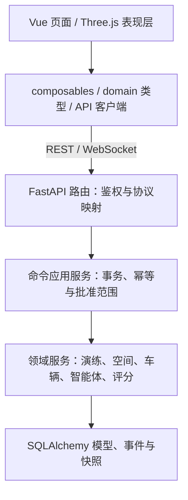

# 贡献指南

本仓库采用“模块化单体 + 领域服务”的交付方式：保持一个可独立部署的演练系统，同时用明确边界避免三维、实时、评分和智能体逻辑相互缠绕。

## 开始前

1. 从 `main` 新建 `codex/<短描述>` 分支；一个分支只处理一个可验证的目标。
2. 不提交 `.env`、运行数据库、访问令牌或真实参演码。临时截图和验收输出放在被忽略的 `output/`；经过内容检查、被文档引用的展示截图可放在 `docs/images/`。
3. 修改状态规则前，先阅读 [架构总览](docs/architecture/README.md) 与对应领域测试。

## 依赖方向



- 路由层不实现仿真规则；新增规则应进入 `backend/app/services/`。
- Three.js 只消费服务端确认的状态，不预测或直接修改演练结果。
- 写操作必须保留命令、事件或评分证据；不要只修改浏览器状态。
- 任务动作在前端统一引用`domain/task.ts`的`TaskActionKind`，不在各页面复制类型；后端输入仍由`schemas/operations.py`校验。
- 新增服务不得反向依赖 Vue 或 HTTP 细节。现有少数历史适配点列在 ADR 中，应逐步迁移而不是复制。

## 提交前检查

```powershell
# 根目录：链接、运行文件及常见凭据特征检查
python scripts/check_repository.py

# 后端
Set-Location backend
.\.venv\Scripts\python.exe -m pytest tests -q -p no:cacheprovider

# 前端
Set-Location ../frontend
npm run test
npm run build
```

若变更导演台、手机参演端或 Three.js 表现，还应检查 1440px、1024px、390px 宽度下的主操作路径；浮层应有独立滚动容器，不能遮挡当前必须操作的控件。

真实浏览器脚本在`frontend/tests/*.e2e.mjs`，按注释区分真实隔离服务与协议/布局替身。执行`npm run test:e2e:map`、`test:e2e:realtime`或`test:e2e:account`前，显式设置`QA_BASE_URL`、`QA_API_URL`、`QA_PASSWORD`，并指向可丢弃数据库；`test:e2e:models`检查本地模型、包围盒、资源失败回退和人物/车辆操作，不要求正式业务账号。浏览器模块路径可用`PLAYWRIGHT_MODULE`，本机浏览器路径可用`QA_BROWSER_PATH`。不要把协议替身的通过记录写成外部服务接入成功。

任务报告与双端场次回归使用`npm run test:e2e:tasks`，必须先配置指向可丢弃服务的`QA_BASE_URL`、`QA_API_URL`和`QA_PASSWORD`。该入口实际创建场景、场次和参演身份，验证刷新、返回、动作报告、岗位释放、核验与回放；不能对生产环境运行。

## Pull Request 要求

文档按职责存放：`docs/architecture/` 保存当前架构与 ADR，`docs/guides/` 保存功能说明，`docs/operations/` 保存部署维护，`docs/reports/` 只保留当前交付证据。被替代的阶段日志从工作树移除，历史通过 Git 查询，不持续增加同主题日期副本。

- 描述用户可观察到的行为改变，而不是只列出文件名。
- 说明状态如何写入、实时如何同步、失败如何反馈或回滚。
- 写明已运行的命令；未运行的检查要说明原因。
- 改动数据结构或接口时，同时更新 `docs/architecture/` 中相应说明。
