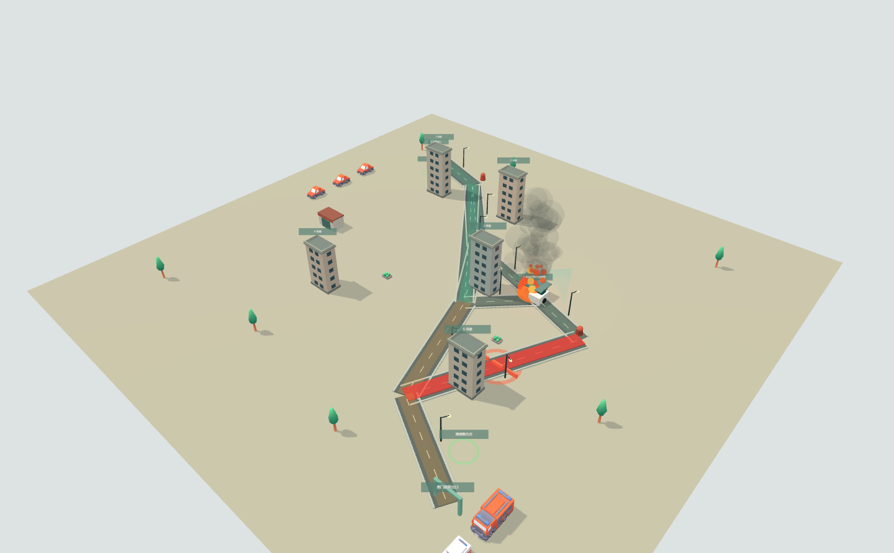

# 智演安巷——面向老旧小区消防治理的数字孪生与智能决策平台

面向社区组织者与参演人员的消防训练平台，连接场景准备、三维推演、疏散协同、责任任务、集合清点与评分复盘。



[操作指南](使用指南.md) · [系统架构](docs/architecture/README.md) · [文档导航](docs/README.md) · [贡献指南](CONTRIBUTING.md) · [界面规范](DESIGN.md)

## 可以完成什么

| 环节 | 当前能力 |
| --- | --- |
| 社区准备 | 编辑建筑、道路、消防设施；拖拽放置、吸附、道路连线；检查数据和通行条件 |
| 自主选择火点 | 充电棚对象选点；厨房按建筑、楼层、房间选点；保存、预览、发布并冻结至新场次 |
| 三维演练 | 鸟瞰、跟随、居民视角、楼内剖面、楼层选择、画质设置、道路风险与队列显示 |
| 人员疏散 | 房间—走廊—楼梯—楼门—室外—集合点连续移动；容量、排队、暴露、差异速度与真实会合护送 |
| 智能体协同 | 目标解析、仿真候选、人工批准、任务依赖、资源占用、工具执行、异常复核、预测与实际核对 |
| 机器人与车辆 | 机器人逐段移动、到位广播与任务队列；消防车、救护车路网调度及已支持的规则化处置 |
| 责任任务 | 分配执行人、接收、到位回执、前置条件检查、文字证据核验与倒计时 |
| 两端协作 | 管理端与独立手机参演端，通过限时加入码登记、接收任务、上报及清点 |
| 实时与复盘 | 版本化增量同步、断线追赶、命令回执、实时评分、历史回放、可操作分支与结果比较 |

系统提供两个可运行案例：

| 案例 | 训练重点 | 主要处置 |
| --- | --- | --- |
| 夜间充电棚火灾 | 室外风险、道路通行、资源接近与多楼栋疏散 | 断电、分流、广播、重点护送、集合清点 |
| 住宅厨房火灾 | 房间选点、分区烟气、门洞与楼梯通行 | 燃气切断、撤空后门控、楼门广播、护送和核验 |

## 智能体的实际定位

采用**一个协调器、四类能力**：现场感知、方案规划、资源协同、执行监督。它围绕居民疏散目标读取服务端现场，比较动作，等待人工批准，通过统一命令服务执行，并持续检查真实回执。

- 默认可使用本地目标解析与确定性规划；配置并授权模型后，可用于目标理解和场景解释。
- 申请方案审阅时暂停现场，确认后恢复；等价分流结果合并，厨房可比较“撤空后关门控烟”动作。
- 已批准步骤持久化依赖和命令编号，登记居民、值守员、机器人及房门资源归属；重启接续原命令，人工接管后让出控制。
- 案例责任任务与集合清点纳入监督范围；燃气、电源操作及核验证据由责任人完成。

四类能力是同一协调器中的模块，不是四个独立大模型。评分、移动、碰撞净距、到位和任务合法性由服务端规则确定。实现及验证见[智能体能力核对](docs/2026-10-23-演练操作修复与智能体能力核对.md)。

## 本次更新

2026-10-24：

- 统一厨房火点、房间门控、燃气阀门、烟气分区与责任任务的数据契约；厨房模型加载失败时仍保留可操作的轻量几何。
- 智能体方案审阅与演练时钟解耦：生成方案时自动暂停，人工批准后恢复；候选方案最多展示两个真正不同且可执行的决策，并保留“撤空后房门控烟”选项。
- 将案例任务、核验条件、倒计时、证据提交和集合清点纳入同一任务监督链，区分“待处置任务”和“运行中指令”。
- 态势区可直接进入逐人集合清点；结束场次保留最终智能体状态和评分证据。
- 完善室内门洞、楼梯容量、队列、烟气暴露、护送会合、机器人逐段移动和消防车辆通行表现，避免人物和设备穿过不可通行几何。
- 清理过时的逐轮设计记录、重复验收文档和未引用的旧素材，仅保留当前架构、P0–P5 交付、双案例实跑和最新修复记录。
- 本次仓库收束删除了被最新交付验收覆盖的旧实跑、旧双案例验收和旧 UI 复刻记录；测试夹具、模型源文件、许可证与当前验收脚本继续保留。

本轮交付审查已修复非过期数据库会话下的场景版本缓存、示例入口覆盖配置与复用旧场次、任务抽屉隐藏画质、手机首页溢出及厨房资源请求生命周期问题；补强认证来源校验、JWT必需声明和日志凭证脱敏，更新命中漏洞公告的依赖。

验证证据：修补依赖后后端全量182项通过，后续日志和示例冻结修复有专项回归；前端单元及厨房资产检查、生产类型构建、真实浏览器的个人中心/双端实时/厨房/车辆/火点/智能体与完整页面流程均取得通过结果。360、390、768、1024、1440像素登录首页检查通过。双端真实验收接收导演台31条、手机10条增量消息，断网后恢复身份和快照。教学模式完整决策本轮再次得到充电棚100分（18/18清点）、厨房100分（8/8清点）。成绩用于验证闭环，不代表考核模式、真实设备或大规模部署结果。

功能—页面—接口—数据—权限清单、安全修复位置、实际命令、截图及部署缺口见[交付审查与修复验收](docs/2026-10-24-交付审查与修复验收.md)。本机没有Docker，容器部署未执行；付费模型和实体设备未执行真实接入验收。

## 快速启动

### Docker Compose

准备 Docker Compose，在仓库根目录运行：

```powershell
Copy-Item .env.example .env
docker compose up --build
```

访问：

- 页面：[http://127.0.0.1:5173](http://127.0.0.1:5173)
- 健康检查：[http://127.0.0.1:8000/api/v1/health](http://127.0.0.1:8000/api/v1/health)
- 接口文档：[http://127.0.0.1:8000/docs](http://127.0.0.1:8000/docs)

开发引导账号在本地 `.env` 的 `BOOTSTRAP_ADMIN_USERNAME`、`BOOTSTRAP_ADMIN_PASSWORD` 中设置。共享部署应配置独立密码、JWT密钥和明确的前端域名。

### 本地开发

环境：Python 3.11+、Node.js 22、npm。以下为 Windows PowerShell 示例，均从仓库根目录开始。

后端：

```powershell
Copy-Item .env.example .env
Set-Location backend
python -m venv .venv
.\.venv\Scripts\python.exe -m pip install -r requirements.txt
$env:DATABASE_URL='sqlite+pysqlite:///./zhiyan-local.db'
.\.venv\Scripts\python.exe -m uvicorn app.main:app --host 127.0.0.1 --port 8000 --reload
```

另一终端启动前端：

```powershell
Set-Location frontend
npm ci
npm run dev -- --host 127.0.0.1 --port 5173
```

SQLite 用于单机开发；Docker Compose 使用 PostgreSQL。需要手机参演时，前后端监听地址、CORS 和分享链接应配置为手机可访问的局域网地址。

## 一次完整训练怎么操作

1. 登录管理端，创建示例社区或选择现有社区。
2. 进入场景准备，选择充电棚/厨房，核对火点、人口、通道、任务与资源，校验并发布。
3. 新建场次。默认教学训练；需要考核时，在“更多工具 → 场次与显示”选择下一轮模式后新开一轮。
4. 开始推演，查看巡检或室内烟感确认。打开指挥助手的“目标计划”，设置人员范围、护送与机器人广播。
5. 生成并阅读方案。现场自动暂停；核对预测和前置条件后批准，现场继续。
6. 按任务提示完成断电或燃气、门控、广播及护送核验。无在线处置人员时可使用总控代办，仍需到位回执与证据。
7. 从态势区“待清点”进入名单，逐人核对已到场居民；未到场者定位寻找。
8. 核对任务、清点和指令状态后结束评分。在复盘中查看证据，或从同一历史时刻建立另一决策分支。

教学模式最低任务预算：电源240秒、燃气300秒、房门420秒、广播360秒、护送600秒；原定时限更长时保留原值。这些是软件训练参数。

## AI 助手配置

离线训练不需要模型密钥。使用兼容服务时，在本地 `.env` 设置：

```dotenv
ASSISTANT_PROVIDER=compatible
ASSISTANT_BASE_URL=https://api.deepseek.com
ASSISTANT_MODEL=<你已开通的模型名称>
ASSISTANT_API_KEY=<本地密钥>
ASSISTANT_TIMEOUT_SECONDS=60
```

也支持 Ollama：`ASSISTANT_PROVIDER=ollama`。重启后端，在助手中授权调用。模型名称以实际服务账号可用项为准，密钥不写入前端或提交记录。详细操作见[助手配置说明](docs/场景AI助手_使用与配置.md)。

## 代码结构

```text
backend/
  app/api/            REST、WebSocket、身份与请求映射
  app/application/    统一命令事务、批准范围、幂等与回执
  app/bootstrap/      共享服务及历史适配器装配
  app/domain/         领域契约与错误
  app/services/       场景、空间、环境、车辆、智能体、评分与回放
  app/models/         SQLAlchemy 持久化实体
  app/schemas/        API 与命令输入契约
  tests/              规则与工作流检查
frontend/
  src/components/     页面、工作区与基础控件
  src/domain/         领域类型
  src/api/            请求、命令、增量同步与恢复
  src/three/          场景、人物、机器人、材质与动画
  public/assets/      运行资产及第三方许可
  tests/              领域检查与隔离浏览器验收页
  tools/              模型整理与开发预览
docs/
  architecture/       当前架构与ADR
  history/            合并后的历史说明
  ui-design/          页面设计参考图
```

技术栈：Vue 3、TypeScript、Vite、Three.js、FastAPI、SQLAlchemy、PostgreSQL/SQLite、WebSocket。当前以模块化单体交付，具体事务和实时链路见[架构文档](docs/architecture/README.md)。

## 验证与持续集成

```powershell
# 后端：在 backend 目录执行
$env:DATABASE_URL='sqlite+pysqlite:///./zhiyan-test.db'
.\.venv\Scripts\python.exe -m pytest tests -q -p no:cacheprovider

# 前端：在 frontend 目录执行
npm test
npm run build
```

GitHub Actions 对 `main` 的推送与拉取请求运行后端测试、前端检查和构建。浏览器验收页及脚本在 `frontend/tests/`；隔离布局数据只验证界面，不作为仿真实跑成绩。

## 模型、数据与交付范围

- 三维资产随部署本地提供，来源和许可在资产目录的 `SOURCES.md`、`LICENSE` 中保留；人物为带动作的低多边形资产，机器人为开源网格与项目补充组件。
- 火势、烟气、人员与车辆是规则化训练仿真；尚未接入真实机器人、车辆或现场传感器。
- 室内外移动使用连续图、容量、间距与队列约束，不代表全局刚体碰撞或照片级重建。
- 房门状态、楼梯通道、路径和渲染读取冻结空间数据；模型加载失败时保留轻量替代。
- 长场次和大人口仍需按部署规模做容量验证。传输恢复改进不等于后台负载问题已经全部消除。
- PDF业务报告、BIM/GIS导入、IoT/MQTT和实体设备接入尚未交付；当前复盘可导出结构化JSON。
- 本地配置、数据库、缓存、日志和临时截图不入库。第三方许可文件与可复现的模型制作工具保留。

第三方资源各自遵循随附许可；项目源代码的授权范围以根许可证为准，仓库未提供根许可证时不推断商用授权。
