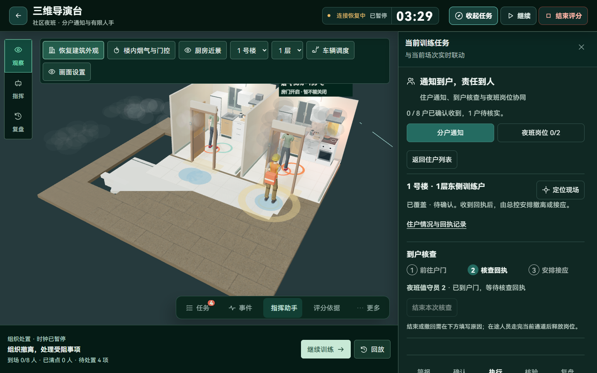
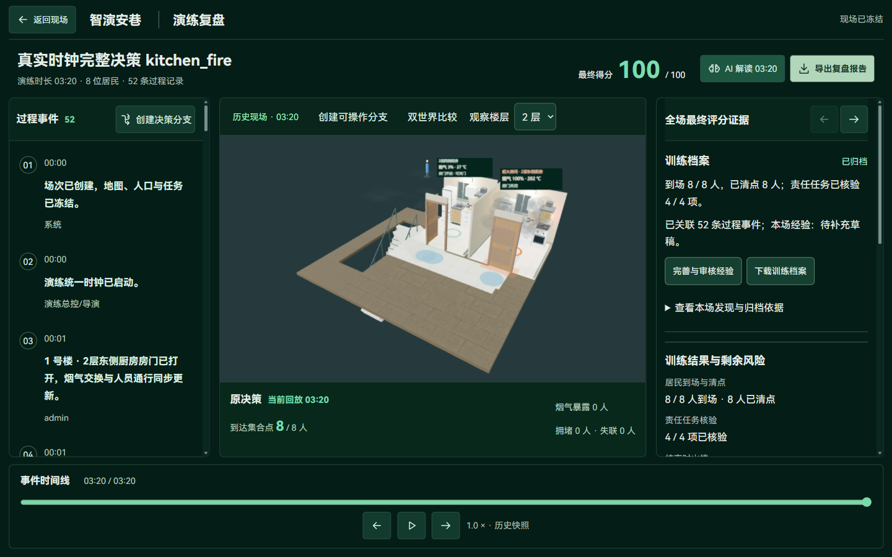

# 智演安巷——面向老旧小区消防治理的数字孪生与智能决策平台

面向社区组织者与参演人员，把场景准备、三维仿真、决策批准、协同执行、责任任务、集合清点和复盘改进连接起来。



[操作指南](使用指南.md) · [系统架构](docs/architecture/README.md) · [部署升级](docs/operations/deployment.md) · [文档导航](docs/README.md) · [贡献指南](CONTRIBUTING.md) · [界面规范](DESIGN.md)

## 核心功能

| 环节 | 已实现能力 |
| --- | --- |
| 社区与场景 | 建筑、道路、设施编辑；充电棚对象选点；厨房建筑—楼层—房间选点；校验、发布并冻结新场次 |
| 连续仿真 | 室内外路径、楼梯容量、排队、差异速度、暴露、护送会合；房门与燃气状态联动环境和通行 |
| 智能体协同 | 目标约束、知识检索、工具校验、候选比较、人工批准、任务依赖、资源归属、异常复核与接续 |
| 机器人与车辆 | 逐段移动、到位广播；道路约束下调度、有效供水与喷水、逐栋放行及执行回执 |
| 两端协作 | 组织者准备与指挥；参演人员限时邀请码登记、责任任务、到位、证据、异常和集合清点 |
| 社区责任协同 | 分户通知与确认、差异画像、有限夜班岗位、到户核查、受阻反馈和撤回；核查与护送、物业任务共用人员 |
| 知识与交互 | 文档提取、审核发布、权限与有效期检索、原文引用；可选模型、Embedding 与讯飞语音 |
| 评分与复盘 | 服务端事件评分、增量同步、历史回放、可操作分支、结果比较、训练档案及待审核经验 |

两个案例：**夜间充电棚火灾**侧重室外通道、资源接近和多楼栋撤离；**住宅厨房火灾**侧重分区烟气、房门控制、分层护送与责任核验。

## 一次完整训练

可选的 **社区夜班训练** 已接入场景准备：匿名分户画像、固定种子、有限岗位、通知覆盖与收到回执、任务占用及撤回。值守员可沿真实通行图执行到户核查，到门后提交敲门回执；与断气、护送共用岗位，途中撤回保持位置。收到通知后仍由总控安排撤离或接应；手机回执、三维人物与训练档案读取同一服务端状态。[开启与操作](docs/guides/community-training.md) · [最新验证](docs/reports/2026-11-13-community-upgrade.md)。

1. 选择案例与目标，配置火点、人口、通道、资源及教学/考核模式。
2. 完成准备检查、发布配置、创建冻结场次，阅读训练简报。
3. 开始训练，确认报警，查看受影响人员和可用资源。
4. 比较不同方案，核对依据、预演覆盖范围和代价，再人工批准。
5. 观察人员、机器人与车辆的真实执行，处理受阻、等待和异常。
6. 责任人完成到位及证据核验，对实际到场人员逐人清点。
7. 结束后查看扣分证据、档案及关键决策，创建另一选择进行比较。
8. 将有依据的经验修订、审核发布，为后续训练提供资料。

任务、助手、车辆与对象详情沿用单工作区。正文 16px、辅助信息 14px；短屏和手机通过内部滚动与视图切换适配。

## 智能体的实际构成

采用**一个协调器、四类能力**：现场感知、方案规划、资源协同、执行监督。默认本地解析与确定性规划可独立运行；授权模型后可辅助目标理解、受约束只读工具推荐和解释。四类能力不是四个独立语言模型。

计划保存批准版本、稳定命令编号和资源归属。机器人必须到位才能广播，护送须先会合；人工改派使原计划交还后续控制。评分、移动、净距、合法性与完成条件由服务端规则确定。

预演只描述注明时域内的模型结果，逐栋时序估算另行显示，不作为全程到场保证。资料出处、现场事实、工具结果和最终证据分别可查。[知识与智能体](docs/guides/knowledge-and-agent.md)。

## 当前版本与验证

2026-11-13 已接入社区夜班契约 v2：值守员先沿冻结通行图到达户门，再提交敲门回执；电话核实与广播覆盖分开，通知确认不自动放行。居民、值守员、任务、智能体、手机回执和档案使用同一服务端状态。

社区专项 **9 项**，最终社区、室内门控、智能体协调与问答组 **35 项通过**；前端 **69 项通过**，类型检查与生产构建通过。已实查 1440px 桌面和 390px 窄屏的到户工作区。[当前交付与截图](docs/reports/2026-11-13-community-upgrade.md) · [本次整库发布检查](docs/reports/2026-11-14-repository-release.md)。

2026-11-14 发布前另修复值守员复用旧节点及参演角色计数回归，原增量世界、历史演练及社区用例 **20 项通过**。完整检查的首次失败、修复和 GitHub CI 核对方式在发布记录中分别保留。

### 最近完整演练记录

2026-11-10，独立数据库、真实后台时钟、教学模式、4 倍速，最后一轮结果如下。这批旧冻结场次未启用新的社区夜班契约，不作为新模式的评分验收。

| 场景与策略 | 最终得分 | 到场 / 清点 | 暴露超阈值 |
| --- | ---: | --- | ---: |
| 厨房：撤空后门控、分流护送 | 98 | 8/8，8/8 | 1 |
| 充电棚：立即撤离 | 92 | 18/18，18/18 | 7 |
| 充电棚：消防车压制后逐栋放行 | 81 | 18/18，18/18 | 0 |

三场均完成责任任务；分批策略有两项超时核验，零暴露存在明显时间代价。未提高暴露阈值或改写历史成绩。不同真实时序与负载会影响结果，以上不是最优策略或稳定满分承诺。[完整验收与未覆盖项](docs/reports/2026-11-10-acceptance.md)。

近期修复包括规划与后台推进锁顺序、刷新响应丢失恢复、部分疏散效率分、超时核验标记、终态只读展示及地图字号。楼栋状态牌读取匹配版本的已批准计划；本地 PBR、厨房设备和消防车接口与权威状态联动。



[手机任务与超时核验](docs/images/participant-task-390.png) · [楼栋空间呈现](docs/reports/2026-11-10-building-release.md) · [三维资源与许可](docs/reports/2026-11-09-model-assets.md)

## 快速启动

依赖 Python 3.11+、Node.js 22 和 npm。从仓库根目录开始：

```powershell
if (-not (Test-Path -LiteralPath .env)) { Copy-Item .env.example .env }
Set-Location backend
python -m venv .venv
.venv/Scripts/python.exe -m pip install -r requirements.txt
$env:DATABASE_URL='sqlite+pysqlite:///./zhiyan-local.db'
.venv/Scripts/python.exe -m uvicorn app.main:app --host 127.0.0.1 --port 8000 --reload
```

另开终端：

```powershell
Set-Location frontend
npm ci
npm run dev -- --host 127.0.0.1 --port 5173
```

访问 [平台](http://127.0.0.1:5173)、[健康检查](http://127.0.0.1:8000/api/v1/health)、[接口文档](http://127.0.0.1:8000/docs)。开发账号取本地 `.env` 的 `BOOTSTRAP_ADMIN_USERNAME`、`BOOTSTRAP_ADMIN_PASSWORD`。

安装 Docker Compose 后，也可在根目录执行 `docker compose up --build`，使用 PostgreSQL 和容器前端代理。共享部署须配置独立 JWT 密钥、初始密码及明确的 HTTPS 前端域名；不要用示例配置覆盖已有凭据。[部署、迁移与回滚](docs/operations/deployment.md)。

## 可选 AI 服务

离线训练不需要模型密钥。聊天模型、语音和语义检索分别配置，重启后端后在页面明确授权。

| 能力 | 默认行为 | 配置说明 |
| --- | --- | --- |
| 问答与目标理解 | 本地解读、确定性规划 | [兼容服务 / 本地 Ollama](docs/guides/assistant.md) |
| RAG | 发布资料的关键词检索 | [Embedding 与回退](docs/guides/knowledge-and-agent.md) |
| 语音输入 | 文字输入可用，听写可关闭 | [讯飞、麦克风及授权](docs/guides/speech.md) |

转写只填写草稿，不自动发送或批准命令。“已配置”不等于真实服务效果已经验收。密钥只供后端读取，不提交到 Git。

## 工程结构

| 路径 | 职责 |
| --- | --- |
| `backend/app/api/` | REST / WebSocket、鉴权、输入与响应映射 |
| `backend/app/application/`、`bootstrap/`、`domain/` | 命令事务、批准范围、幂等、领域端口与适配 |
| `backend/app/services/` | 场景、社区冻结与通知、到户核查、岗位共享、空间、环境、车辆、智能体、知识、评分及回放 |
| `backend/app/models/`、`schemas/` | 持久化约束与输入输出契约 |
| `backend/app/data/`、`evaluation/`、`maintenance/` | 来源资料、检索评估及显式维护 |
| `frontend/src/api/`、`domain/` | 传输、增量恢复与共享类型 |
| `frontend/src/components/`、`three/`、`audio/` | 工作区交互、三维表现及采集 |
| `frontend/public/assets/`、`frontend/tools/` | 本地资产、许可证及模型工具 |
| `docs/architecture/`、`guides/`、`operations/`、`reports/` | 当前架构、功能、运维和最新证据 |
| `scripts/` | 仓库检查与选定资源获取 |

采用模块化单体，权威状态、命令、事件及证据具有明确事务边界。Three.js 消费服务端状态，不自行改写任务或得分。具体依赖方向与剩余适配边界见 [系统架构](docs/architecture/README.md)。

## 检查与持续集成

```powershell
# 仓库根目录
python scripts/check_repository.py
# backend 目录
.venv/Scripts/python.exe -m pytest tests -q -p no:cacheprovider
# frontend 目录
npm test
npm run build
```

GitHub Actions 对 main 推送与 PR 运行仓库检查、后端测试及前端构建。验证结果和清理清单见 [发布记录](docs/reports/2026-11-14-repository-release.md)。隔离样例只验证布局，不作为演练成绩；本地结果与远端 CI 分别记录。

## 数据、模型与当前范围

结束时自动保存成绩与原始档案，经验先进入草稿、审核发布后才参与检索。对话按场次与账号保存，支持分页及清空竞态保护。[训练记录](docs/guides/training-records.md)。

仍需深化完整住宅户型、几何净距与全局碰撞校准、全批次动态预测、条件放行及结构化整改复验。真实外部模型、语音、实体设备、低配设备和生产多进程容量需单独验证。当前为规则化训练仿真，不是 CFD 或实测火场重建；可导出结构化 JSON，PDF 业务报告、BIM/GIS 与 IoT/MQTT 尚未交付。

本地配置、数据库、日志、缓存、临时截图和构建产物不入库。资产来源和第三方许可随文件保留；项目未提供根许可证时，不推断商用授权。已被替代的阶段文件移出当前工作树，原始记录可通过 Git 历史查询。
