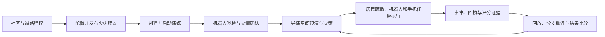
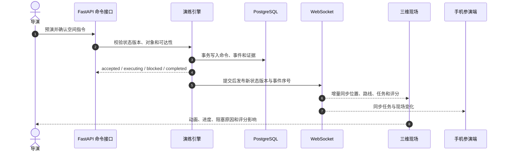
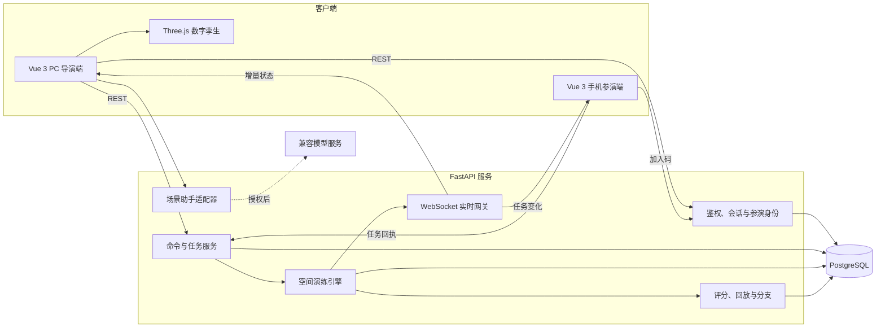

# 智演安巷——面向老旧小区消防治理的数字孪生与智能决策平台

面向老旧小区消防治理的数字孪生、多智能体协同与智能决策平台。

系统围绕“夜间电动自行车充电棚火灾”主案例，把社区建模、火情推演、人员疏散、机器人任务、手机协同、过程评分和复盘重做连接为一条可操作的训练闭环。它不是消防知识答题页，也不是只展示指标的仪表盘：导演可以直接在三维社区中选择居民、封锁道路、预演路线、派遣机器人，并观察人员排队、烟气暴露、任务进度与评分证据如何变化。

> 当前定位：竞赛与教学演示 Beta。用于应急训练和方案验证，不替代消防专业判断、真实指挥系统或安全认证。


## 仓库导航

| 入口 | 说明 |
| --- | --- |
| [系统架构](docs/architecture/README.md) | 模块边界、实时命令链路与渐进重构计划 |
| [文档导航](docs/README.md) | 当前架构、历史实现记录和竞赛资料索引 |
| [贡献指南](CONTRIBUTING.md) | 分支、依赖方向、提交检查与 PR 约定 |
| [使用指南](使用指南.md) | 演练演示与基本操作 |

仓库通过 GitHub Actions 自动执行后端测试、前端基础检查与生产构建；本地和 CI 使用同一组命令。

## 当前版本进展

2026-10-20 补齐智能体预测与实际结果核对：

- 每次批准冻结目标居民、预测指标、事件起点与观察时刻，服务端到时核对到场、烟气暴露和累计排队；计划结束、停止或让权后仍保留观察任务。
- 助手“执行”页提供核对入口，“依据”页展示预测、实际、差值、确认延迟及期间现场变化，并可直接回看对应三维历史现场。
- 提前结束、目标数据不完整或批准时预测窗口已过时不计算完整窗口差值；调度延迟时仍使用原定观察时刻。
- 结果存入独立表，与批准版本唯一绑定；查看页面不触发计算或写入，重复调度不重复生成核对记录。

实现与自我审查见[智能体执行效果核对](docs/2026-10-20-智能体执行效果核对.md)。

2026-10-20 升级可解释分流与三维路线引导：

- 目标计划比较“路径/指定出口优先”与“风险与容量分流”，结合真实楼梯速度、烟气风险、通道流量和共享需求分配出口，不再用全部居民交换出口代替智能比较。
- 方案展示分流依据、共享通道压力及相对原安排的30秒预测差异；两套规则分配相同时如实提示，不人为制造差异。
- 确认执行时持久保存所选方案、规则、预测及批准版本，执行与依据视图可追溯；预测与真实命令回执分开展示。
- 三维居民与机器人路线增加有界方向标记，保留走廊转角和楼梯高度，不改变服务端运动规则。分流依据和通道详情沿用助手内部滚动，不新增遮挡浮层。

实现、分流规则和自我拷问见[可解释分流与三维路线引导](docs/2026-10-20-可解释分流与三维路线引导.md)。

2026-10-20 完善智能体异常恢复与接续执行：

- “指挥助手 → 目标计划 → 调整剩余行动”暂停后续自动下令，已受理的人员与机器人行动继续；重新比较只处理未到场人员，再次确认后接续。
- 机器人按本计划原始指令回执认领在途或已到位任务，沿用任务编号，不重复排队或扣减移动电量；紫色预演路线从当前位置开始，保留剩余道路拐点。
- 护送预演只为尚无护送员的人员分配空闲岗位，接续时不重建正在会合的值守员；到场、排队、暴露与原始证据继续保留。
- 人工改派后智能体保持让权；重点人员缺少护送依据时，不允许通过重新分组变成目标完成。恢复范围、资源条件和操作按钮在原助手内展示，适配桌面、短屏与手机。

实现与操作说明见[智能体异常恢复与接续执行](docs/2026-10-20-智能体异常恢复与接续执行.md)。

2026-10-20 接通智能体计划与三维演练的实时联动：

- 计划、协同状态和执行回执通过导演现有连接增量更新；暂停时仍能同步计划修订，断线后自动读取恢复，重连使用完整快照校准。
- 旧回执无法覆盖刚确认的方案；过期预演和相关现场变化在确认前给出提示，并引导重新比较。
- 管理计划按账号隔离，手机参演连接不订阅；第一视角镜头按人物实际沿路线运动的方向跟随转角。

协议与实现说明见[智能体实时联动升级](docs/2026-10-20-智能体实时联动升级.md)。

2026-10-20 增加智能体协同监护与现场展示：

- 目标计划展示现场感知、疏散规划、资源协同和执行监督的真实状态，按计划阶段提供复核、人员定位和集合清点入口。
- 执行视图优先呈现风险人员与拥堵通道，机器人到位、广播、电量及等待原因与本场回执一致；风险统计覆盖全部目标人员。
- 值守员状态标识、三维选中详情与护送进度同步；轻量人物补充反光肩带、救援背包和电台，位置仍沿服务端确认通道推进。
- 协同信息沿用助手单栏内滚动，桌面双列、手机单列；执行监护修复机器人持续移动时的停滞误判。

入口与实现说明见[智能体协同监护与现场展示](docs/2026-10-20-智能体协同监护与现场展示.md)。

2026-10-18 完成智能体执行监护与护送模型联动：

- “指挥助手 → 目标计划 → 执行”可展开具体居民、等待通道、护送责任人和关联事件，并定位三维现场。停止自动下令后仍显示已受理动作的真实进度。
- 护送方案检查有限值守资源，零资源禁止批准；运行中持续无位置或进度变化时提示检查，未清点即结束的目标标为未完成。
- 固定值守身份复用人物模型，会合线沿实际通道折线绘制，完成护送后留在集合区域；骨骼与轻量模型均支持同行手势。
- 候选方案和执行明细按需展开，修复重复轮询与切换场次残留状态，保持桌面、短屏和手机内滚动布局。

说明和针对性核查见[智能体执行监护与护送模型](docs/2026-10-18-智能体执行监护与护送模型.md)。

2026-10-18 完成凭证、值守资源与短屏布局加固：

- 非开发环境启动时拒绝默认 JWT 密钥、默认管理员密码及非 HTTPS 的 CORS 来源。管理端访问令牌仅驻留内存，刷新页面通过 HttpOnly 会话恢复。
- 手机邀请使用独立随机的 128 位加入码，仅保存 SHA-256 哈希；默认 8 小时到期，导演可在“手机参演”更换或停止邀请。原六位加入码不再有效。
- WebSocket 在每次连接和重连时领取 30 秒、单次使用的票据，不再通过 URL 传输管理令牌或参演码。退出登录、撤销邀请后，已有连接也会停止。
- 新旧参演反馈都要求有效的个人参演会话；历史任务提交同时核对责任角色及文字证据，退出的身份不会从历史事件自动恢复。
- “处置任务 → 搜索与护送值守”展示固定岗位、可用状态和责任绑定；搜索、护送与目标计划共用有限人员。完成任务的值守员从上次实际位置出发接下一项任务。
- 预演与当前现场保留独立时间检查点；寻路按半秒批次更新拥堵压力，避免每名人员经过节点时清空全局缓存。保持半秒容量和间距规则，并对稳定等待或不可达状态直接积分。
- 低高度桌面窗口收起工具文字、压缩时间线，将操作预演放入可滚动底部区域；继续保留画质、楼内透视和任务入口。Docker 前端通过同源 API 代理与 CSP 提供服务。

升级后重新启动后端以创建新增安全表，并刷新浏览器。需要给参演人员重新分享邀请链接。部署配置和接口变更见[安全与演练可靠性修复](docs/2026-10-18-安全与演练可靠性修复.md)。

2026-10-18 完成智能体通行校验与移动模型升级：

- 居民室外连接、机器人路线和车辆调度共用楼体几何检查。机器人考虑转向占地，车辆考虑车身净距、前后悬伸及转角空间；不可通行时保留受阻原因，不生成穿楼路线。
- 新场次通过门厅、真实楼门和绕楼拐点连接路网；住宅精细与远景模型均使用开放门洞。三维移动沿确认路径的拐点前进，缺少连续路径时不补画穿墙直线。
- 指挥助手的目标方案显示地图通行缺项，原面板内展开；点击道路可查看几何阻挡原因。旧方案需重新比较，旧场次不改写冻结地图。
- 场景配置预览与正式演练共用车辆救援状态生成逻辑；新建示例底图修正 3 号楼消防接近道路，已有社区不会被自动覆盖。

实现、验收与使用说明见[通行几何与智能体执行升级](docs/2026-10-18-通行几何与智能体执行升级.md)。

2026-10-18 增加机器人与疏散协同执行：

- 在“指挥助手 → 目标计划”选择单栋建筑并勾选机器人楼门广播。居民分流、护送与机器人移动并行；机器人必须真实到位后才能广播。
- 方案展示机器人路线、到位时间、电量与任务占用；确认与下令前重复核验，不覆盖已有调度。三维预览以紫色长划线区分机器人，蓝色、金色区分居民两个出口。
- 执行视图展示前置步骤、真实回执和等待原因；人工取消或改派让出控制。重新比较复用已完成广播证据，不重复派遣或扣电，到场清点仍由参演人员核验。

实现范围与自查见[机器人与疏散协同升级](docs/2026-10-18-机器人与疏散协同升级.md)。

2026-10-18 增加可执行的疏散目标计划：

- 导演台“指挥助手 → 目标计划”支持提出疏散目标、选择楼栋或当前居民、比较两个出口方案、在三维现场预览并确认执行。
- 计划与步骤持久化，复用现有命令幂等、四名护送员在途限制和连续疏散；后台监督不依赖页面保持打开。到集合点后仍需参演者清点。
- 支持过期方案校验、相关路况变化后的重新比较、人工改派让出控制和停止后续下令。手机路线预览自动返回现场，两个出口以蓝色和金色区分。
- 已配置模型并单独授权时，使用结构化工具调用解析目标；未配置时明确使用本地解析与仿真规划。30 秒预测使用正式过程评分函数，并说明护送覆盖范围。

实现范围、使用步骤、验证和后续边界见[目标计划智能体首轮实现](docs/2026-10-18-目标计划智能体首轮实现.md)。

2026-10-17 完成导演台可用性与车辆联动收口：

- 三维现场新增常驻“画面品质、楼内透视、车辆调度”工具栏；任务抽屉、路线预演、引导面板和 AI 助手不会再把这些入口隐藏或堆叠在同一区域。
- 引导演练采用固定标题/收起操作与内部滚动正文，避让左侧观察、指挥、复盘模式栏；桌面、平板、手机按实际工具栏高度重排。结束与历史状态明确显示为冻结，不再误导为“现场持续推演中”。
- 消防车、救护车可从常驻入口进入调度流程。目标节点拒绝当前位置；道路内仍有居民时显示具体等待人数与原因，人员清空后车辆按服务端时钟继续行驶。
- 消防车到场后可执行受水源、射程、楼体遮挡约束的定时喷水；救护车可完成集合点核验人员的担架接运、装载、异出口行驶和医疗移交。车辆位置、环境变化、评分证据、历史回放和可操作分支共享同一事件链。
- AI 助手与引导、任务、预演互斥展开：桌面使用独立阅读栏，平板会让出时间线空间，手机使用焦点隔离的全屏面板，避免遮挡现场操作。

本轮已通过前端生产构建、车辆调度与到场处置 8 项后端验证，以及 1440/1024/768/390 四种宽度的隔离浏览器布局检查。具体范围与自我审查见[车辆处置与导演台常驻工具修复](docs/2026-10-17-导演台常驻工具与车辆调度修复.md)和[引导演练面板布局修复](docs/2026-10-17-引导演练面板布局修复.md)。

2026-10-16 补齐实时调度与车辆到场处置：

- 大人口现场采用按实体 ID、按字段的 WebSocket 增量同步，保持未变化的居民和路线引用；断线或版本不连续仍回退完整快照，兼容旧协议客户端。
- 导演台「处置任务 → 应急车辆」支持消防车、救护车选择道路节点、预览路线、确认出发、定位、取消和重新规划。车辆跟随服务端时钟逐段移动，道路封锁后原地受阻或改道，恢复后重新规划，到场生成事件证据。
- 三维车辆使用本地 Kenney 资源渐进加载，加载失败保留可选择的基础模型；刷新、历史回放与可操作分支保留车辆行程。
- 消防车到场后校验水源、射程与楼体遮挡；确认喷水后，火势、烟气、道路风险和机器人采样使用同一套环境状态。水带、水流及剩余时间同步显示，水源失效自动中止并记录证据。
- 救护车接运已到集合点并清点的重点或高暴露居民：担架组前往接人、返回装载、车辆驶往另一出口、医疗移交分别按演练时钟推进。人员只在真实上车后进入车辆，移交完成后解除接运责任。
- 车辆通行采用路段互锁：入口暂缓人员进入、已有行人走出后车辆出发、到场恢复通行。蓝色路段、排队原因和车辆回执同时更新；这不是连续碰撞避让求解器。
- 空间操作与训练教练共用可取消预演逻辑，统一超时、场次隔离、运行状态检查和卸载清理；已提交指令不因关闭界面而被误取消。

入口与操作说明见[车辆处置与通行联动](docs/2026-10-16-车辆处置与通行联动.md)，底座说明见[车辆调度与实体增量同步](docs/2026-10-16-车辆调度与实体增量同步.md)。调度本身不额外加分；喷水的有效环境变化参与原有过程评价，接运独立记录交接证据。

本次更新进一步补齐三维导演台的实际执行与恢复能力：

- 机器人目标指派统一进入“路线预演—风险与拥堵影响—确认执行—任务队列—状态回执”链路，不再由任务入口绕过预演。
- 空间预演具有独立超时、主动取消、现场版本校验和场次隔离；切换场次、进入复盘或关闭预演后，旧响应不会覆盖当前现场。
- 已选居民的当前位置、行为、目标出口、累计排队和烟气暴露随服务端状态更新，并同步成为 AI 助手的对象上下文。
- 人物与巡检机器人精细模型下载失败时保留轻量现场，可在当前演练中原地重试，无需刷新页面或重新创建场次。
- 预演面板归入三维视口统一布局，在桌面、平板和手机宽度下避让任务入口与时间线，内容过长时在面板内部滚动。
- 环境模型地址遵循 Vite `BASE_URL`，支持部署在域名子路径；WebGL 上下文恢复后重新同步最新实体位置。

本轮生产构建、指令与三维模型的 13 项针对性回归，以及 1440/1024/390 三种宽度的隔离浏览器检查均已通过。详细范围、证据与仍需完善的部分见[演练联动与模型恢复审查](docs/2026-10-15-演练联动与模型恢复审查.md)。

## 核心体验

### 两个使用端

| 使用端 | 主要用户 | 能完成的任务 |
| --- | --- | --- |
| PC 设计与导演端 | 演练设计员、演练总控 | 建设社区底图、配置并发布场景、开始/暂停演练、空间指挥、事件注入、任务调度、评分与复盘 |
| 手机参演端 | 物业、网格员、居民代表等参演人员 | 使用加入码进入场次、领取任务、回执到位、提交处置证据、报告异常、集合清点 |

角色名称可按演练任务继续细分，但产品入口保持为 PC 导演与手机参演两个端，减少竞赛演示中的认知负担。

### 一次完整演练



## 已实现能力

### 社区与场景设计

- 社区项目、地图对象、道路节点/边、道路状态与可达性检查。
- 地图对象拖拽放置、吸附定位和道路连接，修改结果持久化后可恢复。
- 一键生成示例社区；支持住宅、充电棚、消防水源、微型消防站、出口和集合点等对象。
- 场景参数、火源、水源、通道、人口和楼梯净宽配置；0–10 分钟规则化火势/烟气预览。
- 场景完整性校验、草稿/发布状态和冻结版本；演练运行使用发布时的配置，不受后续编辑影响。

### 三维沉浸式导演台

- Three.js 全屏社区沙盘，支持总控、机器人跟随、居民第一视角和救援视角。
- 点击道路、机器人、居民、建筑和消防设施后显示上下文操作，不依赖外置仪表盘完成主要决策。
- 道路封锁、恢复、居民多选/框选、出口指派、重点护送与机器人目标指派。
- 指令提交前展示路线、预计时间、风险、拥堵、烟气暴露及预计评分变化；确认后才写入演练。
- 房间—走廊—楼梯—楼门—室外道路—集合点连续空间，包含通道容量、车道、排队与护送会合规则。
- A* 风险路径规划；道路变化后居民和机器人从当前位置重新规划，受阻原因可见。
- 楼梯密度、路段风险、人员暴露轨迹、集合点到达/清点、封路护栏和水源异常实时可视化。
- 导演台关键操作与对象详情采用 16px 正文/操作尺度和 14px 辅助尺度，并支持 18px 大字模式和移动端重排。

### 人物、机器人与环境建模

- 本地 GLB 骨骼人物，居民与护送员拥有独立骨骼实例、待机/行走动作、服装配色和重点人员差异。
- 人物动画只消费服务端确认位置；暂停、回放、断线和改道时不会向未来猜测移动。
- Husky 巡检机器人包含轮组差速、雷达/云台、摄像头、状态灯、电量条和任务队列表现。
- 住宅包含楼层立面、窗框、阳台、防护栏、空调外机、屋顶水箱、入口雨棚和 LOD。
- 道路包含路缘、标线、井盖、路灯和风险热力层；集合点包含实体标识牌及实时到达/清点人数。
- 树木、花箱、停放车辆、消防车和救护车从本地资源渐进加载；失败时回退到基础模型，不阻塞演练。
- 三档画质控制像素比、阴影、灯光数量和 LOD 距离；静止场景按需渲染。

模型来源、授权和派生方式见 [人物与机器人资源说明](frontend/public/assets/actors/SOURCES.md)。

### 实时演练与系统联动

每次操作遵循统一执行链，而不是只改变浏览器里的按钮状态：



- 指令具有编号、操作者、进度、预计完成时间、阻塞原因、评分变化和关联证据。
- 服务端维护权威状态版本；前端拒绝旧快照，断线重连后补齐事件或重新校准完整快照。
- 操作支持幂等重试，确认前现场变化会拒绝旧预演并要求基于最新状态重算。
- 服务端统一时钟和后台事件导演驱动火情确认、任务触发、超时和机器人状态。
- 长期闲置场次采用安全的静止区间快进；打开场次不会再触发从零逐帧重算。

### 演练任务、评分与复盘

- 机器人任务队列：路径规划、前往目标、受阻、到达、执行广播、上传结果和完成。
- 手机任务支持领取、到位、处置证据、异常上报与居民清点；重复提交保持幂等。
- 评分不仅给最终分数，还关联具体事件、任务证据、居民状态和关键时间点。
- 底部时间线回看任意历史时刻；回放不会篡改当前场次状态。
- 从关键决策前创建暂停分支，改变出口或封路决策后继续运行，并比较同一批居民的暴露与排队差值。
- 支持多场次结果比较和结构化 JSON 报告导出。

### 专属场景 AI 助手

- 助手读取当前场次、时间点和所选居民/道路/机器人上下文，解释“为什么没动”“谁还没到”“这次改道有什么影响”等问题。
- 默认提供离线规则解释；配置兼容 `/chat/completions` 的模型服务并在界面授权后，可进行开放式多轮问答。
- AI 只负责解释和建议，不能绕过后端校验直接修改演练状态。

### 账号与可用性

- JWT 登录、刷新、退出、会话列表与会话撤销。
- 个人资料、所属单位、默认社区、16/18px 阅读设置和减少动画设置持久化。
- 登录、首页、场景准备、导演台、复盘和个人中心适配桌面及手机尺寸。
- 页面加载具有超时、取消、重试和降级路径；模型加载失败不影响基础演练操作。
- 三维模型失败后支持当前页面原地重试；重试只替换视觉资产，不改变居民位置、机器人任务和演练状态。

## 技术架构



| 层级 | 技术 |
| --- | --- |
| 前端 | Vue 3、TypeScript、Vue Router、Vite |
| 三维 | Three.js、GLB/GLTF、骨骼动画、实例化、LOD、按需渲染 |
| 后端 | FastAPI、SQLAlchemy、Pydantic、WebSocket、后台调度器 |
| 数据库 | PostgreSQL；SQLite 仅用于本机演示和测试 |
| 鉴权 | JWT Access/Refresh Token、服务端会话撤销 |
| 模型接入 | 离线规则、OpenAI-compatible `/chat/completions`、Ollama 适配 |

## 项目结构

```text
backend/
  app/api/routes/       REST、WebSocket 与参演端接口
  app/services/         演练、空间、评分、回放与实时同步
  app/models/           SQLAlchemy 数据模型
  tests/                后端规则与工作流回归
frontend/
  src/components/       页面与业务组件
  src/three/            人物、机器人、环境、动画与材质
  src/api/              API、命令和实时状态客户端
  public/assets/        本地三维模型、纹理与许可
  tests/                前端领域与渲染模型检查
  tools/                模型整理和浏览器诊断工具
docs/                    设计、验收与版本说明
```

## 快速启动

### 方式一：Docker Compose

要求：Docker Desktop 或兼容的 Docker Compose 环境。

```powershell
Copy-Item .env.example .env
docker compose up --build
```

启动后访问：

- Web：<http://127.0.0.1:5173>
- API：<http://127.0.0.1:8000/api/v1/health>
- API 文档：<http://127.0.0.1:8000/docs>

开发引导账号来自 `.env` 中的 `BOOTSTRAP_ADMIN_USERNAME` 和 `BOOTSTRAP_ADMIN_PASSWORD`。`.env.example` 仅用于本机开发，任何共享或部署环境都必须更换账号密码、数据库密码和 `JWT_SECRET`。

### 方式二：本地开发

要求：Python 3.11+、Node.js 20+、npm 10+。

启动后端：

```powershell
Set-Location backend
python -m venv .venv
.\.venv\Scripts\python.exe -m pip install -r requirements.txt
$env:DATABASE_URL='sqlite+pysqlite:///D:/huawei/Documents/work1/tmp/demo-runtime.db'
.\.venv\Scripts\python.exe -m uvicorn app.main:app --host 127.0.0.1 --port 8000 --reload
```

另开终端启动前端：

```powershell
Set-Location frontend
npm install
npm run dev -- --host 127.0.0.1 --port 5173
```

如果项目不在 `D:/huawei/Documents/work1`，请把 SQLite URL 改为实际绝对路径；正式部署使用 PostgreSQL。

## 推荐演示流程

1. 登录后生成“安巷社区”示例，进入地图查看住宅、充电棚、消防设施和路网。
2. 打开场景工作台，确认人口、水源、南门通道和楼梯宽度，完成校验并发布。
3. 进入演练中心并新开一轮，点击“训练教练”按引导启动演练。
4. 等待机器人完成近场采样；处理断电任务，派机器人到目标点，实际到达后执行广播。
5. 切换“指挥”，选择居民或道路；先查看路线与风险预演，再确认疏散、护送或封路。
6. 观察人物逐段移动、楼梯排队、烟气暴露、机器人改道和集合点人数变化。
7. 打开“参演”复制手机链接，使用加入码完成任务回执、异常上报或集合清点。
8. 结束演练，查看评分证据；从封路前的关键时间点创建分支，采用另一条路线并比较结果。

## AI 助手配置

默认不会把演练数据发送到外部模型。若使用 DeepSeek 等兼容服务，在本地 `.env` 中配置：

```dotenv
ASSISTANT_PROVIDER=compatible
ASSISTANT_BASE_URL=https://api.deepseek.com
ASSISTANT_MODEL=<已开通的模型名称>
ASSISTANT_API_KEY=<仅保存在本地的密钥>
ASSISTANT_TIMEOUT_SECONDS=60
```

重启后端，并在场景助手中显式授权本场调用。不要把真实密钥写入 README、前端代码、提交记录或截图。

## 验证

后端：

```powershell
Set-Location backend
$env:DATABASE_URL='sqlite+pysqlite:///D:/huawei/Documents/work1/tmp/test.db'
.\.venv\Scripts\python.exe -m pytest tests -q -p no:cacheprovider
```

前端：

```powershell
Set-Location frontend
npm test
npm run build
```

可选的真实浏览器脚本位于 `frontend/tests/` 与 `frontend/tools/`。它们通过环境变量读取测试账号与浏览器路径，不应在脚本中硬编码密码。

不连接后端、不会写入演练数据的三维恢复与响应式验收页：

```powershell
Set-Location frontend
npm run dev -- --host 127.0.0.1 --port 5181
# 另开终端，根据本机 Playwright 安装方式运行：
node tests/arena-recovery.e2e.mjs
```

该检查会先模拟人物/机器人 GLB 请求失败，再恢复资源请求，随后核对居民详情更新和空间预演在桌面、平板、手机宽度下的边界。

## 数据与安全说明

- `.env`、运行日志、测试数据库和临时截图已加入忽略规则，不应提交到仓库。
- 正式部署必须更换开发默认账号、数据库密码和 JWT 密钥，并限制 CORS 来源。
- 加入码绑定演练身份，但不是企业组织账号认证；处置文字是演练证据，不是 GPS、摄像头或真实设备核验。
- AI 助手只有在配置服务并由用户授权后才会发送场景上下文。
- 模型许可文件必须与模型一同分发；具体来源见各资源目录的 `SOURCES.md`/`LICENSE`。

## 当前边界

- 火势与烟气是可解释的规则模型，不是 CFD、BIM 或真实传感器仿真。
- 人群具有连续路径、容量、排队和会合规则，但不是全局刚体碰撞或高精度人群动力学。
- 机器人、消防车和救护车均为软件仿真实体，未接入真实底盘或车辆；车辆可在演练路网内调度和执行规则化处置，但不代表真实道路通行、喷射或医疗转运能力。
- 本地模型属于适合实时训练的低多边形资产，不是照片级人物扫描或实景社区重建。
- 当前后台调度和命令锁以单进程为边界；多 worker、实体设备和大规模并发需要独立部署与容量验收。
- 复盘导出为结构化 JSON；PDF 报告、BIM/GIS 导入、真实 IoT/MQTT 和实体机器人属于后续扩展。

## 进一步阅读

- [系统需求分析与架构设计方案](智演安巷_系统需求分析与架构设计方案.md)
- [连续空间训练验收说明](docs/连续空间训练_验收说明.md)
- [实时联动升级与验收](docs/实时联动升级与验收_2026-10-02.md)
- [演练模型与执行反馈升级](docs/2026-10-12-演练模型与执行反馈升级.md)
- [三维入口恢复与环境联动](docs/2026-10-13-三维入口恢复与环境联动.md)
- [字号与集合点可视化升级](docs/2026-10-13-字号与集合点可视化升级.md)
- [导演台与 AI 助手面板联动优化](docs/2026-10-14-导演台与AI助手面板联动优化.md)
- [演练联动与模型恢复审查](docs/2026-10-15-演练联动与模型恢复审查.md)
- [车辆处置与通行联动](docs/2026-10-16-车辆处置与通行联动.md)
- [车辆调度与实体增量同步](docs/2026-10-16-车辆调度与实体增量同步.md)
- [导演台常驻工具与车辆调度修复](docs/2026-10-17-导演台常驻工具与车辆调度修复.md)
- [引导演练面板布局修复](docs/2026-10-17-引导演练面板布局修复.md)
- [界面设计系统](DESIGN.md)

## 许可证与第三方资源

仓库中的第三方三维资源分别保留原始许可和来源说明。人物资源采用 CC0-1.0，Husky 网格采用 BSD-3-Clause，Kenney 资源许可随相应资产目录分发。除第三方资源外，项目源代码的对外授权范围以仓库后续发布的根许可证为准；当前不要在缺少根许可证文件时推断可商用或可再分发。
