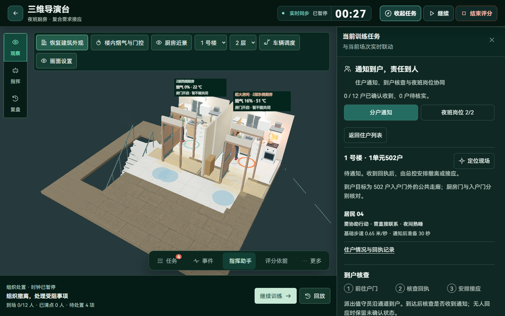

# 智演安巷——面向老旧小区消防治理的数字孪生与智能决策平台

面向社区火情初期的住户通知、重点人员接应、有限资源处置与演练复盘。通过两个角色端，把场景准备、三维现场、人工决策、责任任务和结果证据连接起来。



[操作指南](使用指南.md) · [系统架构](docs/architecture/README.md) · [部署升级](docs/operations/deployment.md) · [当前交付与验证](docs/reports/current-release.md) · [文档导航](docs/README.md)

## 使用场景

| 案例 | 训练重点 |
| --- | --- |
| 夜间充电棚火灾 | 熟睡住户通知、多楼栋接应、消防车接近、有效供水、通道保障与条件放行 |
| 住宅厨房火灾 | 厨房—玄关—入户门—公共走廊的烟气与通行、双门控制、到户核查和重点人员护送 |

保留组织者端和参演人员端。组织者准备与指挥，参演人员接收责任任务、报告到位、提交处置证据、上报异常和集合清点。

## 核心能力

| 环节 | 当前实现 |
| --- | --- |
| 准备与冻结 | 编辑建筑、道路和设施；室外点选火源，室内选择建筑、楼层和厨房；校验、发布并冻结场次 |
| 地图编辑 | 精确坐标与拖动吸附分开；修改备注保留设备参数和模型属性，刷新恢复真实位置 |
| 社区组织 | 分别配置行动协助、直接联系、熟睡人数及响应参数，需求可叠加；广播覆盖与收到回执分开；核查、护送和物业任务共享有限岗位 |
| 连续行动 | 室内外路径、楼梯容量、排队、差异速度、护送会合、暴露与实际到场；房门和能源处置联动环境 |
| 住宅双门 | 独立玄关、厨房门与入户门；核查停在户门外，关入户门检查已建户内分区中的人员 |
| 决策与协同 | 目标约束、资料检索、工具检查、候选比较、人工批准、任务依赖、资源归属、异常复核与接续 |
| 机器人与车辆 | 逐段移动、到位广播；道路约束下调度，有效供水与喷水；逐栋条件核对与执行回执 |
| 现场工作区 | 楼层平面与三维同步选择；按户查看人员、通知和门控；同一侧栏切换任务、助手与对象详情；本机参演往返保留同一场次 |
| 模型与环境 | 本地实拍PBR铺地、墙面、草地与室内地材；扫描木凳、灌木按完整包围盒避让道路和通道；厨房地板与通行甲板分工，减少共面闪烁 |
| 责任作业 | 夜班新场次的断气、断电按接收、到位、动作报告、核验推进；报告释放作业岗位，核验计入任务成绩 |
| 结果留存 | 服务端事件评分、增量同步、历史回放、决策分支、结果比较、训练档案、对话和待审核经验 |

## 完成一次训练

1. 选择案例、目标和教学或考核模式，配置火点、人员、通道、资源。
2. 完成准备检查，发布配置并创建新场次，阅读训练简报。
3. 开始训练，确认异常，查看受影响住户与可用岗位。
4. 比较方案及其预演范围，人工批准；未确认住户保留通知等待节点，已满足条件的部分先执行。
5. 观察真实移动、会合和到场，处理封路、资源占用、烟气及受阻事项。
6. 责任人回执到位，按任务要求报告动作并提交核验证据；对实际到场人员逐人清点。
7. 结束后查看评分证据和训练档案，从关键时刻建立另一决策分支。
8. 将有依据的观察修订为经验草稿，经审核发布后用于后续检索。

住户核实、门控、任务与助手共用一个工作区；返回保留原计划或现场上下文。手机现场工具默认收纳，展开可调整画质、楼层和透视，收起保留选择；护送核验不会提前占住接应岗位。新增操作区域采用16px正文、14px辅助信息和至少44px按钮，短屏与手机使用内部滚动。

## 智能体与知识

采用一个协调器、四类能力：现场感知、方案规划、资源协同、执行监督。默认的本地解析和确定性规划可独立运行；可选模型辅助目标理解、受约束只读工具推荐与解释。

任务图保存批准版本、依赖、稳定命令编号与资源归属。未确认住户的接应步骤不提前占满核查岗位；取得回执后再次检查通道和资源。机器人实际到位后才能广播，护送须先会合。人工接管停止后续自动下令，已受理动作保留实际进展。

知识库支持文档提取、审核发布、权限及有效期检索、原文引用。现场事实读取权威状态，路线与预演调用服务端工具，移动、完成条件和评分由领域规则确定。经验复用核对模型清单、人员、当班资源、种子与放行方式。

预演展示注明时域内的结果和未覆盖事项，全批次时序估算与最终成绩分开。[知识与智能体](docs/guides/knowledge-and-agent.md) · [社区操作](docs/guides/community-training.md)。

## 版本与验证

| 新场次冻结内容 | 当前版本 |
| --- | --- |
| 社区契约 | v6：可组合成员需求、基础步速与准备时间；保留住户身份、独立户门、通知与共享岗位 |
| 室内几何与拓扑 | v3：厨房、玄关、双门和公共走廊 |
| 厨具布局 | v3：尺寸与通行净空约束 |
| 住户入口 | v1：户门、成员与核查目标 |
| 环境与编排 | 因果环境v2、逐户通知条件v1 |
| 责任作业 | 夜班新场次v2：动作报告更新断气/断电状态并释放岗位，任务核验另行提交；普通及历史场次保留v1 |
| 评分 | v4 |

新规则通过重新发布并创建新场次启用。旧世界、旧批准计划、历史成绩和既有档案保留各自冻结内容；普通与夜班新场次独立登记环境模型，不因切换画像而改变环境公式。

本地发布检查、真实页面操作、专项用例和GitHub CI分别记录在[当前交付记录](docs/reports/current-release.md)。旧版验收明细通过Git历史查询，不混作当前新规则的得分结果。

最近一次本地验收为2026-11-17：初始后端359项通过，修复后相关38项回归通过；前端78项、31组浏览器专项及生产构建通过。浏览器专项包含真实隔离接口、协议替身和资源检查，验证边界分别记录。

| 真实时钟实跑（教学模式、4倍速） | 得分 | 完成情况 |
| --- | --- | --- |
| 充电棚，18人 | 92 | 18人到场与清点、3项任务按时核验 |
| 夜班厨房，12人/2岗位 | 91 | 12人到场与清点、4项任务按时核验 |

两场均完成计划与归档，但仍有烟气暴露及厨房效率损失；结果不是最优策略或容量基准。最新修复涵盖场次上下文、持久化租约恢复、手机动作进度与字号。[检查命令、扣分依据与验证限制](docs/reports/current-release.md) · [桌面责任作业](docs/images/action-report-desktop.png) · [公共参演核验](docs/images/acceptance-participant-linked.png)。旧版成绩与被替代的阶段记录通过Git历史查询。

在“人员与出口 → 社区夜班训练”中配置成员需求，默认仍可按人数与种子生成。现场直接筛选待联系住户和待接应人员，点击住户可定位同一居民及楼层；配置、实时状态、档案和经验适用性检查使用同一份参数。[配置界面](docs/images/population-preparation-1440.png) · [住户接应](docs/images/population-operations-1440.png)。

## 快速启动

依赖Python 3.11+、Node.js 22和npm。从仓库根目录开始：

```powershell
if (-not (Test-Path -LiteralPath .env)) { Copy-Item .env.example .env }
Set-Location backend
python -m venv .venv
.venv/Scripts/python.exe -m pip install -r requirements.txt
$env:DATABASE_URL='sqlite+pysqlite:///./zhiyan-local.db'
.venv/Scripts/python.exe -m uvicorn app.main:app --host 127.0.0.1 --port 8000 --reload
```

另开终端：

```powershell
Set-Location frontend
npm ci
npm run dev -- --host 127.0.0.1 --port 5173
```

访问[平台](http://127.0.0.1:5173)、[健康检查](http://127.0.0.1:8000/api/v1/health)和[接口文档](http://127.0.0.1:8000/docs)。开发账号读取本地`.env`的`BOOTSTRAP_ADMIN_USERNAME`、`BOOTSTRAP_ADMIN_PASSWORD`；密钥和运行数据不提交。

Docker部署执行`docker compose up --build`，使用PostgreSQL和前端代理。共享部署配置独立JWT密钥、初始密码及明确的HTTPS前端域名。[配置、迁移、备份与回滚](docs/operations/deployment.md)。

## 可选AI服务

离线训练不需要模型密钥。聊天、语音和语义检索独立配置，重启后端后在页面授权。

| 能力 | 默认方式 | 配置 |
| --- | --- | --- |
| 问答与目标理解 | 本地解读、确定性规划 | [兼容服务与Ollama](docs/guides/assistant.md) |
| RAG | 已发布资料的关键词检索 | [Embedding与回退](docs/guides/knowledge-and-agent.md) |
| 语音输入 | 文字可用、听写可关闭 | [讯飞、麦克风与授权](docs/guides/speech.md) |

语音转写只填写草稿，不自动发送或批准命令。服务配置与真实接入验证分别记录。

## 工程结构

| 路径 | 职责 |
| --- | --- |
| `backend/app/api/` | REST与WebSocket、鉴权、输入及响应映射 |
| `backend/app/application/`、`bootstrap/`、`domain/` | 命令事务、批准范围、幂等、领域端口及适配 |
| `backend/app/services/` | 场景冻结、社区协同、空间仿真、环境、资源、智能体、知识、评分和回放 |
| `backend/app/models/`、`schemas/` | 持久化约束与接口契约 |
| `backend/app/data/`、`evaluation/`、`maintenance/` | 来源资料、检索评估与显式维护 |
| `frontend/src/api/`、`domain/` | 传输、增量恢复及共享类型 |
| `frontend/src/components/`、`three/`、`audio/` | 工作区交互、三维表现与音频采集 |
| `frontend/public/assets/`、`frontend/tools/` | 运行资产、许可证与资源处理工具 |
| `docs/architecture/`、`guides/`、`operations/`、`reports/` | 当前架构、操作、运维和交付证据 |
| `scripts/` | 仓库检查与选定资源获取 |

系统采用模块化单体。权威状态、命令、事件和证据共享演练事务边界；Three.js消费服务端状态。[架构与依赖方向](docs/architecture/README.md) · [贡献指南](CONTRIBUTING.md)。

## 工程检查

```powershell
# 仓库根目录
python scripts/check_repository.py
# backend目录
.venv/Scripts/python.exe -m pytest tests -q -p no:cacheprovider
# frontend目录
npm test
npm run build
```

GitHub Actions对main推送和PR运行仓库检查、后端测试、前端测试与生产构建。运行数据库、日志、缓存、录屏原片和构建产物保持本地；当前验证截图随文档保存。

## 当前范围

仍待深化卧室与起居空间组成的完整住宅、全局碰撞校准、任务图全程批次预测和结构化整改复验。真实外部服务、实体设备、低配设备和生产多进程容量需要独立验收。当前为规则化训练仿真，可导出结构化JSON；CFD、实测火场重建、BIM/GIS、IoT/MQTT与PDF业务报告尚未交付。

第三方资源来源和许可随资产保留，详见[三维资源记录](docs/reports/model-assets.md)。新选资源可用`python scripts/fetch-community-assets.py`核对与重新获取，运行时从本地加载并保留轻量回退。仓库未提供根许可证时，不推断项目整体商用授权。过时阶段文件从当前目录移除，原始证据可通过Git历史查询。
