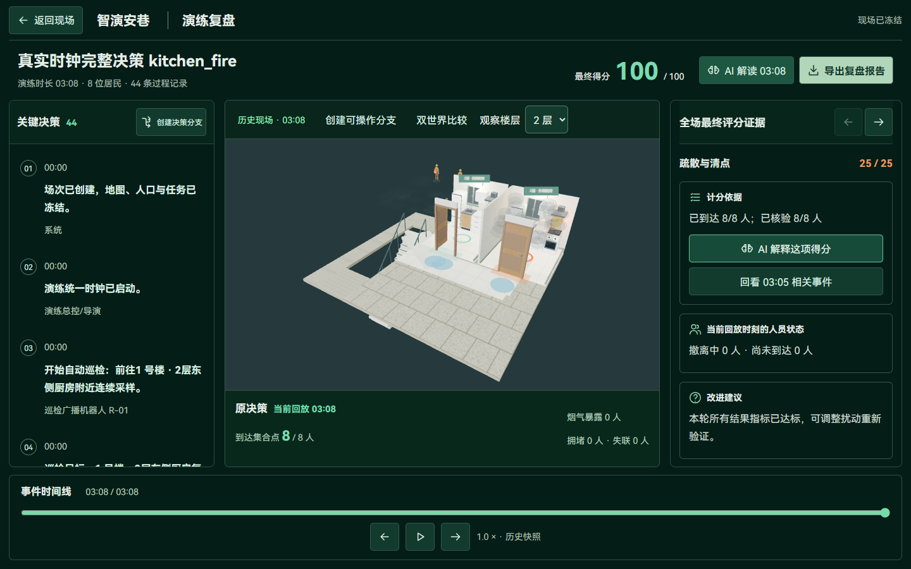
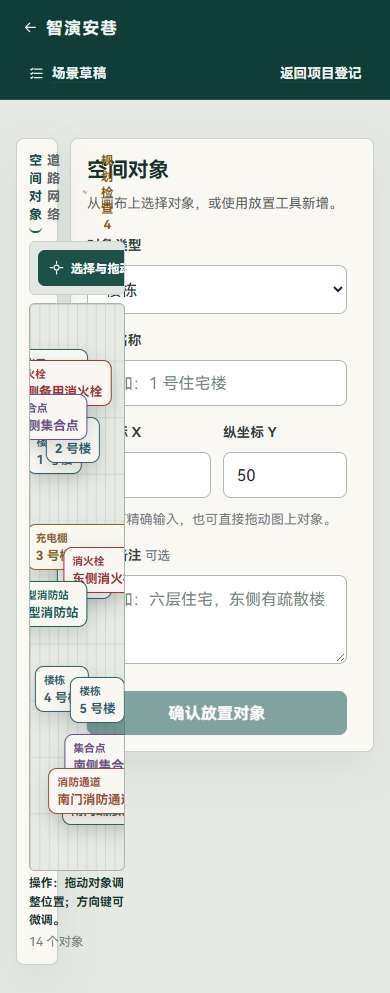
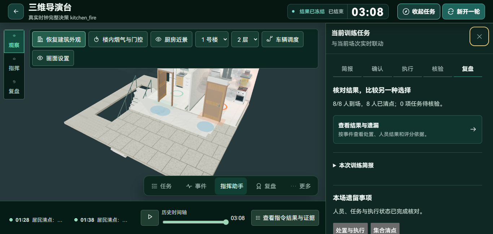
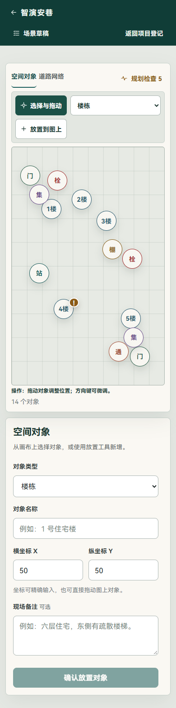
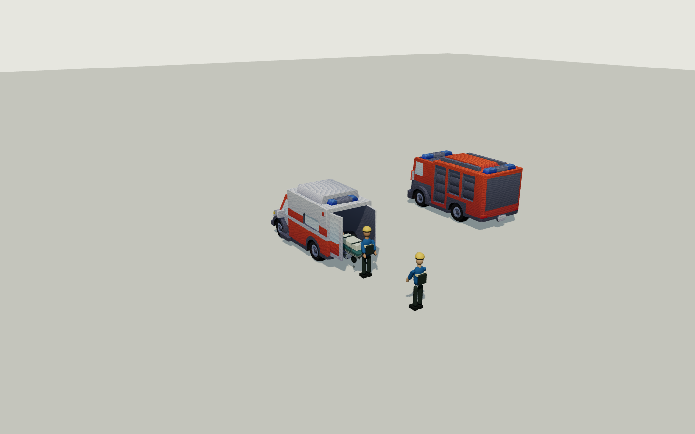

# 全项目决策、联动与页面验收

日期：2026-11-02。对象为当前工作区版本，包含近期未提交的建模与道路修复。本轮主要执行验收与问题定位，业务规则、评分参数及生产页面未为取得高分而调整。

## 实际完整决策结果

独立 SQLite 验收库：`tmp/acceptance-20261102.db`；后台端口 8011、页面端口 5181。原 8000/5173 环境的数据未用作本轮写入目标。新场次采用教学模式、4 倍速、真实 HTTP 和后台时钟，没有替换时钟。

| 项目 | 充电棚 | 厨房 |
| --- | ---: | ---: |
| 最终得分 | **99/100** | **100/100** |
| 结束仿真时刻 | 122 秒 | 188 秒 |
| 从准备到结束的墙钟时间 | 31.86 秒 | 48.85 秒 |
| 到场／清点 | 18/18 | 8/8 |
| 重点人员 | 3 人 | 2 人 |
| 烟气暴露超阈值 | 1 人 | 0 人 |
| 责任任务 | 3/3，未超时 | 4/4，未超时 |
| 智能体最终状态 | completed | completed |
| 请求 P95 | 0.155 秒 | 0.241 秒 |

厨房请求 P95 使用原验收脚本的累计采样集合，包含前一个案例；不能将两项作为严格独立性能对照。两案例的最长请求采样均为 0.69 秒。这里是小人口本机结果，不是容量测试。

充电棚扣分来自烟气与失联控制项：19/20，其余六项满分。厨房七个评分项均满分。场次 ID：

- 充电棚：`5666ebeb-af6f-4d85-8513-5a8b09d45723`。
- 厨房：`358ba0bd-af77-4000-902f-2c1d4e7b290a`。

执行链实际包含：创建社区与场景、配置火点、发布、冻结场次、启动、确认报警、生成候选、审阅暂停、批准、居民分流与护送、机器人广播、责任任务接收／到位／证据提交、集合清点、结束评分和智能体最终结果核对。

成绩来自自动即时操作；证据文字由脚本提交，不代表现实现场的断电、断气行为，也不代表首次用户能够在同样时间内完成。

## 功能与证据清单

| 功能 | 验收方式 | 本轮结论 |
| --- | --- | --- |
| 登录、失败反馈、会话恢复 | entry-pages 真实浏览器与后端 | 通过；刷新不依赖 localStorage 令牌 |
| 首页与案例入口 | atlas-pages、training-entry | 通过当前脚本覆盖的路径 |
| 场景准备、保存、发布与新建 | 完整决策 HTTP、training-journey、配置夹具 | 两案例可创建并运行；非法空间继续被拒绝 |
| 火点选择、三维加载、门控 | fire-source-selection、kitchen-scene，后端定向逻辑包含于全量测试 | 现有测试通过；不等同于任意自定义模型均适用 |
| 智能体方案批准、任务图与结果 | 两次完整决策、全量后端用例 | 两场均 completed；本轮使用确定性规划 |
| 居民、护送、任务核验与清点 | 完整决策与真实训练工作区 | 26 名居民到场并清点，7 项责任任务完成 |
| 道路封锁、跨端实时同步 | realtime-flow 真实导演台／手机 | 后台确认道路 blocked；导演台 23 条、手机 4 条增量 |
| 手机断网恢复 | realtime-flow | 重新收到快照并保留登记身份，无重新登记 |
| 机器人／车辆服务 | 后端全量用例、vehicle-assets、vehicle-rescue-layout | 调度与处置规则、纹理及布局得到覆盖；本轮完整决策未额外加入医疗接运 |
| 个人资料、阅读偏好 | account-layout 真实后端 | 保存、刷新恢复等现有用例通过 |
| 会话管理页面 | account-security-layout 协议夹具 | 桌面双列、移动单列、撤销反馈通过；真实权限逻辑另见后端测试 |
| 历史、复盘、分支与导出 | atlas-pages、training-journey、实际结束场次复盘 | 现有脚本覆盖的路径通过 |
| 手机地图编辑 | 实际页面截图与布局采样 | **存在明显布局缺陷** |
| 付费大模型服务 | 未调用 | 本轮未验证外部模型可用性、费用与多轮质量 |

17 个浏览器脚本均完成最终检查。其中既有真实 API 流程，也有隔离协议或布局夹具，不能把全部脚本统一当成真实后端功能证明。真实后端流程包括 entry-pages、atlas-pages、training-journey、account-layout、realtime-flow、training-entry。

## 优先处理的问题

### P1：手机地图编辑器仍为双列，严重挤压画布

390×844 实际页面中，地图区被压成约百像素宽的竖条；导航竖排、地图标记互相挤压，放置工具与表单发生遮挡。没有横向滚动并不能说明布局可用。

定位：`frontend/src/map-editor.css`。第 424 行附近的窄屏单列规则，在第 486 行被同等优先级、写在后面的双列声明 `minmax(0,1fr) 304px` 覆盖；末尾窄屏规则只改变高度和侧栏定位，没有重新指定列数。

建议修复：最终窄屏断点明确单列，地图与属性按任务切换或上下排列；独立安排工具条与标记密度。不要仅给画布加更小宽度或隐藏溢出。

### P2：地图文字仍明显偏小，复盘操作也需提高字号

实际可见文字采样：390 宽度地图首屏有 43 个小于 14px 的文字节点，其中 14 个类型标签约 10.72px，14 个名称约 12.64px；工具按钮约 13.12px，检查说明约 12.48px。来源包括 `map-editor.css` 中 `.66rem`、`.7rem`、`.72rem` 等规则。标签堆叠时，小字号进一步降低识别性。

复盘“创建决策分支”按钮为 12px。帮助页首屏也有 12–13px 的辅助文字。应将主要操作至少提高到 14px，地图名称保持可读，并配合缩放、筛选和选中详情控制密度。

本轮首页、个人中心、历史、场景准备、导演台所采样首屏未发现小于 14px 的普通直接文本节点；这不包含全部折叠内容、三维贴图文字或所有交互状态。

### P2：厨房案例的可选楼栋仍受基础模型限制

实际内置社区有 5 栋住宅，但仅 1 号楼通过当前厨房与走廊空间校验；其他四栋被拒绝，理由为平面过小或楼梯过宽，容不下两间厨房和独立通道。

安全拒绝本身符合规则；问题是模型配置与“自由选择楼栋火点”的预期不一致。需要升级其他楼栋实际宽深或提供与小户型适配的室内布局，并在选火点前解释哪些楼栋不可用。不能放宽净空校验来让所有模型表面可选。

### P2：高分与真实物理可信度应分别验收

本轮满分证明的是当前规则链能完成，不证明烟气物理、建筑尺寸、车辆转弯或医疗装载已经完成工程标定。当前车辆仍沿折线行驶、用包络检查转角；担架装载最后阶段缺少折叠进入车厢的机械动画。建议下一轮针对实际轨迹、转角及楼门做几何验收，再增加装饰细节。

### P2：验收脚本存在与界面、模型更新脱节的问题

首次后端全量执行：**207 通过、1 失败，237.06 秒**。失败项为 `test_ambiguous_custom_map_does_not_silently_pick_a_house`。核对后发现其原始内置地图仅剩一个合法厨房候选，因此不再构成“多候选歧义”；不能据此断言自动选火点规则有错。本轮将测试中的多栋住宅宽深明确设为可用尺寸，保留原断言；该文件重新执行 **2 项通过**。没有再次执行整个后端套件。

账号安全夹具测试漏了切换“登录与安全”标签；手机实时测试等待折叠的“现场消息”内部文字。已更新测试操作，未降低状态断言：真实道路仍须 blocked，两端须收到增量，手机重连须保留身份。两脚本复核通过。

建议在代码或模型更新时同步更新这些验收契约，并在测试中断言预期页面标题，防止只验证登录页而误认为业务页正常。

## 布局扫描的复核与误报

额外实际页面检查覆盖首页、个人中心、历史、帮助、地图、准备、导演台、复盘 8 个页面，每页 1440×900、1366×650、390×844，共 24 组。现有入口和训练脚本另外覆盖 360、768、1024 等宽度。

纯矩形扫描在短屏导演台报告事件按钮与底部控件相交。截图复核显示这些来自滚动区域已裁切内容的包围盒，不能直接算作可见重叠。本轮确认截图中顶部状态、右侧任务区和底部时间控件可见，未发现与手机地图同等级的实际遮挡。

扫描结果和截图不能覆盖所有抽屉组合。助手、任务及门控的组合另外使用现有布局脚本验证；本轮未引入新的浮层来规避问题。

## 实际检查结果与复现

| 命令／检查 | 结果 |
| --- | --- |
| `cd backend; .venv/Scripts/python.exe -m pytest tests -q -p no:cacheprovider --junitxml=../output/acceptance-20261102-backend.xml` | 首次 207 通过、1 个夹具假设失败 |
| `cd backend; .venv/Scripts/python.exe -m pytest tests/test_scene_initial_parameters.py -q -p no:cacheprovider` | 夹具修正后 2 项通过 |
| `cd frontend; npm test` | 59 项通过 |
| `cd frontend; npm run build` | 类型检查、生产构建通过；Three 引擎 628.46kB，gzip 160.85kB |
| 17 组浏览器流程与布局脚本 | 最终通过；原始失败与复核分开保存 |
| 两套完整决策 | 99 分／100 分，原始得分未改写 |

本地原始证据：`output/acceptance-20261102-decisions.txt`、`acceptance-20261102-backend.xml`、`acceptance-20261102-frontend.txt`、`acceptance-20261102-build.txt`、各浏览器脚本同日期日志。页面采样：`output/playwright/acceptance-20261102/page-audit.json`。实时链路结果位于 `output/acceptance-20261102-realtime-flow.txt`。

最初测试页面端口未配置进验收服务 CORS，导致真实页面测试停在登录页；修正独立验收服务的显式来源配置后重新执行。该环境失败没有算作业务缺陷。原服务配置未修改。

未覆盖：外部付费模型请求、真实手机硬件、生产 PostgreSQL 部署、多机／长时间多人负载、1000 人规模性能，以及任意自定义地图的完整碰撞与仿真标定。下一轮建议先修复手机地图双列覆盖与字号，再增强多楼栋厨房模型和大人口容量验证。

## 同日修复复核

上述发现保留为修复前基线。本轮继续修改后，结果如下：

| 原问题 | 实际修改与验证 |
| --- | --- |
| 手机地图被双列挤压、对象文字相互覆盖 | 最终响应式规则改为单列。窄屏地图对象使用 44px 的简短标记，完整名称仍由按钮无障碍名称和选中属性区提供。真实浏览器 390、768、1440px 的画布宽分别为 340、710、1066px，文档没有横向溢出。 |
| 地图及复盘按钮字号偏小 | 地图可见按钮最低 14px；“创建决策分支”在 390、1366px 实测 15px、高 44px。 |
| 只有一栋住宅可选厨房火点 | 内置五栋楼均提供可用厨房空间。扩大占地后同步校准第 2、3、5 栋的内置坐标，避免堵住原消防路线。旧演示底图只迁移未改过的草稿对象；已自定义的尺寸、位置及冻结场次保留。五栋分别完成服务端 `capture_world` 校验。 |
| 车辆折角和担架上车表现生硬 | 车辆转角在服务端生成经车身包络与建筑障碍检查的轨迹采样；不安全时保持已规划路线。医疗接运增加车外停靠点、8 秒装载阶段、担架底架收折和真实模型后门开合。确认状态与历史投影读取同一事件。 |

针对性后端检查 **23 项通过**，前端 **61 项通过**，类型检查与生产构建通过。实际浏览器复核了地图 390／768／1440px 和复盘 390／1366px；车辆模型截图使用打包的 GLB 与真实纹理，浏览器页面错误为 0。旧主案例草稿中的楼栋已在本地服务重启后按受限迁移条件更新；既有历史场次世界未修改。本轮没有重跑整场评分，也没有对任意自定义地图或真实救护车机械结构作标定结论。

提交前又执行一次后端全量检查：**211 项通过**；该结果覆盖修复后的完整本地后端测试集，不替代上文的真实场次与页面验收。

自检重点：是否只是让按钮可点击？五栋楼已分别构建冻结世界；是否只在前端补动画？车辆轨迹与医疗阶段由服务端确认并可回放；是否覆盖用户调整？迁移只匹配内置草稿默认值，并有保留自定义位置的回归检查。
