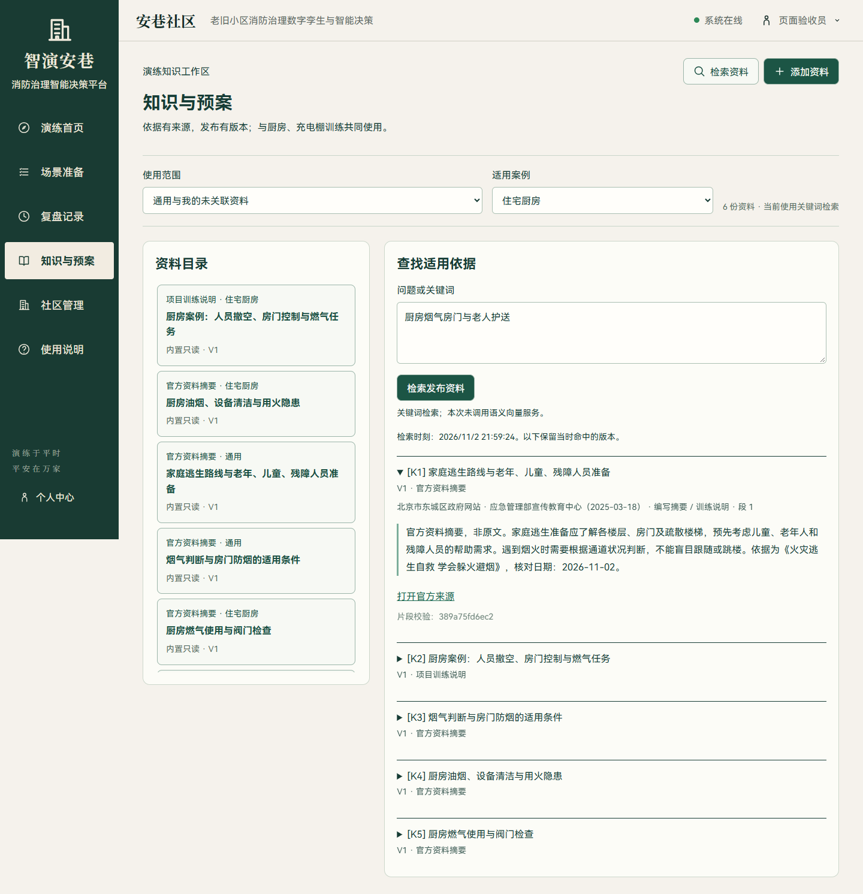
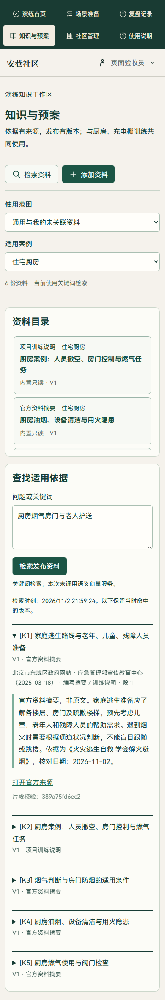

# 知识库与场景 RAG：N1 交付

日期：2026-11-02。本轮在现有两案例、组织者端和助手工作区上交付知识与证据能力；N2 的模型工具规划循环、N3 的新增修订机制和 N4 的复盘经验自动提议尚未作为本轮功能交付。

后续版本已交付受约束的只读工具推荐与语音接续，见[2026-11-03 升级记录](2026-11-03-约束规划与语音工作区升级.md)。本文的测试数字与截图保留 N1 当时记录。

## 已交付的操作链

首页“知识与预案” → 选择社区和案例 → 添加正文或上传资料 → 核对提取内容 → 提交审核 → 组织者确认发布 → 当前权限与案例下检索 → 场景助手引用 → 目标计划保存本次检索证据。

知识中心使用资料目录与详情的主从布局，手机为单列。检索结果在当前详情区展开，不叠加独立浮窗；助手沿用现有依据区，知识引用为 K 编号，现场事实保留 S 编号。

## 专属资料来源

N1 首次交付内置 8 份资料：6 份官方资料的项目编写摘要，2 份由实际软件功能编写的训练说明；N2 新增两份规划与语音说明，N3 再加入异常修订指南，现共 11 份。官方摘要与原文链接一并展示；项目操作说明不作为法规或官方专业结论。资源包位于 `backend/app/data/fire_knowledge.json`，启动时按固定 ID 幂等导入，不覆盖用户资料和历史证据。

| 资料 | 来源与适配 |
| --- | --- |
| [社区消防安全知识常识](https://www.mem.gov.cn/kp/shaq/201904/t20190401_366005.shtml) | 应急管理部；社区通道、消防设施、重点居民准备与日常巡查 |
| [电动车火灾事故频发 消防教您如何防范](https://www.mem.gov.cn/kp/shaq/201804/t20180411_365997.shtml) | 应急管理部；充电棚与通道烟气风险；不将旧科普中的充电时长直接用作模型参数 |
| [燃气安全必知](https://www.119.gov.cn/kp/hzyf/jt/2023/39833.shtml) | 国家消防救援局网站；厨房燃气设备与不同条件下的适用性 |
| [了解火灾逃生中的误区，学会科学求生](https://www.hn119.gov.cn/content/1086303) | 湖南省消防救援总队；烟气、门状态与条件判断 |
| [火灾逃生自救 学会躲火避烟](https://www.bjdch.gov.cn/ztzl/aqsczbgjsnxd/zdgz/202503/t20250318_4037101.html) | 东城区政府网站，应急管理部宣传教育中心；家庭路线与老年、儿童、残障人员准备 |
| [厨房用火安全知识](https://kjt.nx.gov.cn/ztzl/kpyd/202307/t20230704_4167127.html) | 宁夏科技厅；厨房油烟、设备与隐患准备 |

资料核对日期为本轮日期；发布时间不等同于失效日期。内置资料以科普摘要使用，不自动转换为新的评分标准、通道安全阈值或设备控制命令。后续法规条文应单独核对适用对象、效力和版本后再发布。

## 资料与检索规则

- 资料具有所属账号、可选社区、适用案例、来源、类别和版本。当前与既有社区所有权一致：组织者只能管理自己的资料；内置资料只读，手机参演凭证不能调用组织者知识接口。
- 草稿和失败版本可修订；发布必须经过“提交审核—核对确认”。当前为同一组织者核对并记录审核人，不宣称已经实现双人独立审核。
- 修订创建新版本，当前发布内容在新版本发布前继续使用。数据库通过部分唯一索引限制同一资料仅一个当前发布版本。
- 可设置带时区的有效截止时间。过期、停用、被替代和未发布版本不参加当前检索；历史检索保留当时实际命中的文字、哈希与版本。
- 从未发布的资料可确认删除。已经发布过的资料通过停用退出检索，保留审计与引用版本。
- 关键词检索使用中文双字词、领域同义词扩展和 BM25 风格评分，按社区权限和案例先筛选，再排序、去重，最多返回 5 个片段。不会因关键词无结果就返回假来源。
- 当前本地候选容量为 2000 个有效片段；超过时明确要求缩小范围，不悄悄截断整个知识库后宣称完整检索。

检索会保存 `knowledge_retrievals` 记录，保留命中片段快照及问题哈希，避免额外保存完整敏感问题。引用的版本和内容哈希可以追溯；历史证据接口再次核对所属账号。

## 上传与提取

支持 UTF-8 TXT、Markdown、DOCX、文本型 PDF，单文件最多 3MB，提取正文最多 80000 字，PDF 最多 80 页。扫描件不能提取文字时进入“提取失败”，不能审核发布空资料。

提取使用固定 Python 子进程，不执行文档宏或远程链接，超时 15 秒终止；DOCX 限制条目、解压体积并拒绝危险 XML 声明。Linux 子进程设置 CPU 和地址空间限制；Windows 当前使用子进程与时间限制，未宣称具备同等内存隔离。新增依赖 pypdf 仅用于文本型 PDF 提取，版本为本次核对的 6.21.4。

请求体在 JSON 校验前限制大小和上传时间；文件解析并发和知识写请求频率受到限制。文件原始二进制不写入公开目录，版本保存提取内容、定位锚点和哈希。PDF 页码或文字段落锚点供原始提取片段核对，官方摘要则通过来源链接查看原文。

## 与问答、计划的联动

每次场景提问使用场次所属社区和冻结案例类型限定检索范围，再将本次发布资料与当前场次事实提供给助手。离线模式同样能够展示命中资料；启用既有聊天模型后，检索片段进入模型上下文。模型返回不存在的 K 引用时会放弃该回答并回退，而非显示伪造引用。

目标计划创建时保存检索记录 ID、原片段和版本；审批、执行和复盘读取同一证据。方案页面明确区分“参考资料”和“仿真可行性”：当前候选行动仍由既有确定性规划器生成，知识检索尚未被冒充为模型自主分解任务。

本轮不修改模型决定不了的事实：居民位置、会合、道路可达性、设备实际动作和评分仍由领域服务及事件确认。

## 可选语义检索

配置独立的兼容 Embedding HTTPS 接口，并重启后端：

```dotenv
KNOWLEDGE_EMBEDDING_URL=https://<provider>/v1/embeddings
KNOWLEDGE_EMBEDDING_MODEL=<available-embedding-model>
KNOWLEDGE_EMBEDDING_KEY=<local-secret>
```

聊天模型配置不能视为已经提供 Embedding。知识中心中明确授权资料发送后可建立语义索引；明确授权查询发送后才使用语义通道。首次配置后需先为发布版本建立索引。内置资料语义索引由系统管理员维护。

索引记录模型和端点指纹；向量格式、维度和有限数值经过校验。新的批次全部完成后才原子保存，失败不覆盖旧索引。更换服务或模型需重新索引。不匹配、未配置或网络失败时返回真实关键词检索结果及回退原因。

当前小规模部署使用 JSON 向量与受容量约束的余弦比较、排序融合，未引入独立向量数据库。外部 Embedding 服务尚未在本机配置，本轮没有把隔离向量响应当成真实外部语义验证。

## 架构和迁移

新增四张表：`knowledge_documents`、`knowledge_versions`、`knowledge_chunks`、`knowledge_retrievals`。沿用项目的表初始化与版本化迁移；新增有效期字段、当前发布版本唯一索引的迁移均可重复执行。旧场次及既有评分不回填知识记录。

| 模块 | 职责 |
| --- | --- |
| `models/knowledge.py` | 资料、版本、片段、检索证据 |
| `services/knowledge.py` | 权限、版本组织、关键词检索、证据冻结 |
| `services/knowledge_ingestion.py`、`knowledge_worker.py` | 限制文件提取和段落切分 |
| `services/knowledge_vectors.py` | 可选 Embedding 调用、索引身份与语义回退 |
| `api/routes/knowledge.py` | 资料、状态转换、检索与索引入口 |
| `KnowledgeCenter.vue` | 资料管理、原始提取内容、审核发布与检索 |
| `KnowledgeEvidence.vue` | 计划/检索结果的来源和版本展示 |

## 实际验证证据

隔离数据库的真实 HTTP 与浏览器流程已执行：上传 TXT → 草稿 → 刷新重新打开 → 审核 → 发布 → 检索 → 停用 → 验证旧检索证据不变。浏览器覆盖 1440、390px，页面脚本错误为 0。另通过真实场次接口确认助手和新目标计划均取得 4 条适用知识依据；该过程使用离线规划和真实数据库，没有调用外部模型。

当前本地服务已初始化 8 份内置资料，厨房检索实际返回 5 条片段，方法标识为 `keyword`。原始验收数据位于 `output/playwright/knowledge/`；本地资料截图与检索报告位于 `output/playwright/knowledge-live/`。

后端验证覆盖访问隔离、未发布不检索、版本替换、停用、过期、唯一发布约束、提取失败、危险大小、引用快照、模型伪造引用回退、目标计划证据和语义故障回退。隔离 Embedding 测试仅证明协议与回退处理，未测量真实语义质量。

| 检查 | 实际结果 |
| --- | --- |
| `pytest tests/test_knowledge.py tests/test_scene_assistant.py -q` | 28 项通过；覆盖本轮知识功能及问答适配回归 |
| `pytest tests/test_knowledge.py tests/test_agent_workflow.py tests/test_agent_task_graph.py tests/test_agent_recovery.py -q` | 当时 26 项通过；验证原有计划执行链兼容 |
| 后端全量 `pytest tests -q --tb=short` | 首轮 221 通过、6 失败；定位到最小问答上下文缺少 `sources` 的兼容错误，已修复，随后上述 28 项包含这 6 项并通过；未再重复全量运行 |
| `npm test` | 61 项通过 |
| `npm run build` | 类型检查与生产构建通过 |
| `frontend/tests/knowledge-workflow.e2e.mjs` | 真实上传、刷新恢复、审核、发布、检索、停用、历史引用、助手与计划依据通过 |
| 实际主服务的 1440、390px 浏览器检查 | 均返回 5 条适用知识，无横向溢出、无页面脚本错误；手机导航已修正为两行三列 |

桌面实际检索页面：



手机实际检索页面：



下一阶段继续 N2：扩展目标契约和受预算约束的工具规划循环，让知识依据参与动作草案、工具反馈及修订，而非仅作为当前方案的参考证据。
