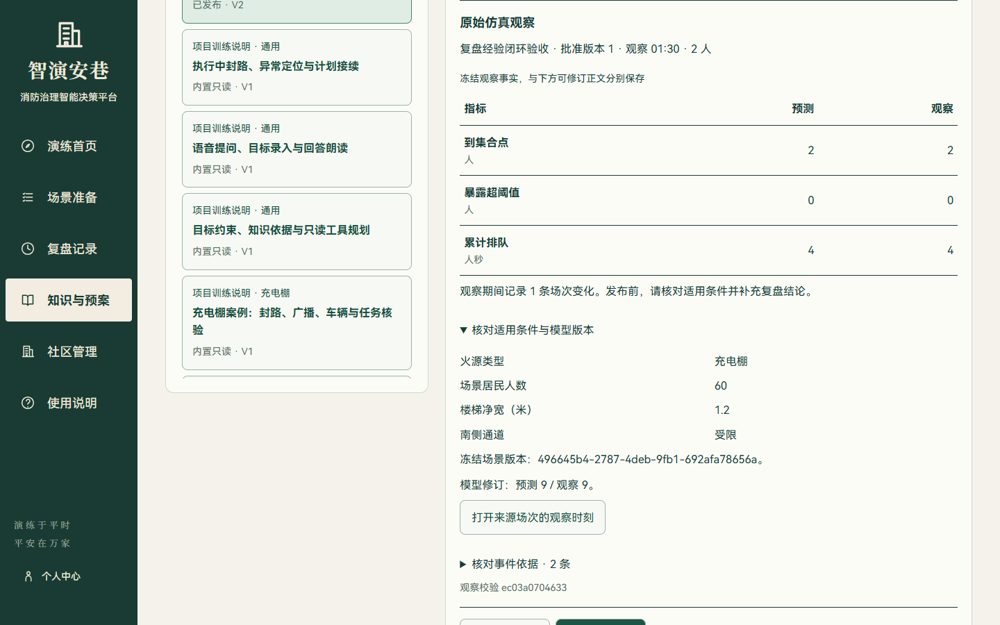
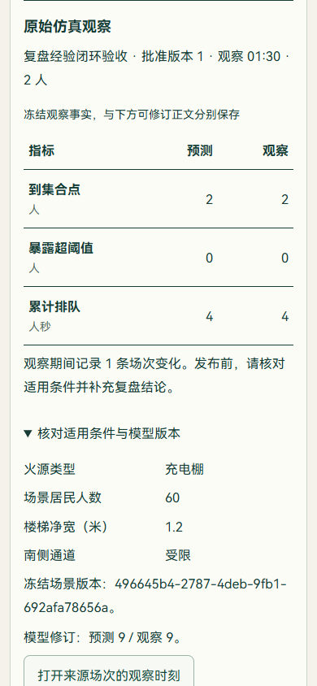

# 复盘经验审核与知识闭环

本轮交付 N4 的经验入库流程：把已经完成的同批居民预测/实际核对，保存为可修订、需审核的知识草稿；发布后，场景问答与下一轮计划可按社区和案例检索。沿用当前知识中心和助手工作区，没有增加独立聊天窗口。

## 用户操作

1. 在目标计划确认方案并执行，等待服务端到达约定观察时刻。
2. 打开“执行效果核对”，查看到集合点人数、暴露超阈值人数、累计排队，以及期间事件。执行页的“查看预测与实际结果差异”直接定位到此区域。
3. 点击“保存为经验草稿”，再进入知识资料与审核。同一账号重复保存同一批准版本，返回已有资料。
4. 核对冻结条件、预测/实际指标、模型修订与事件；可以回到来源场次的准确观察时刻。
5. 修订正文，补充发现、适用条件和下一次对照办法。正文支持语音输入，转写后仍需人工保存。
6. 提交审核，确认事实、条件与正文结论，再发布。未发布的经验不参与检索。
7. 在下一场查询或规划中检索适用资料，从引用入口打开当时使用的具体知识版本。

## 数据和执行契约

| 数据 | 实现 |
| --- | --- |
| 来源事实 | `knowledge_experiences` 保存观察时刻、批准版本、同批人数、预测/实际、场景条件、模型修订与有限事件引用 |
| 可编辑正文 | 复用知识文档版本、审核、发布、停用、有效期与权限机制 |
| 来源摘要 | 对冻结事实计算 SHA-256，用于比对来源；修订正文不改写来源事实 |
| 幂等性 | `(owner, decision_check_id)` 唯一约束、确定性文档 ID 与事务提交；并发冲突读取已有资料 |
| 授权 | 先核对计划账号和社区访问权限；来源回放仍经过场次原有鉴权 |
| 检索依据 | 命中记录固定文档版本、文本和来源观察，后续发布不会替换旧计划已经使用的依据 |

只有完整、已观察、同口径且目标人数非零的结果可自动生成经验；未完成观察、提前结束、人员未匹配或指标缺失返回明确错误。生成接口读取已经结算的记录，不推进时钟来制造结果。

新预测与实际记录包含模型修订号；模型版本改变时不计算可比较差值，也不能自动生成这类经验。旧记录缺少修订号时显示“历史未记录”，不补造版本。经验是特定条件下的仿真观察，问答与工具规划提示会区分它和专业预案，不把一次结果当作普遍有效的规则。

接口 `POST /api/v1/knowledge/experiences` 接收 `run_id`、`revision`，返回 `created` 和资料详情。新增表通过现有启动初始化建立；没有删除、重写旧场次或知识版本。上线前沿用既有数据库备份流程，重启后端即可加载；本轮没有新增依赖。

## 页面与模型表现

资料页把“原始观察”和“可修订正文”分别呈现。指标在正常文档流中展示，条件与模型版本按需展开；宽屏目录/详情双列，手机单列滚动，正文 16px、辅助信息 14px，主要按钮至少 44px。引用返回保持在原工作区流程内。

住宅门增加通行状态灯与净空提示，读取已确认的开关状态和通道占用：关闭、占用、畅通分别呈现。指示件布置在门洞外，门扇仍按服务端目标开合；房门关闭判断继续由已有通行规则决定。模型回归检查用实际射线验证门洞没有被新增构件缩窄。

## 实际验证

| 检查 | 执行结果 |
| --- | --- |
| 后端经验、观察与知识测试 | `python -m pytest tests/test_knowledge_experience.py tests/test_agent_outcomes.py tests/test_knowledge.py -q --tb=line -p no:cacheprovider`：19 项通过 |
| 最后边界修正回归 | `python -m pytest tests/test_knowledge_experience.py -q --tb=line -p no:cacheprovider`：4 项通过；与上行重叠，不累加 |
| 前端业务/模型检查 | `npm test`：61 项通过，含门洞净空和占用状态 |
| 类型与生产构建 | `npm run build` 通过 |
| 真实浏览器流程 | `tests/knowledge-experience-flow.e2e.mjs`：真实后台观察 → 草稿 → 修订 V2 → 审核发布 → 来源回放 → 下一轮方案检索，通过 |
| 页面复核 | 1440×900、390×844，核对观察表、条件展开、按钮与正文，无横向溢出；没有发现本轮资料区内容重叠 |

浏览器验收使用隔离数据库和离线模型配置，后台以真实时钟完成 90 秒仿真观察，匹配 2 名目标居民；没有替换仿真结果或模型成功响应。修订后的来源摘要保持不变，来源回放接口请求 `at_seconds=90`，下一轮计划返回已发布经验的真实引用。报告保存在本地 `output/playwright/knowledge-experience/report.json`。

未执行：整场评分重算、大人口性能对比、真实口述音频识别效果、外部大模型推荐质量、Embedding 实际服务效果。本轮不据此宣称训练效果或决策质量提升。内置知识仍为 6 份官方摘要、5 份项目说明；截图中的经验为隔离验收资料，没有写入主社区。

## 主要代码位置

- 后端：`services/knowledge_experience.py`、`services/agent_outcomes.py`、`models/knowledge.py`、知识路由与检索服务。
- 界面：`OutcomeExperienceAction.vue`、`KnowledgeObservation.vue`、`AgentOutcomeReview.vue`、知识中心、知识引用、助手与导演台导航。
- 模型：`three/residentialDoor.ts`、`three/indoorFireVisuals.ts`。

后续应以真实团队审核的预案和复盘材料充实知识库，并建立带标注的检索与推荐评估集，比较依据是否适用、行动是否可执行及操作负担。人审经验入库已经连通，不等同于自主训练或自动优化模型。
