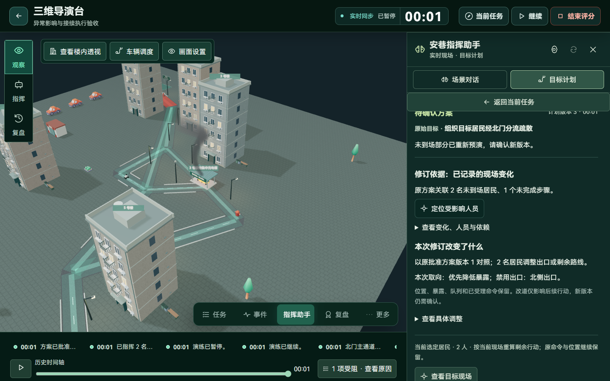
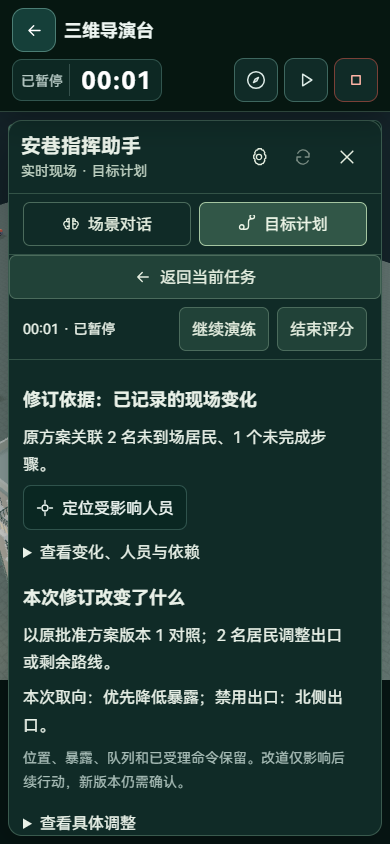
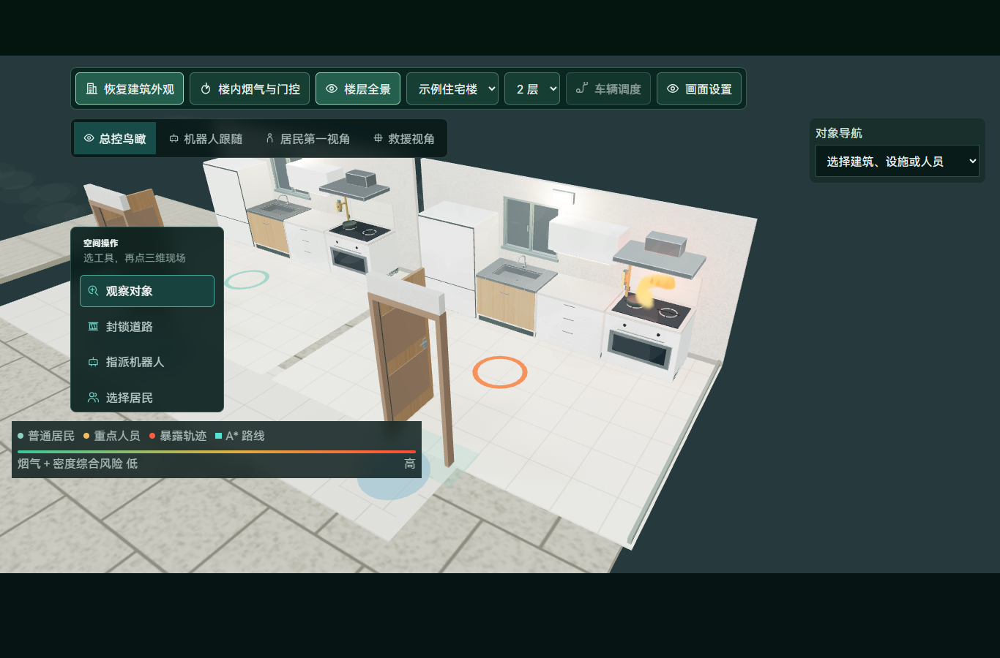

# 异常影响、计划修订与模型联动

本轮接续 N2 约束规划，交付 N3 的异常影响分析、修订差异、知识刷新和重新批准流程。沿用现有两个角色端、两个案例和命令执行链，不增加独立聊天窗口。

## 真实操作流程

1. 批准原方案，居民与机器人按原命令行动。
2. 封锁原路线上的道路，或改变相关房门、机器人与人员状态。
3. 在目标计划查看事件依据、涉及的未到场居民、直接步骤和下游依赖，定位回原三维现场。
4. 请求调整剩余行动；已受理行动继续，后续自动下令暂缓。
5. 按需修改优化取向与禁用出口，按当前现场重新比较。
6. 核对新旧出口、剩余路线、知识依据与资源，批准新版本后接续执行。

实际浏览器验收完成了北门主通道封锁后的两人改道：原计划仅允许北侧出口，封路后识别 2 名受影响居民，新版本禁用北侧、转为南侧路线，重新批准后继续执行，原命令证据仍然存在。

## 异常影响来自哪些数据

`agent_impact.py` 读取本场计划的原候选、已批准步骤、当前位置和版本化事件。关联道路封锁/恢复、房门变化、人员失联/外部指派和机器人变化，排除本计划已有命令证据和系统巡检。

- 按每名居民的路线判断影响，不把同组人的路段并集误当成每个人都经过的路线。
- 已走路段按当前位置裁剪；到场居民退出待调整范围。
- 未完成步骤通过依赖图向后传播，例如机器人移动受影响时关联后续广播；已完成步骤不重新执行。
- 事件查询以本次快照序号为上限，防止将快照之后的事件混入当前依据。
- 页面展示有限样本，统计与明细数量分别提供。最多分析最近 100 条相关事件，超出时明确显示限制。
- 护送/机器人命令查询按唯一 ID 分批，依赖传播使用邻接表与队列；本轮没有进行规模性能提升的量化宣称。

房门影响判断改为具体门 ID 与目标路线/门控任务匹配。无关房门变化不再导致所有待批准方案失效。当前判断仍针对原方案相关性，不把“原路线涉及”直接解释为人员此刻一定被困。

## 修订服务与版本保护

重算逻辑抽到 `agent_revision.py`，路由负责鉴权、事务锁和响应。修订允许改变优化取向和禁用出口，不改变原目标人员名单。变更仅在 `replan` 请求接受，不能在 `approve` 请求中临时夹带约束。

每次修订保存：

| 数据 | 用途 |
| --- | --- |
| 原步骤、命令 ID、原范围与原知识记录 | 保留批准和执行依据 |
| 异常事件、关联居民及任务依赖 | 解释此次为何调整 |
| 旧批准版本、候选/草案基线 | 区分批准版本与后续“请求复核”控制版本 |
| 新优化取向、禁用出口、人员差异 | 解释新版本实际改变什么 |
| 已到场人数、剩余人数、在途护送 | 保留已发生行动与接续状态 |
| 新知识检索记录 | 按当前有效发布资料重新核对，而非一直沿用首次检索 |

正常向前走不算改变决策。新旧路线在相同当前位置比较，避免仅因删去已走路段而虚增“改道人数”。原目标文字保留并标注“原始目标”，新版约束单独明确显示，防止原文“经北门”与新版禁用北门相互混淆。

机器人复用已有到位/广播回执，护送员继续原会合身份；重新规划不会清空位置、暴露与队列。人工接管后释放资源归属，原计划不能通过重算夺回控制。

本轮也修复了本地目标校验失败仍留下审阅暂停的问题：未授权模型的本地规划在同一事务中校验与暂停，失败时回滚状态。

## 知识、助手和语音如何跟随执行

知识库增加“执行中封路、异常定位与计划接续”项目说明，目前共 11 份内置资料：6 份官方摘要、5 份项目说明。固定 ID 追加，不覆盖用户资料和旧引用。

修订时重新检索适用资料；授权模型后可在事务外使用原只读工具循环核对当前异常和候选差异。模型返回前若计划已经被批准、停止或再次修订，不覆盖新状态。

场景问答能够读取本账号当前计划的状态、版本、到场/清点数量和异常关联，并提供现场 S 引用。点击入口打开对应计划，不误把诊断问题变成新目标草稿。历史问答不读取当前计划，避免引入未来状态；S、K 引用都校验是否属于本轮依据。

模型推荐说明中直接写出的引用编号也参加校验，避免引用列表合法、说明正文却夹带不存在来源的情况。

执行页增加主动朗读当前摘要，读取真实人数、计划原因和下一步。切换工作区或开始录音时停止播放。没有增加新的语音模型，仍使用现有讯飞转写与浏览器朗读能力。

## 建模和界面

厨房燃气阀补充管夹、墙面固定件和螺钉；尺寸继续位于冻结台面深度范围内，管路不延伸进抽油烟机。阀柄只跟随服务端确认状态转动，暂停、历史或跳转时立即对齐确认位置，不在任务待核验时提前展示关闭。

人物继续沿服务端确认路径移动；修订定位与新路线预览复用当前三维现场，没有增加直线追逐或越墙的动作。

异常原因、人员差异、原始目标和新约束使用原侧栏的普通文档流；细节按需展开，定位返回原现场。桌面给面板让出实际空间，手机保留场次控制与内部滚动，正文 16px、辅助信息 14px，操作控件至少 44px。

## 验证与实际范围

| 检查 | 结果 |
| --- | --- |
| 修订、原接续逻辑与工具规划定向检查 | 14 项通过；护送/机器人回执复用、位置保留、约束、无关房门及失败回滚 |
| 异常、助手与知识定向检查 | 33 项通过；当前计划依据、历史隔离、知识版本及实际修订 |
| 最后调整后的依赖传播与路线裁剪检查 | 2 项通过 |
| 推荐说明的伪造引用检查 | 1 项通过，未注册工具与无效引用按预算回退 |
| 前端既有模型与状态检查 | 61 项通过，包含燃气硬件净空、阀柄状态与暂停对齐 |
| 类型检查与生产构建 | `npm run build` 通过 |
| 真实数据库、真实 HTTP 与生产页面 | 封路后识别 2 人，版本 3 按原批准版本 1 对照，两人转向南侧，重新检索 5 条资料，批准后原命令记录保留 |
| 1440、390px 浏览器 | 无横向溢出、页面脚本错误为 0；新旧约束与批准版本标注经过截图复核 |
| 厨房近景 | 使用生产渲染组件的隔离户型，1366px 加载正常，页面脚本错误为 0 |

上述检查组存在重叠，不累加为独立用例总数。本轮未重算完整场次得分、未测量大人口性能，也未验证真实外部模型的修订质量或上传真实口述音频。隔离验收使用单独数据库，未向正式社区插入验收场次。

原始证据：`output/playwright/agent-revision/report.json`、同目录浏览器截图与厨房报告。部署沿用现有依赖，重启后端加载服务和第 11 份内置资料；修订信息保存在原计划 JSON 与证据中，无破坏性迁移。

下一阶段可将核验过的复盘发现生成经验草稿，经组织者审核发布后纳入下一场检索，并继续比较修订前后的实际结果。
