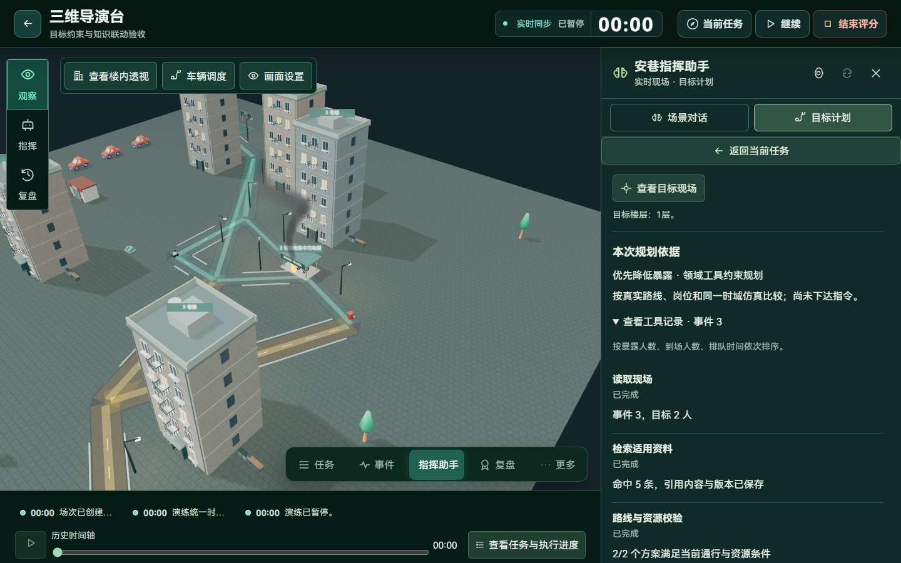
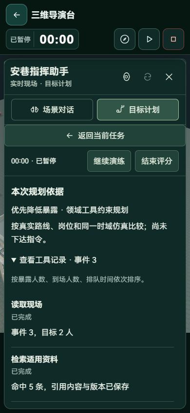

# 约束规划、专属知识与语音工作区

本轮继续 N1 基础上的 N2 受约束规划，复用两个火灾案例、冻结空间、统一命令、资源归属和执行监督。新增的模型能力是通过只读工具查阅依据、比较已有可执行候选、提出受校验的推荐；候选动作和预测结果仍由领域规划器计算。

## 可以实际完成的操作

1. 在场景对话中输入或听写“优先护送三层重点居民，降低暴露”。
2. 点击“转为疏散目标”，文字保留到目标框，核对建筑、居住楼层、护送和广播需求。
3. 展开“目标约束与优化取向”，按需指定楼层、优化取向和禁用出口。
4. 生成方案后查看目标人员、知识引用、路线与资源校验、同起点预演，以及推荐依据。
5. 可进入三维现场查看目标或预览路径。人工确认后，通过既有命令链执行，读取真实回执。
6. 发生封路、外部改派等变化后，重新比较剩余行动，保留位置、暴露、队列和原任务证据。

语音与对话接续只填入草稿，不直接创建或批准计划。已有活动计划继续保留；新目标仍需通过居民重叠、资源与版本校验。

## 目标契约与实际约束

新增字段沿用原 `POST /drills/{id}/agent/runs`，旧请求默认值兼容，无数据库破坏性迁移。

| 字段 | 语义 | 实际影响 |
| --- | --- | --- |
| `floors` | 冻结居住楼层，最多 30 个，范围 1–100 | 与建筑、居民 ID 取交集，形成真正参与规划的人员名单 |
| `objective` | `balanced`、`low_exposure`、`fast_arrival` | 控制候选排序与确定性推荐；页面显示具体排序口径 |
| `forbidden_exits` | 北侧、南侧出口的禁止条件 | 重新构造允许出口分配并调用原路径和仿真规则，不仅改变文字 |

自然语言可识别“三层”“十二层”等明确楼层，不把“三号楼”当成三层。含糊的楼层区间要求明确选择；“不要疏散三层”不会被反向解析为安排三层疏散。两个出口均被禁止、目标范围没有待撤离居民时直接提示调整。

楼层按冻结居住信息选人，移动途中不改变名单。禁用条件优先于出口偏好，不会为了生成可执行结果而自动放宽。当前仍使用既有北/南出口契约，没有声称实现任意出口系统。

排序使用同一有限预演时刻：均衡按状态预估分、暴露、到场、排队依次比较；降低暴露将暴露人数置于首位；尽快到场将预演到场人数置于首位。没有把短时到场数量等同于整场最终耗时，也不强行制造动作相同的备选。

## 智能体的只读工具循环

### 真实领域计算与保存

服务端读取权威现场，限定人员范围，检索适用发布资料，调用已有路径、护送、机器人与仿真服务。输出 `planning` 记录，包括观察时刻、事件序号、约束、候选检查、推荐及工具摘要；知识记录保留原片段、版本和来源。

生成方案期间按原授权暂停现场。外部模型调用前结束数据库事务；模型等待不持有场次或资源行锁。推荐返回后再次核对计划版本与状态，已被批准、停止或修订的计划不会被迟到的推荐覆盖。

### 模型可调用的工具

| 工具 | 返回内容 | 权限边界 |
| --- | --- | --- |
| `observe_scene` | 当前目标、约束、观察版本、人数、完成条件 | 只读取当前已授权场次的精简投影 |
| `search_knowledge` | 当前目标实际检索的发布片段与 K 引用 | 不接受跨账号资料或任意外部 URL |
| `compare_candidates` | 服务端已计算的路线、资源检查及同一时域预测 | 不接受模型编造的路径或指标 |
| `recommend_candidate` | 候选 ID、说明和知识引用 | 必须先读取前三项；候选可执行、ID 和引用均校验 |

协调器最多执行 6 轮工具调用，循环预算 25 秒。模型选中受阻候选、伪造 K 编号、未读取必要依据或调用未注册工具时，返回校验错误并允许修订。未取得有效结果时保留确定性推荐和实际工具输出，页面标明回退原因。

这是一套具备工具调用与反馈校验的受约束推荐流程。当前模型不能自由生成新的领域动作、任意修改候选、执行命令或宣告人员到场。行动批准、资源预占、依赖执行、会合与清点继续读取原领域规则和证据。

## 知识库更新

现有资料共 10 份：6 份官方资料摘要、4 份项目功能说明。本轮新增“目标约束、知识依据与只读工具规划”和“语音提问、目标录入与回答朗读”，根据实际实现编写，类别与官方资料明确区分。

固定 ID 幂等导入，不覆盖用户资料、旧版本或旧检索证据。组织者可以继续维护自己的社区预案。检索默认采用真实关键词检索；独立 Embedding 服务仍为可选配置，本轮未接入新的外部语义服务。

## 语音与页面交互

- 场景对话、目标计划、知识检索共用语音输入，单次最长 30 秒，显示时长与进度。
- 点击结束后才上传到已配置讯飞听写；取消、关闭或切换工作区停止麦克风并取消等待。
- 录音与转写期间阻止当前表单提交；识别结果填入文字框，提示核对对象后再发送或生成方案。
- 对话中的疏散目标可以直接接续到目标计划，不必重复输入。
- 最新回答提供主动点击的浏览器朗读，开始录音、切换视图或关闭助手时停止。声音来自设备和浏览器，此能力不称为讯飞 TTS 或新的语音对话模型。
- 规划依据使用原侧栏的正常文档流，工具明细按需展开；案例处置显示简明数量和直接核验入口，责任与截止时间可展开。
- 桌面给工作区让出实际宽度；手机沿用单个内部滚动面板，保留场次控制。新增内容没有引入独立叠加窗口。

本轮将人员范围、出口限制与三维路径预览联动，没有替换厨房或人物资产。路线仍由冻结的通行空间和净距规则确定，模型没有获得直线移动或越过几何阻挡的权限。

## 验证记录

| 检查 | 结果与范围 |
| --- | --- |
| 后端知识、工具规划、语音定向检查 | 22 项通过；访问隔离、版本引用、楼层/出口约束、模型错误修订、预算回退和语音协议 |
| 后端规划与原工作流检查 | 15 项通过；覆盖约束后的真实审批与命令、重算接续，以及原疏散和机器人执行兼容 |
| 前端类型检查与生产构建 | `npm run build` 通过 |
| 实际数据库与导演台浏览器流程 | 指定居住楼层后选中 2 名居民，检索命中 5 条依据，人工批准后产生 1 条执行命令；1440、390px 无横向溢出、页面脚本错误为 0 |
| 语音浏览器交互 | 390、1366px 使用浏览器合成麦克风和真实 PCM 管线；取消不上传、识别不自动发送、对话目标接续及录音停止朗读通过 |

工具循环的外部模型响应使用隔离协议测试，未把它作为本轮真实 DeepSeek 调用成功的证据；讯飞本轮没有上传真实口述音频进行识别效果测量。浏览器朗读验证了调用和取消交互，没有测量声音质量。本轮未重跑完整场次最终得分、全仓库安全审计和全部页面。

原始记录：`output/playwright/agent-knowledge/report.json`、`output/playwright/speech-input/`。隔离验收写入单独数据库，不向正式社区插入验收场次。

## 后续开发

下一步将异常影响对象与任务依赖直接关联，扩展模型可提出的受校验动作草案，并记录每次修订的差异。继续优先完成单次目标的真实执行与核验，不通过新增聊天面板或独立“子智能体”入口增加操作负担。
