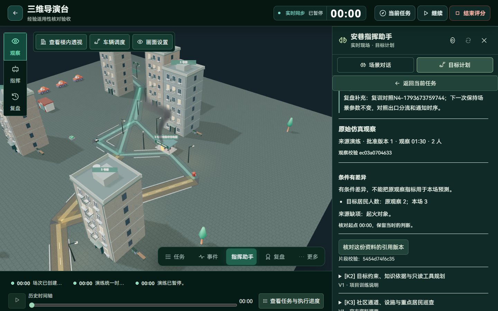
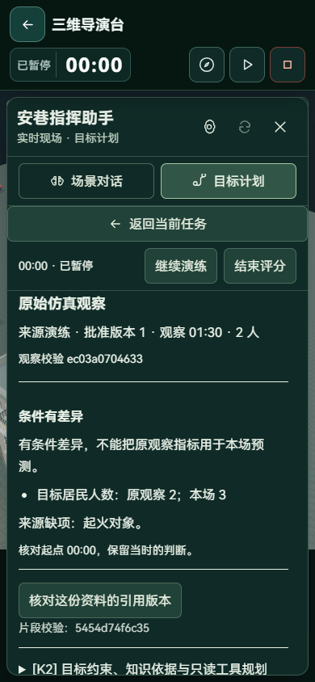
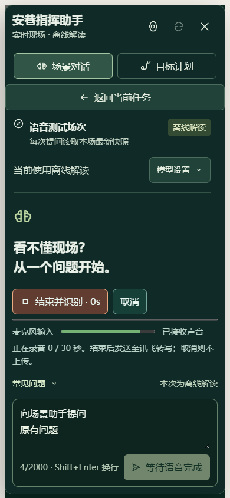
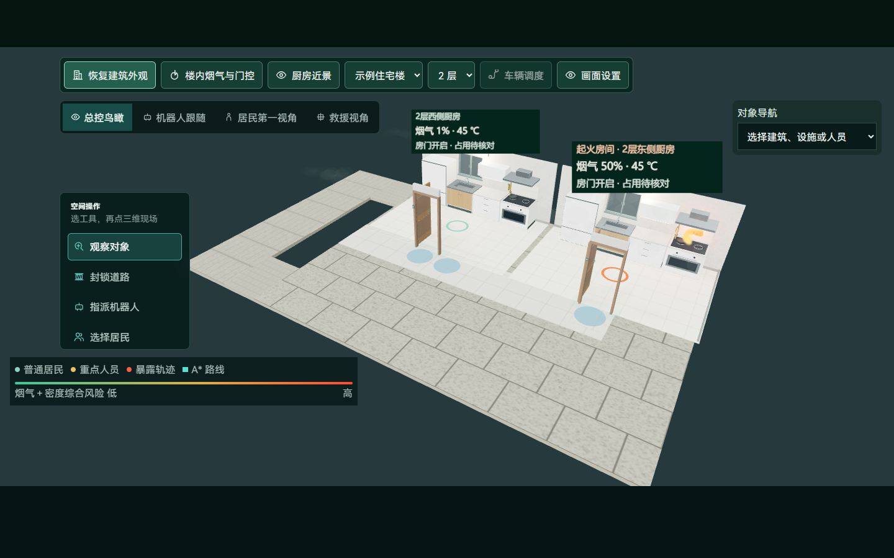

# 经验适用性、语音输入与室内状态展示

本轮继续完善知识增强智能体：经验检索不再只返回正文和历史指标，还会比较本次快照的条件。语音控件补充真实输入反馈，室内房间标注读取已确认的环境与门状态。保留原有工作区和人工批准流程。

## 知识怎样用于当前决策

新服务 `knowledge_applicability.py` 使用调用者提供的准确快照，比较经验来源记录中的起火对象、类型、楼层、房间、居民规模、楼梯净宽、南侧通道、初始门状态和观察模型修订。目标计划还比较本批目标人数。历史问答使用历史快照，不查询未来现场来填补历史条件。

| 结果 | 处理 |
| --- | --- |
| 已核对记录条件 | 记录字段一致；页面仍提示核对人员、动态事件和时序，当前效果由本场预演计算 |
| 条件有差异 | 列出原观察值、本场值；经验仍可查看，不能用于证明当前方案效果 |
| 条件记录不完整 | 明确来源缺项，不能把缺失当成一致 |
| 尚未对照具体场次 | 普通知识检索没有绑定演练，保留资料检索职责 |

条件判断与命中的文本、知识版本一起保存在检索快照。旧计划保留原引用；重新规划会按当前快照重做判断。来源记录采用分批读取，替代逐条查询经验来源，未宣称量化性能提升。

新的经验草稿增加起火对象 ID。旧来源没有这个字段时显示缺项，不回写历史事实，也不改变原始摘要。内置知识仍为 6 份官方摘要、5 份项目说明。

## 智能体增加适用性核对工具

模型推荐前必须读取四种只读工具：

1. `observe_scene`：目标范围与现场版本。
2. `search_knowledge`：本轮实际检索的资料与来源。
3. `assess_knowledge`：经验条件差异、缺项与排除引用。
4. `compare_candidates`：领域校验与仿真结果。

随后才能提交现有候选的推荐。有差异、缺项或未绑定本场的经验，推荐工具保留来源和核对说明，但不发送其正文与历史指标；完整资料仍可由用户打开。引用这些经验将被推荐校验拒绝并要求修订。仍使用 6 轮、25 秒预算，失败保留真实领域工具的确定性推荐，不能自行下令。问答可讨论这些历史经验，但必须展示差异，不将历史指标转换成本场预测。

这使知识与规划的关系从“附一段相关文字”变为“检索—检查适用性—调用本场工具—给出可核对建议”。它没有新增独立大模型角色，也没有引入自动训练。

## 语音输入

录音控件显示实际采样计算的相对音量，不是装饰动画或校准声压级。连续输入偏弱时提示检查设备；完全空音频在本地阻止上传。弱输入提示不等同于人声检测，也不据此判断一句话的内容。

识别结果仍需用户编辑确认，不自动发送问题或执行计划。取消、关闭助手和切换现场/历史时刻会取消录音或转写；原有文字输入继续可用。

## 室内模型与可视化

房间标注现在显示楼层/方位、起火标识、烟气百分比、温度和门状态，由服务端分区与房门记录驱动。门开启不直接等于路线安全：明确区分“可关门”“暂不能关闭”和“占用待核对”。

复用同一张状态纹理，只有展示值变化时重绘。标注完整放在墙体上方，避免被墙面裁切；不向门洞和通行空间添加碰撞实体。近景继续沿用既有标注收纳方式。该变化提高状态可读性，没有修改消防物理参数或人物速度。

## 验证证据

| 实际执行 | 结果 |
| --- | --- |
| 后端适用性、工具规划、经验测试 | `python -m pytest tests/test_knowledge_applicability.py tests/test_agent_tool_planning.py tests/test_knowledge_experience.py -q --tb=short -p no:cacheprovider`：13 项通过 |
| 知识检索和异常修订回归 | `python -m pytest tests/test_knowledge.py tests/test_agent_revision_impact.py -q --tb=short -p no:cacheprovider`：17 项通过 |
| 前端业务和模型检查 | `npm test`：62 项通过，含室内标注门状态投影 |
| 类型及构建 | `npm run build` 通过 |
| 真实 API 与导演台 | 隔离数据库中，已发布的 2 人经验用于 3 人目标时返回人数差异和旧起火对象缺项；计划的排除引用包含 K1，桌面与手机可查看具体原因 |
| 语音浏览器流程 | `node tests/speech-input.e2e.mjs` 通过：真实浏览器合成音频设备、两次转写协议请求、取消不上传、全静音不上传、关闭释放麦克风、手动发送；无页面运行错误 |
| 布局检查 | 资料差异工作区 1440×900／390×844；语音工作区 1366×650／390×844；检查范围内无横向溢出、未发现控件互相遮挡 |

浏览器报告在本地 `output/playwright/applicability/report.json`；语音截图位于 `output/playwright/speech-input/`。厨房截图使用生产渲染组件与隔离固定输入展示状态，不冒充整场动态验收。

本轮未执行真实口述音频识别准确率、外部大模型推荐质量、Embedding 服务效果、完整场次重新评分、大人口性能测量。语音协议使用隔离转写响应；实际场景与经验核对使用真实本地 API 和数据库，外部模型调用次数为零。

## 部署

无新增依赖或数据库结构变更。重启后端加载适用性服务；前端按原流程构建部署。旧知识、旧场次、旧检索快照保留；尚未记录的来源条件显示缺项。真实语音与模型服务沿用本地独立配置和显式授权。
