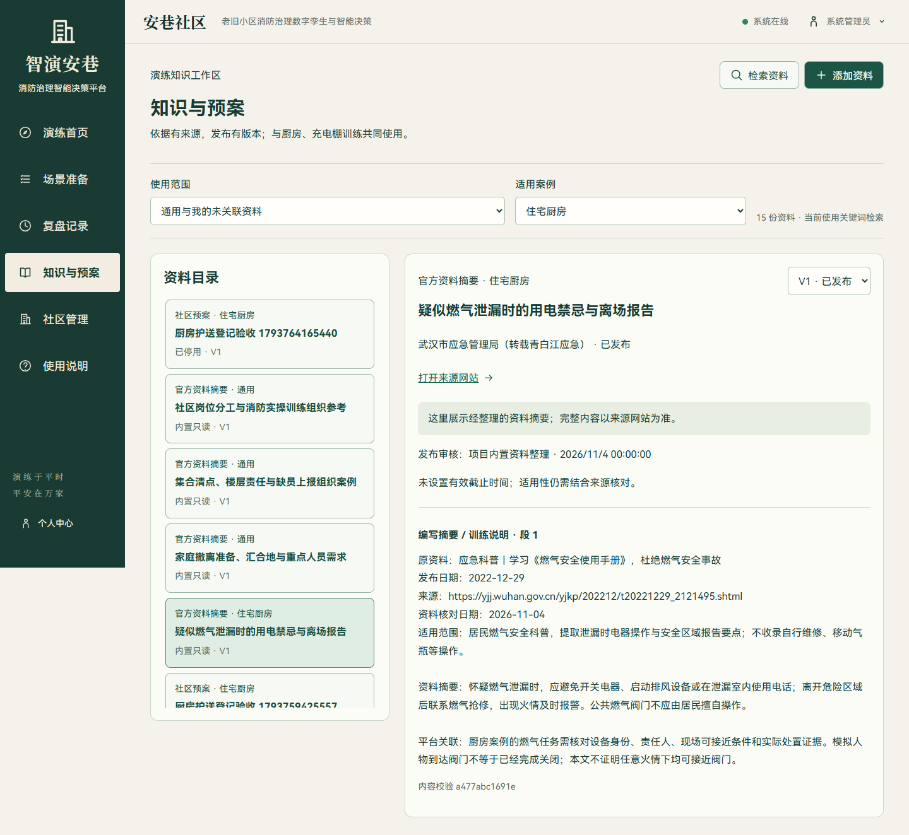
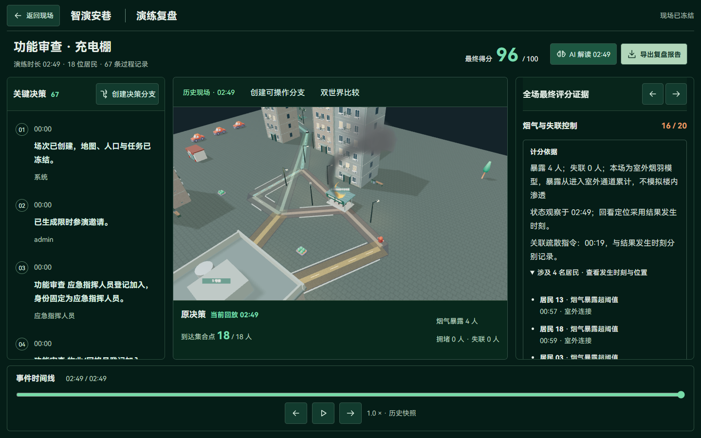
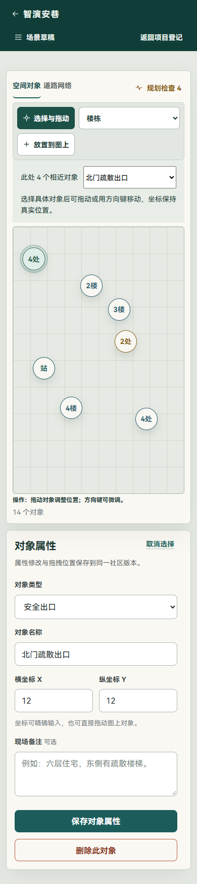

# RAG 知识扩充与验收修复

日期：2026-11-04。继续处理[功能审查](2026-11-04-功能审查与实跑验收.md)中的执行误暂停、评分追溯、知识引用与手机地图问题。保留已有场次、事件和冻结成绩。

## 交付内容

| 项目 | 本轮行为与证据 |
| --- | --- |
| 智能体关门监督 | 按居民尚未经过的路线判断房门影响；已通过的门不再误停计划，前方门和计划目标仍校验。厨房修复实跑保留在前一验收记录中 |
| 风险时间追溯 | 累计剂量首次超过阈值时记录模型时刻、居民和所在通行段；复盘区分发生、观察和关联指令 |
| 历史成绩 | 比较已有充电棚场次完整评分 JSON，保持原样；没有补写或修改历史扣分 |
| 失效知识版本 | 同一文档切到不存在版本时清空旧正文并提示不可访问，不静默回退 |
| 来源标识 | 官方摘要链接显示官方资料来源；用户资料仅显示资料来源 |
| 场景问答语义授权 | 读取知识服务状态，提供独立复选框，默认关闭；切换场次清除授权，未授权继续关键词检索 |
| 手机地图 | 相近触控目标合并为组，可切换具体对象并按原坐标编辑；方向键保存后刷新恢复。390px 标记重叠对数为 0 |

## 新增来源及场景适配

本次通过网页搜索并打开正文，整理以下五份资料的简短摘要。资料总数由 11 增至 **16**，其中 **11 份官方来源摘要、5 份平台训练说明**。正文不整页复制；来源事实与“平台关联”分别编写。

| 原资料及链接 | 日期 | 对应内容与适用范围 |
| --- | --- | --- |
| [应急管理部：高层民用建筑消防安全管理规定答记者问](https://www.mem.gov.cn/gk/zcjd/202107/t20210716_392214.shtml) | 2021-07-16 | 充电停放、公共疏散空间和消防车通行；标明高层建筑管理解读范围，不作为所有低层社区的统一强制条款 |
| [武汉市应急管理局：燃气安全使用手册科普](https://yjj.wuhan.gov.cn/yjkp/202212/t20221229_2121495.shtml) | 2022-12-29 | 摘录疑似泄漏时避免电器操作、离场后报告等要点；不收录自行维修或搬运气瓶等操作 |
| [应急管理部：家庭应急计划](https://www.mem.gov.cn/kp/shaq/201904/t20190401_365926.shtml) | 2019-04-01 | 家庭线路、汇合地、联系与重点人群需求，关联演练前人员登记和护送准备 |
| [济宁市政府公开：微山县第二实验中学消防应急疏散演练方案](https://www.jining.gov.cn/art/2026/4/21/art_89367_2928736.html) | 2026-04-21 | 借鉴楼层责任、到达后清点和汇报方法；不沿用学校队形、时限及师生岗位 |
| [浙江省消防救援总队公开：全民消防安全素质提升行动工作方案](https://zj.119.gov.cn/col/col1229456259/art/2026/art_0edcb19b1d504b3da14a6d6a25f85610.html) | 公开 2026-10-10；文件落款 2026-07-23 | 岗位培训与实际技能训练组织，关联训练简报、责任任务和专业指导 |

目录在 `backend/app/data/fire_knowledge.json`。每个新增条目具有独立 ID、场景、原文标题、来源机构、链接、公开日期、核对日期和范围。来源信息写入不可变版本正文，已有 11 份资料的 ID、正文和历史引用不重写。充电棚条目采用实际场景标识 `charging_shed`。

服务启动时只补种不存在的资料。上传资料仍经过原提取、审核、发布流程；检索继续执行账号、社区、场景、发布状态和有效期过滤，返回版本与片段校验值，并保存检索记录。语义服务需单独配置和授权，新增资料不会自动发送到外部向量服务。

## 评分模型改动与实跑

烟气剂量计算公式、越阈条件与得分规则保持不变，新增首次越阈的追溯信息。发生时刻按当前积分步内的剂量线性插值记录；所在位置是该步进记录的节点或路段。整数秒回放向后取整，防止定位在越阈之前。居民剂量、位置和检查点继续使用同一仿真状态。

检查点修订号由 9 调为 10，旧派生检查点重新计算，数据库不增加业务字段。历史已结束评分不重算。旧经验若因引擎版本差异被标为不可直接比较，应保留此提示，重新采集观察后再比较。

新充电棚流程使用真实隔离 API、后台时钟和数据库，未替换演练时钟：

| 指标 | 本轮结果 |
| --- | --- |
| 演练时长 | 169 秒仿真时间，4 倍速教学模式 |
| 智能体 | 已完成 |
| 到达及清点 | 18 / 18 人 |
| 责任任务 | 电源、广播、护送 3 / 3，均按时核验 |
| 最终得分 | 96 / 100 |
| 烟气超阈人数 | 4 人 |
| 关联疏散指令 | 00:19 |
| 首次风险回看 | 00:57；此时回放确有 1 名超阈居民 |
| 最终状态观察 | 02:49 |

本轮修复的是风险证据定位，未将 96 分调整为满分。风险发生后到最终观察之间，其余人员继续累积暴露，因此首次时刻人数与最终人数不同。

## 页面与交互验证

实际浏览器检查知识资料、同页失效版本跳转、地图和复盘，覆盖 1440×900、390×844；语音/助手协议覆盖 1366×650、390×844。检查的页面没有横向溢出或页面脚本异常。地图聚合只改变显示分组，不移动业务对象；选定对象后可通过原输入、拖动和方向键编辑。

语音协议验证使用浏览器合成麦克风及隔离听写响应：确认录音、取消、静音、权限拒绝、文本保留、朗读和语义授权布尔值。不是讯飞真实转写准确率或真实 Embedding 检索质量测试。

## 实际执行检查

| 检查 | 结果 |
| --- | --- |
| `python -m pytest tests/test_score_evidence.py tests/test_scoring_v3.py tests/test_knowledge.py tests/test_agent_revision_impact.py tests/test_agent_workflow.py tests/test_agent_recovery.py -q --tb=short -p no:cacheprovider` | 41 项通过；涵盖新资料检索与版本固定、剂量追溯、回放、增量检查点与计划监督 |
| `npm test` | 63 项通过，包括移动标记分组、真实坐标保留 |
| `npm run build` | 类型检查与生产构建通过 |
| `node tests/rag-repair.e2e.mjs` | 真实知识命中、失效版本、手机零标记重叠、坐标保存刷新通过 |
| `node tests/knowledge-workflow.e2e.mjs` | 真实 TXT 提取、审核、发布、检索、停用、历史引用及问答/计划知识接入通过 |
| `node tests/speech-input.e2e.mjs` | 两种尺寸录音与语义授权协议通过，2 次音频提交、2 次问答，无页面异常 |
| 充电棚完整决策与风险回看 | 上述 96 分记录；历史完整评分 JSON 相等；厨房场景问答检索到新增燃气来源 |

后端测试工作目录为 `backend`，前端命令工作目录为 `frontend`。浏览器脚本依赖 Playwright、Edge、显式隔离 API 地址及环境中的验收账号，不包含密钥。`rag-repair.e2e.mjs` 会在隔离数据库准备示例社区并短暂移动对象，随后恢复位置，不应指向生产环境。

原始浏览器结果在本地 `output/playwright/rag-repair-20261104/`，决策结果在 `output/playwright/rag-decision-20261104/`；构建日志为 `output/rag-repair-build.log`。界面规则检查发现的既有 3px 引用边线已改为 1px，未重新设计整套界面。

## 运行与后续

正常启动后端即可补种五份资料，不需要数据库结构迁移；前端开发服务自动更新，部署时重新构建前端并重启后端。入口为首页“知识与预案”，可检索“燃气泄漏 电器”“家庭 汇合地”“集合清点 缺员上报”。

本轮未重复全量后端套件、万人口压测、实际收费模型/Embedding 调用、真实语音识别质量或全部几何净空验收。下一步应建立带答案和原文位置的检索评测集，再在已配置的真实服务上比较命中率、引用正确性及延迟；剩余 4 人暴露也需要单独校准训练基线和通知/护送策略。
