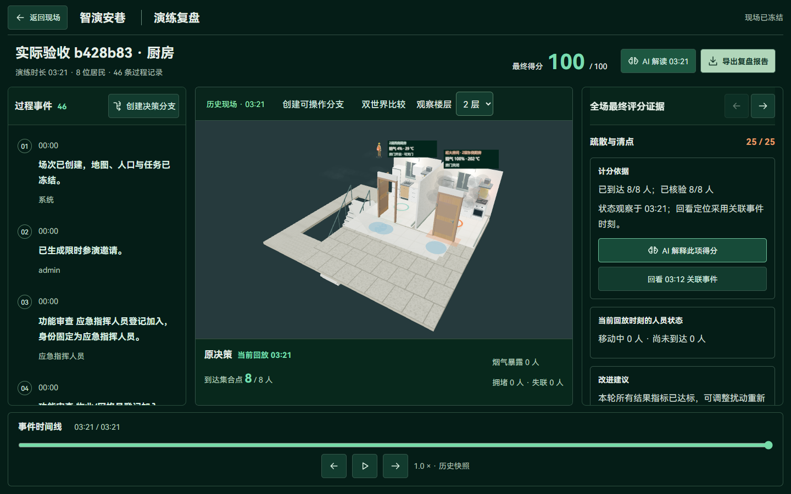
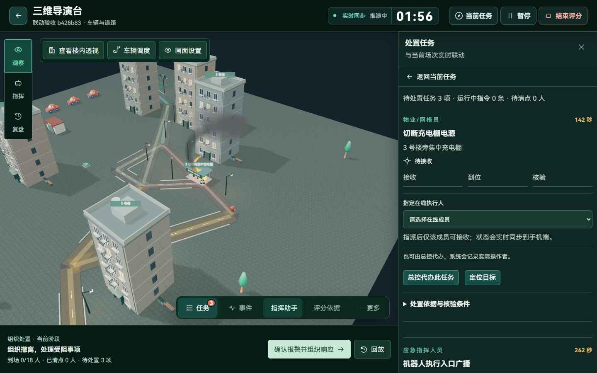
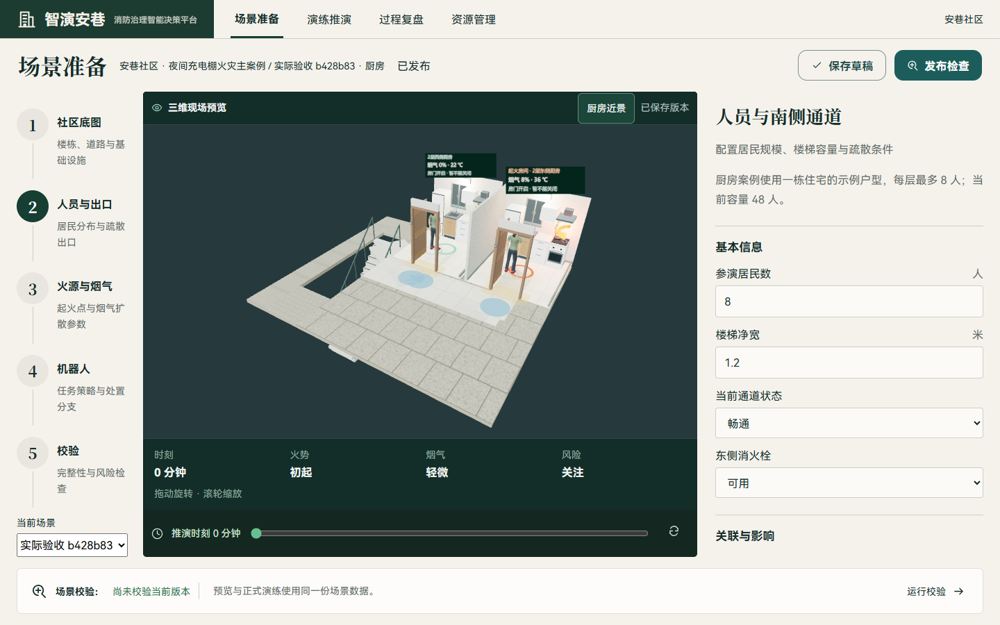
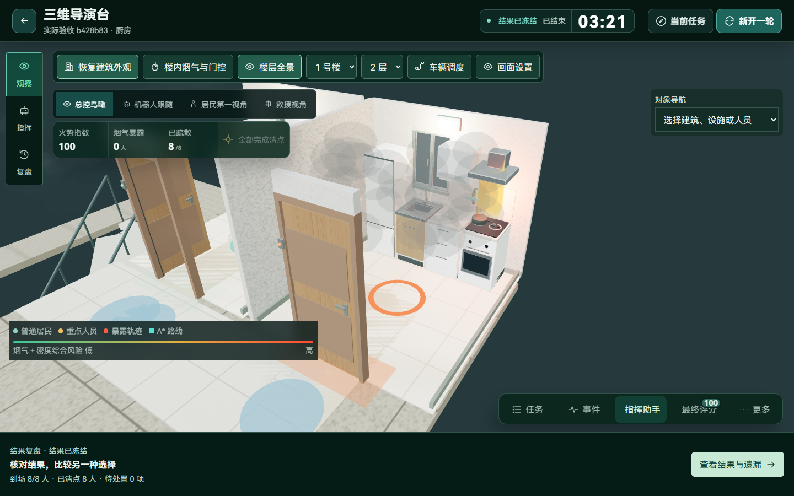

# b428b83 全流程验收与问题清单

日期：2026-11-04。检查对象为提交 `b428b838c4f2ca1151a79f1e84f154a756c9ac5d`。本轮运行验证并记录问题，没有修改业务规则、模型参数、评分或已有场次成绩。

## 实际决策结果

在独立 SQLite 数据库、8011/5181 服务上运行，主项目数据未参与验收。使用教学模式、4 倍速、真实服务时钟；使用本地确定性规划，没有调用外部问答模型、语音或 Embedding。脚本通过正式接口登记不同角色，在实际前置条件成立后提交模拟处置证据。

| 案例 | 最终得分 | 到场并清点 | 责任任务按时核验 | 智能体最终状态 | 结束时刻 | 实际运行耗时 |
| --- | ---: | ---: | ---: | --- | ---: | ---: |
| 充电棚 | 96/100 | 18/18 | 3/3 | completed | 02:51 | 46.6秒 |
| 厨房 | 100/100 | 8/8 | 4/4 | completed | 03:21 | 54.6秒 |

充电棚扣分来自4名居民烟气暴露，安全项16/20，其余项满分。首次越阈发生于约59.56秒，扣分回看定位60秒；实际回放59秒暴露人数为0，60秒为1，最终为4，证据时刻与模型结果一致。

厨房的燃气、广播、房门及护送核验分别完成于56、59、68、195秒。两场任务、集合人数、报告得分和智能体最终状态一致，没有复现此前正常关门导致后续广播停滞的问题。

上述成绩对应明确的疏散、护送和责任任务目标，核验脚本的操作及时性不等同于首次使用者的阅读和操作耗时。

场次编号：充电棚 `13c3800f-4eb2-420b-ab9e-fa4ef976f57b`，厨房 `ef43be92-ca5c-4d6e-95e7-c10b42c8d61b`。

## 优先修复的问题

### P1：复合目标可能遗漏子目标，却仍被接受为完整计划

复现目标：`组织全部居民疏散，并派消防车到火点连接水源喷水灭火`。

接口返回201，保存了完整目标文字，但生成的范围和完成条件只有居民到场、重点护送、清点及既有案例责任任务；候选没有车辆作业契约。对照请求中仅提出消防车喷水目标时，接口明确返回422，提示车辆仍需从车辆调度操作。两种输入对不支持能力的处理不一致。

代码依据：`backend/app/api/routes/agent.py:64` 仅检查是否包含疏散等关键词；`services/agent_planner.py:52` 解析建筑、出口和护送；`services/agent_workflow.py:94` 只构建已有疏散完成条件。复合目标中的灭火要求没有进入完成条件，也没有进入待澄清项。本轮只创建该边界方案，未批准执行，不能将它算作已完成的灭火计划。

建议先补完整目标契约及未识别子目标校验。批准前明确展示支持的目标和未覆盖部分；未接入车辆编排前，不静默接受“疏散+灭火”作为全部可执行目标。

### P2：车辆调度入口没有定位到实际控制区

点击三维工具栏“车辆调度”后，界面打开通用处置任务抽屉顶部。实际车辆控制区顶部位于约2014px，浏览器高度为900px；上方还有三项责任任务和护送人员区域。首次使用者看见的是断电任务，而不是车辆控制。

对应代码：`frontend/src/components/OperationsCenter.vue:177` 的 `openVehicleDispatch` 只设置车辆ID并打开 `missions`，未滚动或聚焦车辆区域。

滚动至控制区后，真实预览、确认、移动和到场均成功：消防车从(12,12)逐段行驶至(58,54)，采集到多组不同的中间位置，77秒时到场。进一步执行喷水后，规则化火势由100降至0，并完成服务回执。问题主要在入口和反馈定位，不是本场消防车不能移动。

建议车辆入口直接打开聚焦车辆的同一工作区，或自动滚动并聚焦车辆控制标题；确认指令后继续保留该区域与执行进度。

### P2：本地会话时间显示少8小时

在 `Asia/Shanghai` 浏览器中，当前时间18:01，接口返回的最近活动为 `2026-11-04T10:01:01.947685`，没有时区偏移；页面将其按本地时间解析，显示10:01，与实际相差8小时。

代码位置：`backend/app/api/routes/auth.py:255–257` 直接返回 SQLite 读取的时间；`frontend/src/components/AccountCenter.vue:24` 使用 `new Date(value)`。这次验证的是本地 SQLite 部署的展示问题，没有证明服务端会话过期判断错误，也未验证 PostgreSQL 的同类表现。

建议接口统一输出带UTC偏移的时间，浏览器按用户时区显示，并覆盖 SQLite 往返序列化。

### P2：已发布场景仍显示“尚未校验当前版本”

两场均实际执行校验通过、发布、冻结和运行；重新打开配置页后，顶部为“已发布”，底部却显示“尚未校验当前版本”。

`frontend/src/components/SceneWorkspace.vue:163` 在选择场景时清空本地校验结果，底部357行只根据这份本地状态生成提示，没有区分“已发布版本通过检查”和“本页尚未重新检查”。这不会阻止已冻结场次运行，但容易引导用户重复检查或误认为版本有问题。

建议返回发布版本对应的校验摘要和参数指纹；页面区分已发布检查、当前草稿检查、运行风险评估。

### P2：HTTP快照和持久化快照仍偏重

两条完整流程的244次正式API请求，累计响应约80.45MiB，中位响应190ms、P95为622ms，最慢方案批准约2.06秒。该流量包含验收脚本的轮询，不是浏览器增量WebSocket的流量。

两场完成、一个默认未启动场次时，数据库约20.33MiB；64条 `drill_state_snapshots` 占约19.76MiB。后续样本中，单条快照仍含约204KB空间拓扑，人员列表也重复携带较长路线。虽然已经去除 `simulation.world`，拓扑及路线等数据仍被重复保存。

对应位置：`backend/app/api/routes/operations.py:810` 的快照投影、933行的完整读取入口，以及 `backend/app/services/state_store.py:44–58`。每场最多保留120份快照已有上限，不应将问题描述为单场无限增长；仍需要控制每条快照体积和跨场次保留策略。

建议将静态空间与路线按冻结版本引用，运行快照保存动态游标；命令接口提供精简回执，按需补读完整状态。未执行大人口或多场并发压测，本轮不能给出生产容量结论。

### P2：满分没有表达剩余火情状态

厨房结束时得到100分，所有疏散与处置任务完成，但火势指数仍为100，近景仍能看到火焰；充电棚96分结束时火势为87.9。当前评分评价的是疏散、清点、任务核验与响应，不包含灭火目标。

因此这不是把分数计算错了，而是结果展示和训练目标应更明确：分别表达“疏散目标达成”“责任任务完成”“火情是否受控”。如果某轮明确要求灭火，再将已支持的车辆作业和火情条件纳入目标及完成判定；不要为提高分数而改写历史成绩。

### P3：少量操作文字仍低于当前字号基准

社区管理的“编辑资料、准备检查、编辑地图”等按钮约13px，数量和部分辅助说明为12px；使用说明页也有13px说明。主要导演台、助手和个人中心检查未发现同类关键小字。

应继续把操作文字统一到16px、辅助信息14px。此次34个页面状态没有发现横向溢出；浏览器命中检测中的隐藏跳转链接、关闭的details内容和滚动裁切不计为卡片重叠。

## 功能验收范围

| 链路 | 实际结果 |
| --- | --- |
| 两案例准备 | 选择合法火点、保存参数、预览、校验、发布、冻结成功 |
| 完整决策 | 告警确认、方案比较、批准、人员疏散、真实会合护送、机器人广播、责任核验、清点、结束评分成功 |
| 评分证据 | 充电棚首次暴露回放与最终扣分一致；最终报告与冻结分数一致 |
| 智能体异常修订 | 封锁北门，定位2名受影响居民；生成第3版方案，知识依据刷新，原命令编号保留；桌面和手机可查看 |
| 车辆 | 通过页面预览、确认，消防车实际移动到场；正式命令喷水，火势下降；未执行本轮完整伤员上车—转运—移交验收 |
| 手机端 | 真实登记，收到封路更新，断网重连后仍保留身份；两端均收到增量帧 |
| 历史分支 | 30秒分支与原回放位置一致，改派居民后推进至46秒，位置变化；原场次96分不变，比较接口可读 |
| 知识库 | 真实TXT提取、草稿、审核、发布、刷新、检索、固定引用、撤回；问答和计划均命中5条依据，无页面异常 |
| 个人中心 | 通过页面保存资料，刷新后恢复，测试后还原原资料 |
| 三维展示 | 厨房近景、楼内透视、画质切换可用；本轮未做全部居民路径的逐帧穿模检查 |
| 复盘导出 | 下载实际JSON文件并重新解析，含得分、证据、任务和训练信息；未验证PDF报告 |
| 页面 | 登录、首页、社区、历史、说明、个人资料、偏好、安全、知识、地图、两案例准备、导演台、两案例复盘及助手，共34个页面状态；涉及390、768、1366、1440宽度 |

同一提交的 GitHub Actions 已完成：后端266项通过，前端检查及构建通过。工作流编号 `41803247807`。它提供自动化规则回归证据，不能代替以上真实操作，也不能证明外部模型或真实语音质量。

## 下一轮建议顺序

1. 修复复合目标的能力校验，防止接受后遗漏子目标。
2. 让车辆入口直接定位控制区，确认后持续显示执行回执。
3. 修复UTC序列化和场景校验状态展示。
4. 将评分结果按训练目标与剩余火情分开展示。
5. 精简HTTP回执及快照中的静态拓扑、路线，并建立同一口径的容量基线。

原始结果位于本地忽略目录 `output/playwright/acceptance-b428b83-20261104/`，包含 `decisions.json`、各案例结果、`pages.json`、`requests.json`、`linked.json`、`final-checks.json`、`focused-findings.json`、`goal-boundary.json` 和原始截图。知识生命周期及异常修订的独立输出位于 `output/playwright/knowledge/`、`output/playwright/agent-revision/`。临时脚本和运行凭据没有写入本报告或公开仓库。
