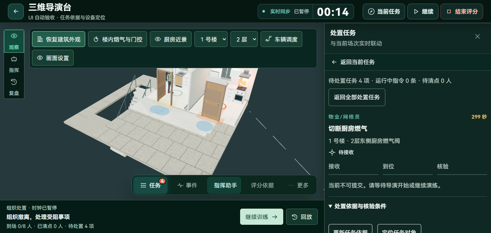
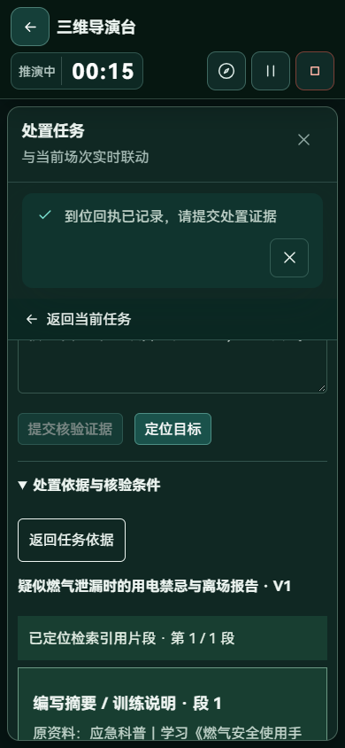
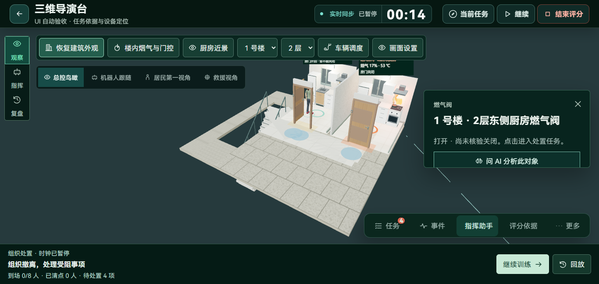

# 任务知识、核验条件与现场定位联动

本轮将已有智能体任务图、知识库和三维对象定位连在同一条操作链上。沿用组织者与参演者两个端、两个火灾案例、现有任务和评分规则，没有新增独立聊天窗口或自动代办处置。

## 用户现在可以完成什么

1. 打开指挥助手的“目标计划”，展开案例责任任务，选择某项任务。
2. 进入只显示该任务的抽屉，查看责任人、接收—到位—核验进度，以及服务端当前允许的下一步。
3. 展开“处置依据与核验条件”，核对火情触发、到位回执、运行条件和证据核验；查看该任务对应的知识检索结果。
4. 打开引用的原始版本和片段，返回后继续填写同一份证据草稿。
5. 点击定位，厨房燃气和房门任务切到冻结场景中的对应楼栋与楼层，并选择实际存在的设备或房门；室外目标恢复建筑外观后定位。
6. 继续通过原有任务入口接收、到位和提交证据。查询知识不改变任务完成状态或分数。

知识不是任务状态的替代品。资料保留文档、版本、片段、内容校验与适用范围；现场条件保留场次时刻和事件序号。状态或观察时间发生变化后，页面提示更新依据，不将旧查询当成实时结论。

## 功能与实现对应

| 功能 | 页面与入口 | 服务与数据 | 权限和执行语义 | 验证 |
| --- | --- | --- | --- | --- |
| 单任务直达 | 智能体案例任务→任务抽屉 | 传递真实 task_id，校验属于当前场次 | 仅组织者工作区；不会下达命令 | 浏览器确认只显示选中任务、助手不同时显示 |
| 核验条件 | TaskGuidance | POST `/drills/{id}/tasks/{task_id}/guidance`；读取权威快照 | 当前账号须拥有场次；非法字段拒绝 | 未登录401、外部账号404、其他任务404、非法动作422 |
| 任务知识检索 | 展开任务依据 | 固定任务类型查询，按社区、案例和资料发布权限检索 | 本入口使用本地关键词检索；不调用付费模型或 Embedding | 有真实命中；版本与片段可逐项核对 |
| 引用阅读 | 当前抽屉内阅读器 | 按 document_id、version_id、chunk_id 加载 | 保留原引用；不可访问或缺失明确报错 | 原文往返、草稿保留、网络失败与重试 |
| 设备定位 | 定位任务对象 | 冻结任务的 target_floor、target_device_id 与室内模型选择 | 不创建虚拟阀门，不移动居民或变更设备状态 | 实际厨房二层燃气阀选择、楼栋与楼层一致 |
| 模型规划上下文 | 现有 compare_candidates 工具 | 增加任务图中的责任任务、阻塞条件、核验与清点人工关口 | 模型仍只能推荐已校验方案 | 深复制与任务事实回归；本轮未调用外部模型 |

第一次从任务进入知识时，同步初始化缺少的内置资料。此前内置资料主要由知识列表入口初始化，可能导致直接进入任务时无资料可检索。查询只新增知识检索记录，不新增演练事件、领域命令或核验证据。

## 排版和交互修复

- 接收、到位、证据输入和提交按钮排在知识详情前，长资料不会将主要操作推到文末。
- 更新依据、定位和引用返回均有独立的44像素操作区域；正文16像素，辅助说明14像素。
- 浏览器发现到位成功提示覆盖手机引用返回按钮。任务抽屉内的成功和错误提示改为正常文档流，长消息具有独立滚动上限，避免遮挡证据和原文。
- 引用返回时恢复对应片段的展开和键盘焦点。请求可取消；切换场次或任务后丢弃旧请求回包；失败保留已读取状态和证据草稿。
- 历史回放不请求实时任务依据，继续使用回放任务及原计划引用。

## 实际验证

在独立 SQLite 数据库与8011/5181端口执行，没有向主运行数据写入验收任务。

| 检查 | 结果 |
| --- | --- |
| `python -m pytest tests/test_task_guidance.py tests/test_agent_tool_planning.py tests/test_knowledge.py -q -p no:cacheprovider` | 29项通过，包含查询无领域副作用、授权、固定引用、任务阶段及模型工具事实 |
| `npm test` | 63项通过，覆盖传输、实时版本、指令以及已有模型几何和资产规则 |
| `npm run build` | 类型检查及生产构建通过；Three.js引擎包仍约628KB（gzip约161KB），未宣称体积下降 |
| `node tests/task-guidance.e2e.mjs` | 实际创建、发布厨房场景并启动，等待自动巡检触发，建立四项责任任务计划；经页面接收和到位，读取依据与引用，草稿不丢失，断网重试有效；最后暂停保留记录 |
| 1366×650、768×1024、390×844、360×780 | 任务依据无横向溢出；顶部控制可见；主要依据按钮至少44px；实际查看桌面、手机和设备截图 |
| 手机回执遮挡回归 | 成功提示位于抽屉正常流，引用返回按钮不与提示相交 |

浏览器原始记录和截图位于忽略目录 `output/playwright/task-guidance-20261104/`，可通过上述脚本重新生成；脚本自行创建场景，不依赖旧验收输出文件。

## 使用与配置

无需数据库结构迁移，继续使用现有知识检索记录、任务和场次表。后端重启后启用新接口，前端重新构建部署即可。配置与启动方式沿用项目 README；无需为任务依据配置外部服务。

本轮没有重新跑完整疏散计分，没有改变评分参数，也没有更换厨房资产、修改通行图或碰撞几何。它补齐的是任务—知识—核验—实际模型对象的连接。外部大模型工具调用、真实语音质量、Embedding服务质量及大人口长场次性能未在本轮执行，不能由本轮结果推断。
