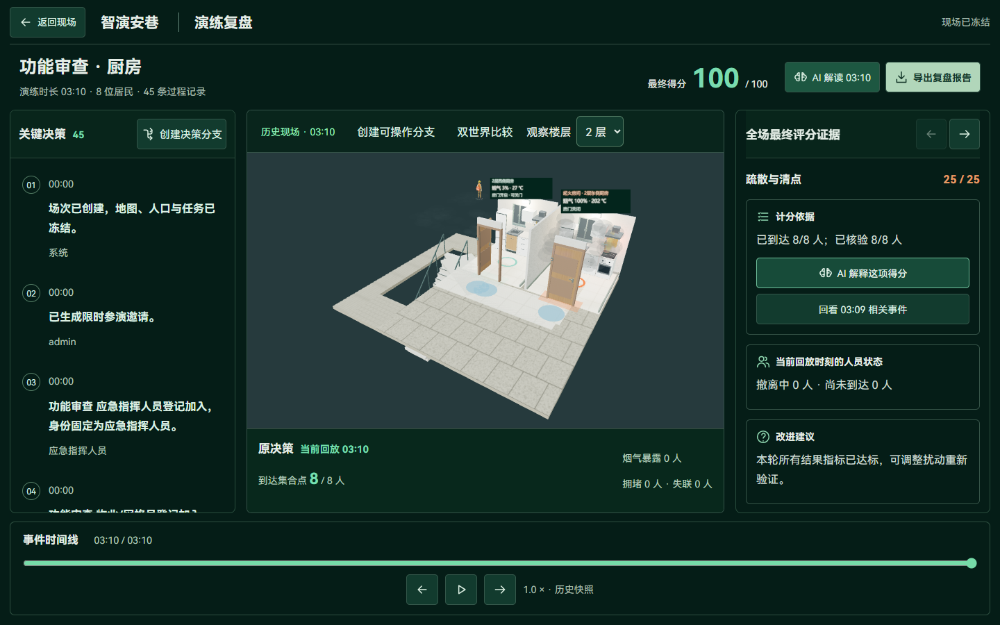
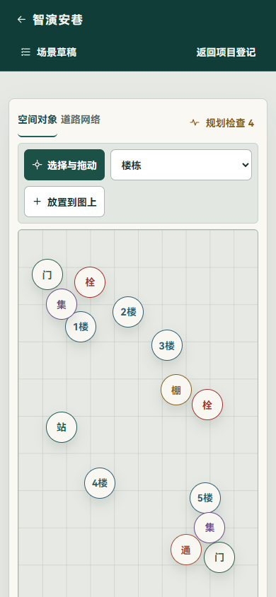

# 功能审查、真实演练与修复记录

日期：2026-11-04。基线为 `a99400b`，本轮增加剩余路径判定修复与一项回归用例。实际演练使用独立数据库 `tmp/function-audit-20261104.db`、后端 8011、前端 5181，未向主环境写入验收场次。

当前核心训练可以运行，但本轮确实发现了执行监督误暂停、评分证据定位及知识页面边界问题。下面区分已修复、仍存在和没有实际验证的内容。

## 真实决策结果

使用教学模式、4 倍速和服务端真实时钟，没有替换仿真时钟。采用与页面相同的 `include_case_tasks=true`，让责任任务与集合清点参与智能体完成条件；未配置模型参与本轮推荐。

| 场次 | 得分 | 到场/清点 | 责任任务 | 智能体结果 | 结束仿真时刻 |
| --- | ---: | ---: | --- | --- | ---: |
| 充电棚 | 96/100 | 18/18 | 3/3 按时核验 | completed | 168 秒 |
| 厨房，修复前 | 95/100 | 8/8 | 3/4，广播未核验 | unfinished | 602 秒 |
| 厨房，修复后新场复验 | 100/100 | 8/8 | 4/4 按时核验 | completed | 190 秒 |

厨房失败场次运行到验收上限后由脚本结束；系统没有自行宣称任务完成。修复后使用新场次重跑，旧场的 95 分和未完成记录保留。

充电棚扣分为“烟气与失联控制”16/20：4 人暴露超阈值，0 人失联，其余评分项满分。该结果来自本次实际条件和操作时序，不与 11 月 2 日不同场次作严格性能或评分回归比较。

两套案例都实际经过创建、火点配置、预览、校验、发布、冻结、后台推进、报警回执、方案批准、居民分流与护送、机器人移动、任务接收/到位/证据提交、清点、结束评分、历史回放与只读分支比较。处置证据由验收脚本按实际前置条件提交。

场次记录：

- 充电棚：`4092eedd-e517-4fea-8e6d-e9dfaa5c6489`。
- 厨房失败记录：`3e3ed568-842d-4bd7-b32c-30a19b019cec`。
- 厨房修复后：`fff97570-c9d0-4e05-99f9-68c61c9b4695`。

## 已修复：正常关门误暂停后续广播

厨房失败场次中，机器人已经到达楼门，居民也完成了撤离和清点，但广播步骤一直等待。计划历史显示：41 秒时，组织者完成起火房间撤空后的正常关门，被判定为“目标路线或门控任务涉及的房门已变化”，计划进入 `needs_review`，后续自动广播停止。

根因是两套相关性判断不一致：

- `agent_impact.py` 的页面影响分析已经裁去居民走过的路线。
- `agent_workflow.py` 的执行监督仍按原始完整路线判断变化。

本轮抽取 `remaining_resident_routes`，让执行监督与影响展示共用当前位置、当前边/节点和已选择候选的剩余路线。到场人员退出剩余路径判断；路径信息无法匹配时保留保守判断，不猜测已经通过。机器人未完成路线和计划中的门控目标继续参与复核。

这项修复不调整火势、烟气、人员速度、任务期限或评分规则。新增回归检查同时验证：已通过的房门不误停剩余行动，尚未通过的房门仍触发复核。

厨房新场复验中，燃气任务在 43 秒核验，房门与广播任务均在 44 秒核验，护送在 186 秒核验，190 秒结束并得到 100 分。

修改位置：`services/agent_impact.py`、`services/agent_workflow.py`、`services/agent_revision.py`、`tests/test_agent_revision_impact.py`。

## 仍需修改的具体问题

### P2：评分结果与证据定位时刻没有准确区分

本次充电棚最终有 4 人暴露，但该扣分项提供的 `at_seconds=20` 对应的是居民指令事件；实际回放到 20 秒，暴露人数为 0。

原因位于 `backend/app/services/scoring.py`：烟气、护送、效率等结果项复用了 `resident.command` 作为事件类型，并取该类最后一条事件的时刻。最终统计可用，但这个关联时刻不足以解释结果如何发生。

应分别记录关联命令、风险发生/越阈时刻和结果观察时刻，并让复盘定位具体人员与对应轨迹。旧场保留原始评分，明确原数据是关联指令时刻，避免重写历史。不能把所有扣分都改定位到结束时刻来代替原因追踪。

证据：本地 `score-evidence.json`，包含场次 ID、最终暴露数、关联时刻和该时刻的真实回放统计。

### P2：同一知识文档的无效版本导航没有提示

在知识中心打开一个有效版本后，通过页内路由将同一文档的 `version` 改为不存在的值，页面仍显示原版本，没有错误提示。直接完整刷新无效链接时则会正确报错，两条路径行为不一致。

位置：`frontend/src/components/KnowledgeCenter.vue:123`。路由监听只处理“文档变化”或“缓存中已有这个版本”；没有处理同文档无效/新版本的分支。

应统一调用版本解析逻辑；缓存中没有时重新读取，不存在时明确提示，不静默沿用旧版本。

### P2：用户资料链接也被标为“官方来源”

`frontend/src/components/KnowledgeEvidence.vue:19` 对所有包含 `source_url` 的资料统一显示“打开官方来源”。用户上传的社区预案、设备说明、复盘经验和参考链接也会走这条分支。

这是代码路径确认的问题。应依据类别与审核来源显示“官方资料来源”或“资料来源”，保持用户资料、平台说明和官方摘要的身份区别。

### 部分实现：场景问答没有语义检索的页面授权入口

后端 `ChatRequest.semantic_retrieval` 已实现，知识中心也有 Embedding 授权与检索开关；但 `SceneAssistant.vue:130` 的问答请求没有发送该字段，页面也没有相应选择。

因此，用户在场景对话中启用大模型后，资料检索仍使用默认关键词方式。应接入明确的语义服务状态和授权选择，失败时继续说明实际回退方式。当前不能将“支持可选 Embedding”理解为所有问答入口已经使用语义检索。

### P2：手机地图存在局部标记重叠

390px 下整体页面没有横向溢出，但北侧集合点与 1 号楼、南侧集合点与 5 号楼等标记仍局部重叠。DOM 点击包围框检查和截图均可定位，最大一组包围框交叠约 211 平方像素；其他较小的矩形交叠不等同于圆形可见区域全部重叠。

应保留真实对象坐标，通过标签偏移、聚合选择或重叠对象列表改善点击，不能为了排版修改模型位置。

### P3：地图辅助坐标仍偏小

`frontend/src/map-editor.css:117` 的坐标读数使用 `.7rem`，本次桌面实测为 11.2px。其余采样首屏未发现低于 12px 的普通 DOM 文字。三维画布中的文字不在这项 DOM 检查范围内。

## 功能—入口—接口—数据—权限—验证清单

运行实例枚举了 105 个 HTTP 操作。下面按业务模块列出实际核对范围，不将接口数量当成已逐条验收的数量。

| 模块/页面 | 主要接口与数据 | 权限边界 | 本轮状态与证据 |
| --- | --- | --- | --- |
| 登录、刷新 | `/auth/login`、`/auth/refresh`；账号会话 | 正式账号会话 | 真实登录、刷新恢复和失败恢复通过；不依赖 localStorage 令牌 |
| 首页、社区目录、说明 | `/communities`、场景/历史查询 | 组织者及社区归属 | 真实数据读取，桌面/手机首屏通过；首页 5 种宽度检查通过 |
| 地图编辑 | 地图对象、道路节点/边 | 社区归属 | 页面与现有数据展示已检查；本轮未逐项重做拖拽、连线和全部编辑 CRUD；发现标记重叠 |
| 场景准备 | `/scenes/{id}/parameters`、`preview`、`validate`、`publish`；SceneVersion | 场景所属社区 | 两案例实际保存、预览、发布、冻结；预览人数与正式场次一致 |
| 火点与室内 | `fire-sources`、冻结火源、分区/门状态 | 场景与场次归属 | 当前案例可选地址读取及单个合法火点实跑通过；没有逐栋运行全部候选 |
| 演练与移动 | 场次状态、统一命令、居民/机器人状态 | 组织者；服务端规则 | 两案例真实后台推进、分流、护送、到位与广播；修复一次误暂停 |
| 责任任务、清点 | 任务 actions、参演 actions；任务及回执事件 | 固定参演会话角色 | 修复后两案例所需任务完成；提前清点、冒用指挥角色和越权接任务分别拒绝 |
| 智能体计划 | `/agent/runs`、actions、资源归属、计划历史 | 计划账号、场次资源、人工批准 | 目标、候选、批准、真实回执和最终完成状态已验证；使用确定性推荐 |
| 手机与实时 | 邀请、参演会话、socket ticket、增量通道 | 有效邀请与绑定会话 | 真实道路封锁同步：导演 22 条、手机 4 条增量；手机断线后保留身份 |
| 知识与预案 | 文档、版本、审核/发布、检索快照 | 账号/社区、内置只读 | TXT 实际上传和独立进程提取、审核、发布、停用、刷新及版本引用通过；其他格式沿用既有检查，本轮未逐一再上传 |
| 语音与模型 | `/speech/status`、`transcribe`、问答与工具协议 | 账号、独立配置及授权 | 本地语音状态为已配置；本轮没有发送真实口述音频或调用外部模型，不能据状态接口判定识别质量 |
| 复盘、比较、导出 | `report`、`replay`、`branches/compare`；冻结得分与世界 | 原场次鉴权 | 报告与最终得分一致，回放和只读方案比较通过；发现风险定位时刻问题。创建分支后完整重跑、报告下载文件未在本轮逐项操作 |
| 个人中心 | `/account/profile`、历史筛选；偏好修订 | 当前账号、修订冲突检查 | 实际保存、刷新恢复、保存失败保持输入、未保存导航保护和历史筛选通过 |
| 消防车、救护车 | 车辆预演、派遣与作业状态 | 场次归属、路径与动作前置条件 | 代码入口及既有验证记录已核对；本轮双案例未额外派车，不将机器人移动当成车辆验证 |

## 页面和基础授权检查

检查了首页、历史、知识、社区、使用说明、个人中心、地图、场景准备和已结束导演台的 1440×900 / 390×844 首屏，并打开真实复盘工作区。登录/首页脚本另覆盖 360、390、768、1024、1440px；个人中心脚本覆盖桌面、平板和手机。

采样页面没有横向溢出、越出视窗的表单按钮、页面运行异常或 API 5xx。该结论不等于验证了每个弹窗组合；主要可见问题是地图局部标记与辅助文字。

基础授权实际返回：

| 操作 | 返回 |
| --- | ---: |
| 匿名读个人资料、社区、知识目录、演练状态 | 均 401 |
| 停用内置知识 | 403 |
| 居民会话冒充指挥角色 | 403 |
| 居民接收物业任务 | 403 |
| 未到集合点提前清点 | 409 |

这里验证的是上述访问与业务前置条件，不是网络渗透或完整依赖安全审计。

## 检查命令和原始证据

- 本轮修复回归：`python -m pytest tests/test_agent_revision_impact.py tests/test_agent_workflow.py tests/test_agent_recovery.py -q --tb=line -p no:cacheprovider`，21 项通过。
- 真实浏览器：`entry-pages.e2e.mjs`、`knowledge-workflow.e2e.mjs`、`realtime-flow.e2e.mjs`、`account-layout.e2e.mjs`，均完成本轮检查。
- 双案例：本地 `tmp/function-audit-20261104.mjs`；最终验收带 `include_case_tasks=true`。最初的兼容 API 预查单独保留，未用它代替完整任务契约。
- 页面与异常路径：本地 `tmp/function-pages-20261104.mjs`、`tmp/function-edges-20261104.mjs`，以及评分证据回放核对脚本。
- `git diff --check` 通过。
- 11 月 3 日已执行的 246 项后端、62 项前端与生产构建是基线记录；本轮未重复全量，也没有把这组旧结果当成新增修复后的全量通过。

原始材料在 `output/playwright/function-audit-20261104/`：`decisions.json` 保留失败场次，`score-evidence.json` 保留风险定位核对，`pages.json`、`edges.json` 保留页面和授权采样。修复后材料在 `output/playwright/function-audit-20261104-fixed/decisions.json`；回归结果在 `output/function-audit-fix-tests.log`。

## 下一步顺序

1. 修正评分证据的发生/观察时刻和人员关联，让扣分能定位真实风险。
2. 统一知识版本导航、资料来源标签和语义检索授权入口。
3. 处理手机地图标记聚合与坐标字号。
4. 为知识召回、真实模型推荐、语音识别建立固定样例和实际服务验证；再测长场次、大人口与网络波动。

当前室内/室外状态、任务与人员移动能支撑这次训练。精细人物姿态、车辆作业全链、所有楼栋的几何净空以及大规模联动仍需各自的针对性验收，不能由这两场成绩推断已经覆盖。
