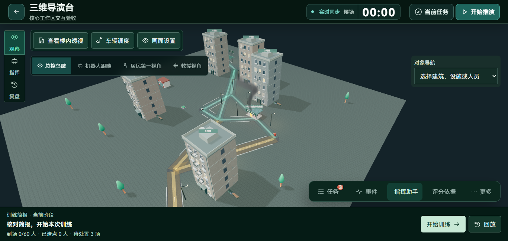
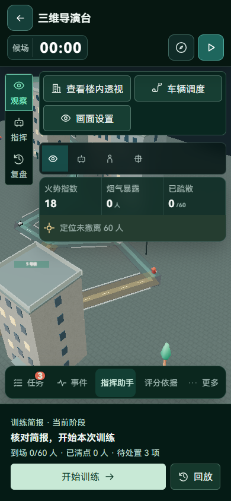
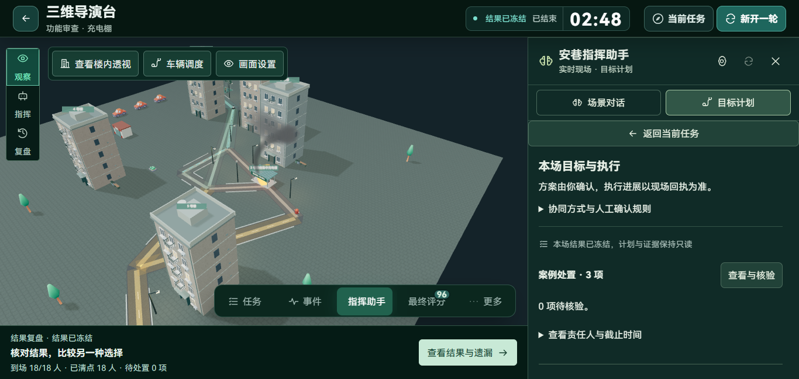
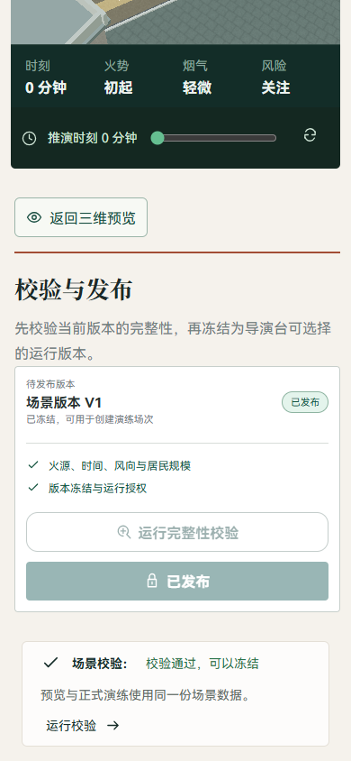

# 核心页面与操作呈现优化

本轮检查首页、场景准备、三维导演台、智能体计划和复盘。初始浏览器覆盖 1440×900、1366×650、390×844 的 15 个页面状态；代码与交互检查确认以下问题，而非仅按页面外观判断功能。

## 问题与修改

| 问题 | 实际原因 | 修改 |
| --- | --- | --- |
| 收起任务后，不清楚当前阶段与下一步 | 训练引导主要在抽屉，底部默认展示过程日志和时间轴 | 新增 `DirectorProgress.vue`，复用底部保留区域，显示服务端阶段、到场、清点、待处置与当前动作；点击动作调用原统一命令与导航服务 |
| 任务数量不明显 | 导演台皮肤把任务徽标与分数徽标一起隐藏 | 仅恢复任务数量和冻结后的最终分数，保留 14px 辅助信息和 44px 操作区域 |
| 早期低分易被理解为最终表现 | 运行中的评分入口缺少语义区分 | 运行中称“评分依据”，冻结后称“最终评分”，未结束时不展示最终分数徽标 |
| 手机选择配置步骤后看不到变化 | 单列布局中参数区位于三维预览下方，原操作只改状态 | 手机上选择步骤后聚焦并滚动到配置参数；提供“返回三维预览”，保留未保存检查 |
| 准备页按钮动作名过度承诺 | “冻结场景”按钮实际只打开校验步骤 | 改为“发布检查”，不声称点击即已发布或创建场次 |
| 已完成计划被新表单遮住 | `canCreate` 将 completed 等终态自动视为应展开新目标 | 先展示原目标和执行；主动选择后才展开新目标；结束场次不展示不可执行的输入表单 |
| 智能体方法介绍占据首屏 | 完整编排说明始终展开 | 保留一句确认与回执说明，完整方法与人工权限规则按需展开 |
| 短屏复盘中场景偏小、平板三列过窄 | 固定头尾辅助区和三列布局占用高度与宽度 | 短屏压缩头尾间距与辅助内容；761–1100px 改为场景优先的单列滚动，保留全部事件和证据 |
| 把全部日志称为关键决策 | 事件列表包含建场、加入、登记等系统记录 | 改称“过程事件”；可操作决策分支保留原入口 |
| 首页满分结果也被称作遗留问题 | 复盘入口使用统一文案；历史接口的明细是精简空列表 | 依据真实总分及可用明细区分“核对上次训练失分”和“查看上次训练结果”，同时显示对应场次与成绩 |

首页进入未完成训练的动作改为“进入现场 · 查看当前任务”，明确只是进入，不会擅自恢复暂停时钟。

## 实际操作验证

`frontend/tests/core-workspace.e2e.mjs` 使用隔离 API 和数据库，建立新场次并操作生产组件：

1. 收起默认任务抽屉，检查底部阶段、人数、任务徽标与评分入口。
2. 从阶段摘要打开当前任务，再进入助手。
3. 点击“开始训练”，通过 `/commands` 的 `state` 命令收到真实回执；暂停后底部显示“继续训练”，点击后服务端状态确为 running。
4. 暂停、打开结束确认、确认结束；服务端冻结评分，页面进入复盘；返回现场后展示最终评分和结果入口。
5. 检查首页进入准备页、打开发布检查；手机自动定位参数区并可回到三维预览。

本次专门提前结束场次验证状态转换，得到 25 分；未组织居民疏散，不是完整决策成绩，也未更改评分规则。此前 96 分的完整充电棚记录属于前轮验收，本轮没有重新执行全套疏散决策。

| 检查 | 结果 |
| --- | --- |
| 前端 `npm test` | 63 项通过 |
| `npm run build` | 类型检查与生产构建通过 |
| 核心工作区真实浏览器 | 15 个页面状态通过；开始、暂停、继续、结束均经服务端回执；无页面脚本异常或横向溢出 |
| 复盘尺寸 | 1440×900、1366×650、1024×768、768×1024、390×844；验收中的三维视口高度均不低于 200px |
| 已完成智能体计划 | 1366×650、390×844 核对已有真实完成记录；显示完成结果，不出现新目标表单 |
| 发布检查与手机定位 | 点击步骤后对应参数处于视口内，返回预览有效 |
| 界面规则扫描 | 本轮扫描的触及组件未报告问题 |

本轮只修改前端展示、导航和复用命令入口，未改动后端仿真、任务核验、评分算法或模型资产，因此未重复后端全量测试。

原始材料：本地 `output/playwright/core-pages-20261104/audit.json`、`output/playwright/core-workspace-20261104/result.json`、`agent-result.json`；前端检查与构建日志在 `output/core-pages-tests.log`、`output/core-pages-build.log`。

## 代表页面

## 仍需继续处理

1. **演练数据标识**：首页和历史过滤仍依赖部分场次命名规则，新的验收名称可能漏入列表。应引入显式数据用途标识与归档流程，不按名称批量删除用户记录。
2. **复盘组织**：目前过程事件仍逐条展示，下一阶段应按“决策—受影响对象—执行—核验—结果”组织可追踪的处置链，同时保留原事件列表。
3. **手机现场密度**：三维视角、设备工具和风险信息虽未发现本轮重叠，但占用的模型可视区域仍较多，可继续合并常驻工具并验证触达效率。
4. **异步装载**：首次加载与已加载状态需要持续分别检查；本轮初始截图中出现过正常加载状态，不能用加载截图推断功能缺失，也不能据稳定页面推断弱网性能已达标。

部署只需重新构建前端。开发服务会自动更新，不需要数据库迁移或重启仿真服务。
