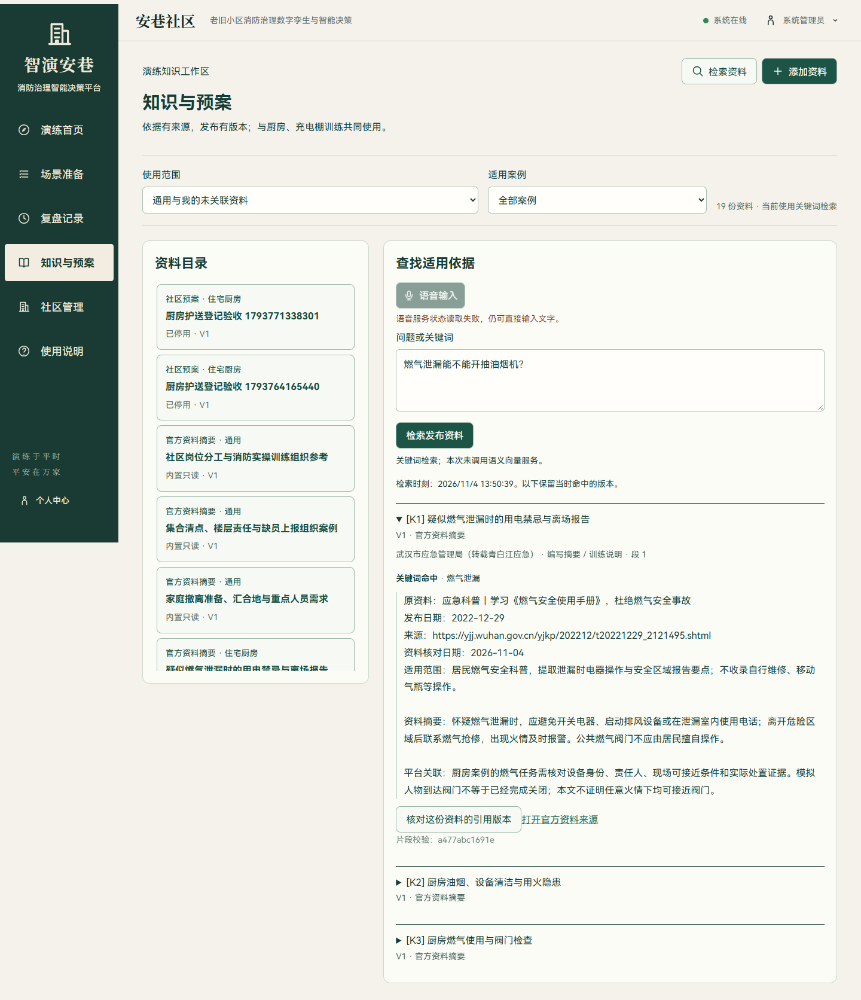
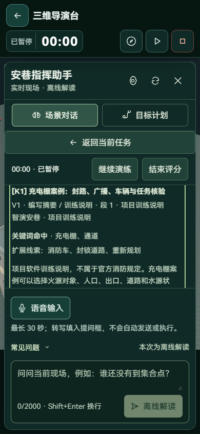

# 检索质量与任务入口优化

本轮继续改进既有 16 份资料库及问答工作区。主要问题是：扩展词和原问题同权排序，长问题的偶然词片段也会返回资料；默认当前任务抽屉打开时，用户需要关闭它才能发现助手；引用匹配信息位于长正文之后。

## 实际修改

1. 将词项处理和排序抽到 `backend/app/services/knowledge_ranking.py`，权限、发布状态、有效期和版本快照仍由原知识服务处理。
2. 原问题词权重为 1，自动扩展为 0.2；操作类问题适度优先平台操作说明，保留官方资料参与排序。移除常见问句用语，长问题不凭一个偶然词片段返回结果；短精确词、已知说法归一化和已支持的语义召回仍可使用。
3. “煤气”“烟雾”“电动车”“残障”等说法按明确词表归一化。没有足够匹配时返回空列表和补充具体事项的提示，不伪造资料。
4. 每个命中保存检索方式、匹配短语、扩展线索和排序版本 `lexical-v2`；与版本、片段校验值一起保存在原检索快照，历史记录不补写。
5. 知识工作区与场景对话共用 `KnowledgeMatch.vue`。相邻匹配片段合并为“燃气泄漏”等可读短语，引用先显示资料类别、版本及线索，再显示正文。没有将词项分数转换成正确率或安全置信度。
6. 当前任务新增“询问当前任务与依据”，切换到已有助手并根据案例和阶段准备问题。保留已有草稿，不自动请求模型、不自动执行命令；用户仍需编辑和发送。

## 固定问题集的前后结果

问题集位于 `backend/evaluation/knowledge_cases.json`，在改排序前固定，共 16 个相关问题和 6 个无关/信息不足问题。参考目标由实际资料内容标注；语义服务关闭，只检索内置资料，在新建内存数据库运行。

| 指标 | 修改前 | 修改后 |
| --- | --- | --- |
| 相关问题前三条命中目标资料 | 15 / 16 | 16 / 16 |
| 前五条平均倒数排名 | 0.9531 | 1.0000 |
| 无关问题返回空列表 | 3 / 6 | 6 / 6 |
| 本地检索中位耗时 | 2.704 ms | 3.158 ms |

原版本会为护照办理、餐厅推荐、量子纠错问题误返回资料；修改后在本样例中不再返回。“充电棚通道堵了怎么改道”的平台操作说明从第 4 条提升至第 1 条。新增词项核对有计算开销，单次内存采样没有显示加速，不将这组耗时解释为线上性能结论。

这是开发用小样例回归，不是独立泛化评测或真实 Embedding 质量测试。更大规模资料、复合跨领域问题与长文档需继续扩充样例。

完整逐题前后结果及语料/问题集校验值保存在 [质量记录 JSON](../backend/evaluation/results/2026-11-04-knowledge-quality.json)。重新运行当前版本：

```powershell
cd backend
.venv/Scripts/python.exe -m app.evaluation.knowledge --output ../output/knowledge-quality.json
```

该入口仅新建内存数据库，不连接运行数据库，不调用外部模型或向量服务。

## 页面与业务验证

| 检查 | 实际结果 |
| --- | --- |
| `pytest tests/test_knowledge.py tests/test_agent_tool_planning.py tests/test_knowledge_experience.py -q --tb=short -p no:cacheprovider` | 23 项通过，包含权限、版本固定、语义接口替身与失败回退、工具规划、经验适用性 |
| `pytest tests/test_knowledge_quality.py -q --tb=short -p no:cacheprovider` | 3 项通过，固定问题集、常见说法、匹配快照与可读短语 |
| `npm run build` | 类型检查和生产构建通过 |
| `node tests/knowledge-quality.e2e.mjs` | 1440×900 / 390×844 实际页面：检索、无匹配、当前任务直达、可编辑预填、引用定位和线索显示通过；未自动发送，未调用模型或 Embedding，无页面异常和横向溢出 |
| `node tests/knowledge-workflow.e2e.mjs` | 真实 TXT 提取、审核、发布、停用、历史引用和问答/计划知识接入通过 |

浏览器脚本在隔离 API 8011、前端 5181 与验收账号下执行。它们会准备隔离示例和测试资料，不应指向生产环境。语义故障用测试替身验证协议；真实语义质量未执行。

本轮未重新跑完整演练评分，也未改动运动、剂量、评分或模型资产；上一轮充电棚 96 分是历史验收记录，不能冒充本轮新结果。后端本轮只执行上述针对性 26 项，没有重复全量套件。

原始浏览器材料在本地 `output/playwright/rag-quality-20261104/`；构建日志为 `output/rag-quality-build.log`，界面规则扫描未报告触及组件的异常。正文 16px、匹配线索 14px，继续使用单工作区和内部滚动。





部署不需要数据库结构迁移：重新构建前端并重启后端即可；已有检索和已结束场次保持原始快照。
