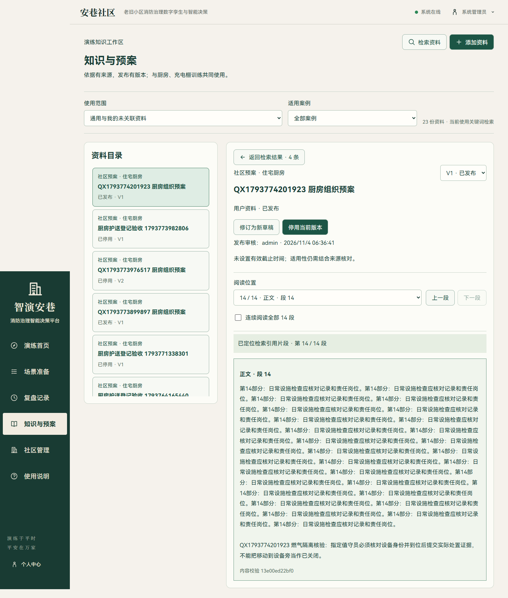
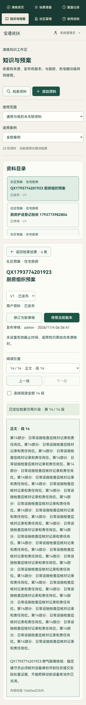

# 长资料检索与片段定位

本轮将资料检索后的核对过程从“打开整份版本、人工翻找”改为“打开指定版本的具体片段”。同时修正新资料固定字数切分可能截断句子的情况，保留现有版本与历史证据。

## 具体行为

| 功能 | 本轮实现 |
| --- | --- |
| 新版本切分 | 每段最多 700 字，优先段落边界，再选句末或换行；连续无标点长文本按上限切分 |
| 历史兼容 | 切分只发生在新建资料或新建版本时；不重建已发布片段、不修改历史校验值 |
| 来源定位 | 知识检索、场景对话和目标计划传递 `document_id`、`version_id`、`chunk_id` |
| 版本阅读器 | 阅读位置选择、上一段、下一段、连续阅读；默认只渲染当前片段，显示来源锚点与校验值 |
| 返回检索 | 保留问题、筛选范围和原检索结果，重新展开原引用，不重新发送检索请求 |
| 刷新与链接 | 地址保存文档、版本和片段；旧版引用在新版发布后仍指向原版 |
| 错误处理 | 版本不存在或片段不属于该版本时清空旧正文并报错，不回退为另一个片段 |
| 手动切换版本 | 更新链接并清除旧引用标记，新版本不会被标成旧引用 |

PDF 页码和提取段落锚点沿用原资料。若单句本身超过 700 字仍需分段；跨句或跨章节的论证仍需要连续阅读，不能仅凭一个命中片段推断完整预案。

## 代码边界

- `knowledge_ingestion.py` 只负责新版本的文本切分。原始提取页、版本校验值、既有片段与检索快照不改写。
- `KnowledgeReader.vue` 从知识中心抽出正文展示与段落导航，替代原来的整页片段列表；连续阅读仍可查看全部内容。
- `KnowledgeCenter.vue` 校验文档—版本—片段归属，保留检索返回状态，维护固定引用地址。
- `KnowledgeEvidence.vue`、`AgentPlanWorkspace.vue`、`SceneAssistant.vue`、`OperationsCenter.vue` 贯通片段编号，复用原工作区，不增加独立窗口。
- 场景问答返回的知识来源包含片段编号；仍由原鉴权与资料权限接口读取正文。

## 实际验证

| 检查 | 结果 |
| --- | --- |
| `pytest tests/test_knowledge_long_documents.py tests/test_knowledge.py tests/test_knowledge_quality.py -q --tb=short -p no:cacheprovider` | 19 项通过；包含跨旧窗口的完整句、无标点上限、PDF 页锚、长文后部召回、历史片段及检索快照保持 |
| 补验助手来源字段 | `test_assistant_uses_scenario_knowledge_and_keeps_drill_state` 通过，返回片段编号与本次检索一致 |
| `npm run build` | 类型检查及生产构建通过 |
| `knowledge-reader.e2e.mjs` | 真实隔离 API 创建并发布 14 段长资料；桌面 1440×900、手机 390×844 的引用定位、段落切换、连续阅读、返回原检索通过；新版发布后旧链接刷新正常，错误版本/片段组合被拒绝 |
| `knowledge-workflow.e2e.mjs` | TXT 提取、审核发布、检索、停用、历史引用与计划/问答知识接入通过 |
| `knowledge-quality.e2e.mjs` | 当前任务进入助手、引用资料匹配以及助手来源跳转到准确版本/片段通过，两种尺寸无页面异常 |
| 固定 22 题本地评测 | 16 个相关问题前三条命中 16/16；6 个无关问题返回空列表 6/6；语义服务关闭 |

长资料浏览器样例是专门构造的重复文本与后部核验条目，用于验证定位和版本行为，不是实际社区预案。验证服务为隔离端口 8011/5181，不修改运行中的正式业务记录。

没有重复全量后端套件、完整演练得分、实际模型或 Embedding 质量测试。原始浏览器材料在本地 `output/playwright/knowledge-reader-20261104/`，构建日志为 `output/knowledge-reader-build.log`；本地固定问题集结果为 `output/knowledge-reader-evaluation-20261104.json`。

## 使用方式

1. 在“知识与预案”上传或修订资料，完成审核发布。
2. 检索后展开一条结果，选择“定位这份资料的引用片段”。
3. 在阅读器核对锚点、正文与校验值；按需查看前后段或连续阅读。
4. 点击“返回检索结果”继续原问题；也可保留当前地址作为固定版本引用。

部署只需更新前端并重启后端，无数据库结构迁移。已有长资料若希望采用新的切分方式，应创建新版本审核发布；历史引用继续保留。
