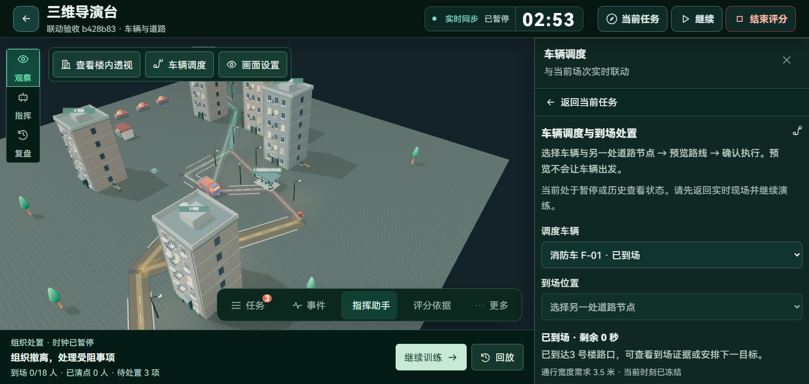
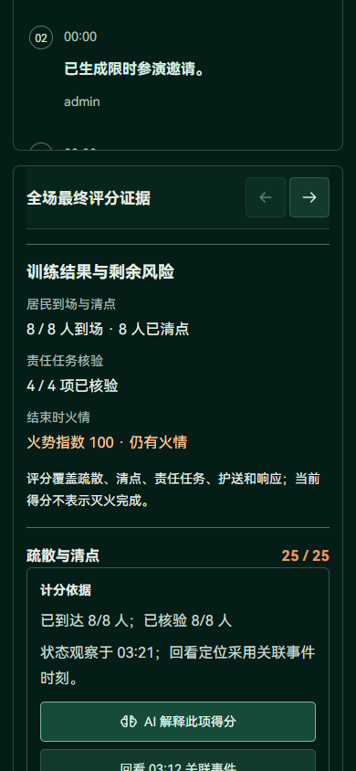

# 验收问题修复与快照压缩

针对 [b428b83 验收清单](2026-11-04-b428b83-全流程验收与问题清单.md) 的七项问题完成代码修复，保留原96分与100分场次及其冻结证据。本轮没有修改评分公式、火势规则或人物移动参数。

## 修复结果

| 问题 | 实现 | 实际验证 |
| --- | --- | --- |
| 复合目标遗漏灭火要求 | 创建前校验车辆、喷水灭火、转运等未支持的自动动作；批准与重算共用校验；旧待批准计划展示阻塞原因并禁止批准 | 新混合目标返回422，不调用模型、不推进时钟或写入命令；旧混合目标批准被拒绝。否定动作及“灭火器旁居民”等上下文回归通过 |
| 车辆入口藏在任务列表后 | 车辆使用独立工作区，保留选中车辆、行程和到场处置；入口滚动到顶部并将键盘焦点交给车辆标题；可返回全部任务 | 控制区域顶部从约2014px移到约220px；通过页面确认后消防车逐段移动到场 |
| 会话时间少8小时 | 接口将SQLite读取的时间明确转换为带UTC偏移的输出 | Asia/Shanghai浏览器正确转换显示，不再出现8小时偏差 |
| 已发布与未校验提示矛盾 | 预览返回本次真实校验结果及版本号；保存版本预览成功后恢复检查状态；隔离未保存参数与过期请求 | 桌面与手机刷新后均显示“已发布版本校验通过”；切换场景的旧响应不能覆盖新版本 |
| 快照体积偏大 | 派生快照采用有版本标识的无损压缩，兼容旧JSON；损坏缓存返回未命中并重建；HTTP启用标准GZip | 快照读取、重启检查点恢复、实时重连通过；115份旧快照压缩及成绩/事件校验通过 |
| 满分被理解为灭火完成 | 复盘分别显示到场清点、责任核验及结束时火情；结束确认明确提示剩余火势和评分范围 | 厨房旧成绩仍为100分，同时明确显示“火势指数100·仍有火情”和“得分不表示灭火完成” |
| 少量操作字过小 | 清除共享按钮/链接13px的强制样式，统一社区操作字号；调整数量、版本、日期及说明文字 | 桌面与手机社区操作按钮均至少16px，辅助信息按14px基准展示 |

车辆仍由组织者在已有工具中预览和批准，本轮修复的是目标承诺与执行能力不一致，没有将其描述成已交付车辆智能体自动编排。





## 快照与传输数据

隔离验收库的115份旧派生快照，按相同JSON序列化口径计算：

| 项目 | 修改前 | 修改后 | 变化 |
| --- | ---: | ---: | ---: |
| 快照逻辑存储 | 34,153,153字节 | 4,480,621字节 | 减少约86.9% |
| 同一场次HTTP状态响应正文 | 297,640字节 | 38,026字节 | 减少约87.2% |

快照解码保留原拓扑、人员路径及检查点，不依靠当前版本重新猜测历史空间。压缩前后成绩表、事件表的校验值一致。HTTP比较中的演练状态、人物、命令、任务、事件及成绩一致；独立在线心跳时间随请求自然更新。

上述数据是该验收库和单个响应的实测，不代表大人口或多场并发性能。SQLite已分配的数据库文件空间通常需要维护后才能归还文件系统；逻辑体积下降不等于文件立即同比缩小。

## 兼容、升级和回滚

无需数据库表结构迁移。更新并重启所有后端实例后，新快照自动使用压缩格式，旧JSON仍可读取。浏览器、HTTP客户端透明解压GZip，WebSocket协议保持不变。

旧快照可在维护窗口通过显式命令整理。命令读取当前环境的数据库配置，默认只估算，不写入；不要对错数据库执行维护。

```powershell
# 在backend目录，先核对数据库配置
.\.venv\Scripts\python.exe -m app.maintenance.compact_snapshots

# 以最多50条为一批写入派生快照
.\.venv\Scripts\python.exe -m app.maintenance.compact_snapshots --apply --batch-size 50

# 回退到不支持压缩格式的旧服务前，还原为旧JSON
.\.venv\Scripts\python.exe -m app.maintenance.compact_snapshots --restore-json --apply
```

本轮已对独立验收库执行整理，主项目历史快照保持兼容读取，未批量改写主库。整理不删除演练事件、成绩和任务，不自动执行VACUUM；有损或无法识别的缓存不被强行转换。

## 执行的检查

- 后端修复、增量模型、持久化恢复、实时命令、工具规划和训练流程共42项通过。
- 快照还原旧JSON的回滚检查另外执行1项，通过。
- 前端63项检查通过，类型检查和生产构建通过。
- 实际浏览器确认1366×650与390×844下的场景检查、车辆工作区、复盘结果和社区页面，共8个页面状态，无横向溢出或页面脚本异常。
- 新车辆流程实际经过登记参演、页面预览与确认、车辆逐段到场、封路和恢复、手机断线重连、历史分支创建；收到导演端21帧和手机端33帧增量更新。
- 旧96/100分场次及评分证据逐项保持一致；本轮没有再次计算两场完整训练的最终成绩。

关键检查命令：

```powershell
# backend
.\.venv\Scripts\python.exe -m pytest tests/test_acceptance_repairs.py tests/test_incremental_world.py tests/test_realtime_commands.py tests/test_agent_tool_planning.py tests/test_training_journey.py -q -p no:cacheprovider

# frontend
npm test
npm run build
```

原始浏览器结果和截图位于本地忽略目录 `output/playwright/repairs-b428b83-20261104/`；检查输出位于 `output/fix-findings-backend-final.log`、`output/fix-rollback-test.log`、`output/fix-findings-frontend.log`、`output/fix-findings-build-final.log`。未调用外部模型、真实语音或Embedding，也未执行生产容量压测。
