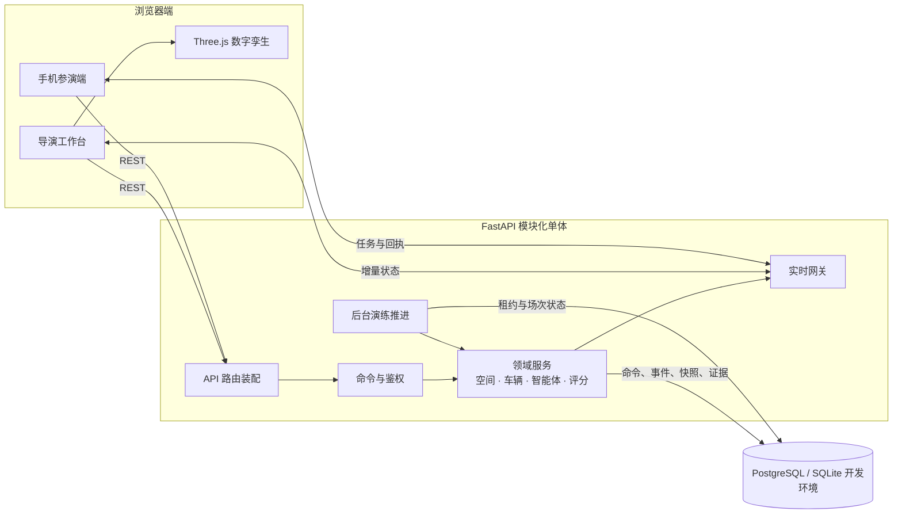
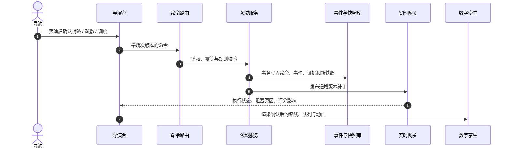
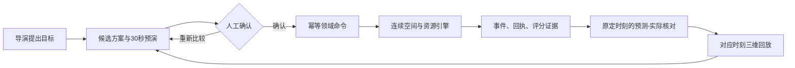

# 系统架构

## 架构定位

智演安巷采用 **模块化单体**。社区地图、演练状态、空间仿真、智能体执行、实时推送与评分证据共享同一个强一致的演练事务边界；在当前竞赛与教学部署规模下，拆成微服务会增加跨服务状态同步与排障成本，而不会提升可用性。

模块化不等于大文件堆叠：HTTP 路由、领域服务、持久化模型、前端领域类型与 Three.js 表现层各自独立，新增功能必须沿既定数据流进入系统。

## 代码边界

| 目录 | 责任 | 不应承担 |
| --- | --- | --- |
| `backend/app/api` | HTTP/WebSocket 入口、身份、请求校验和响应映射 | 仿真、评分或寻路规则 |
| `backend/app/services` | 演练推进、空间路径、环境、车辆、智能体、实时状态 | Vue 或 HTTP 表现细节 |
| `backend/app/models` | 持久化实体及约束 | API 输入输出结构 |
| `backend/app/schemas` | Pydantic 请求、响应与命令契约 | 数据库会话操作 |
| `frontend/src/domain` | 跨页面领域类型和纯转换函数 | DOM 或网络副作用 |
| `frontend/src/api` | REST、WebSocket、重连和版本同步 | 页面排版与业务展示 |
| `frontend/src/components` | 页面与可组合交互 | 服务端权威状态的自行推断 |
| `frontend/src/three` | 场景、材质、模型、动画与视觉降级 | 命令提交或演练规则 |

## 一次指令的权威链路

页面不得跳过预演直接把本地结果当成完成；Three.js 也不能为“显得流畅”而让人员穿墙、提前到达或伪造任务完成。

## 运行时组成

- `app.api.router`：唯一的 API 路由装配点。
- `app.core.lifespan`：初始化表结构并托管演练调度、智能体监督任务；测试时不启动后台循环。
- `engine_scheduler`：通过数据库租约推进运行中的场次，浏览器关闭不会停止演练。
- `agent_workflow`：提出和监督目标计划；领域命令仍需经过人工确认与服务端校验。
- `agent_allocation`：在冻结路网中计算路径优先与风险容量分流候选，不直接写入演练状态。
- `agent_execution`、`agent_resources`：把已批准计划映射为可观察的执行步骤、值守资源和机器人任务回执。
- `agent_outcomes`：按批准时冻结的人群、指标和观察时刻进行一次性结果核对；停止、完成或人工让权后仍保留观察。
- `agent_realtime`：为导演账号生成私有的目标计划投影，不向手机参演端广播管理计划。
- `realtime`：使用状态版本、实体补丁和追赶机制同步，不信任浏览器本地状态。

## 智能体计划闭环

计划候选、人工确认、命令执行和结果观察具有不同职责。计划未确认不写入现场；结果核对只读取服务端权威历史状态，不反向修改人员、任务或得分。

## 渐进重构计划

当前最需要持续收束的是少数历史兼容路径：`agent_workflow` 与 `engine_scheduler` 仍会调用 `operations` 中已验证的命令处理函数。后续按以下顺序迁移，避免复制规则：

1. 从 `operations` 提取无 HTTP 依赖的演练命令应用服务。
2. 让路由与后台调度共同调用该应用服务，并保留现有幂等、事件与测试。
3. 将智能体工作流只保留为“计划和监督”，不直接依赖 API 模块。
4. 只有当独立负载、独立故障域或容量数据明确证明必要时，再把后台推进拆为独立 worker。

详见 [ADR-0001](adr/0001-modular-monolith.md)。
