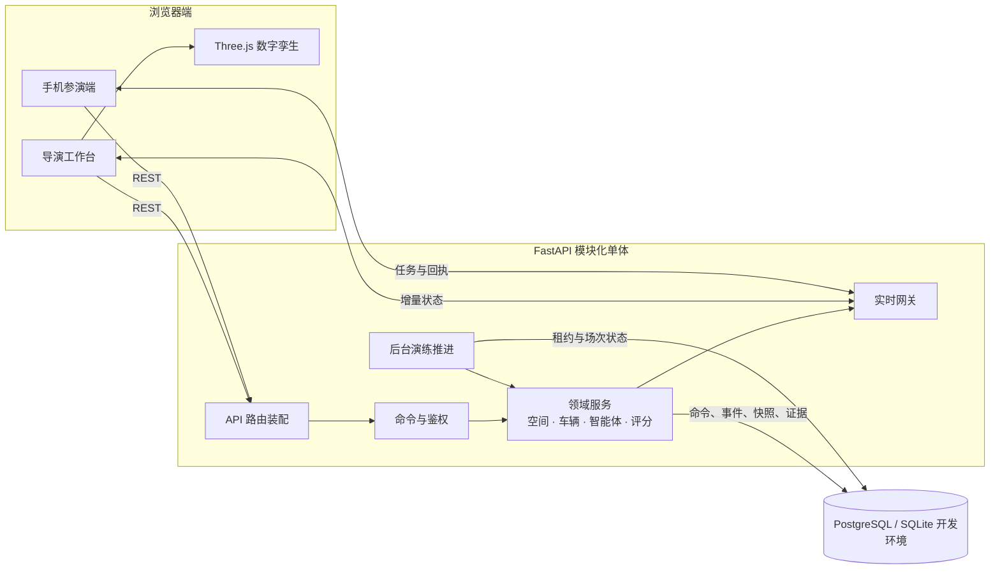
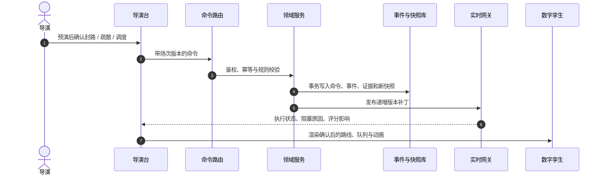
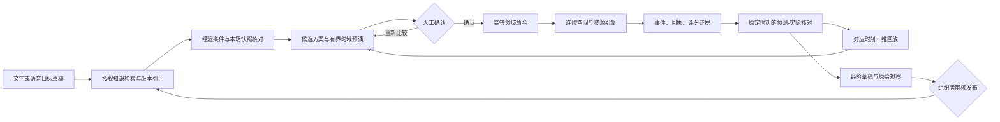

# 系统架构

## 架构定位

智演安巷采用 **模块化单体**。社区地图、演练状态、空间仿真、智能体执行、实时推送与评分证据共享同一个强一致的演练事务边界；在当前竞赛与教学部署规模下，拆成微服务会增加跨服务状态同步与排障成本，而不会提升可用性。

模块化不等于大文件堆叠：HTTP 路由、领域服务、持久化模型、前端领域类型与 Three.js 表现层各自独立，新增功能必须沿既定数据流进入系统。

智能体 P4 的执行边界：`agent_task_graph.py` 编译并校验任务依赖；`agent_claims.py` 管理场次级居民、值守员、机器人归属；`DrillCommandApplication` 再次校验批准版本与资源。工作进程租约控制“谁推进计划”，资源归属控制“谁可以派遣对象”，两者不能互相替代。批准写入稳定命令编号后才执行，恢复时优先读取命令台账；人工接管撤销后续自动下令，已受理移动保留。护送事件包含具体值守员映射，与空间仿真和三维表现共用身份。详见 [P4 实施记录](../guides/knowledge-and-agent.md)。

## 代码边界

### 训练目标与当前任务

新场次的 `world.training_briefing` 保存初始目标、火点、重点人员和责任任务。`training_journey.project_journey` 从同一份人员、任务、指令、机器人及完整事件状态派生当前阶段、行动入口和结束阻塞条件；它不写入事件、不执行命令、不调整评分。快照和增量实时消息携带同一 `journey` 契约，前端只负责展示和将动作分派给现有命令入口。

首页历史查询只选择最近待继续与已结束场次；进度另由受资源鉴权保护的单场 `/drills/{id}/journey` 读取，避免对每条历史运行仿真。旧世界使用标识为 `legacy_derived` 的只读简报，不重写历史。新增字段保存在既有 JSON 世界中，无数据库迁移。详见[实施与验证记录](../../DESIGN.md)。

### 社区住户、到户核查与岗位共享

新世界可选 `community_profile=night_shift`，与 `duty_staff_count`、`simulation_seed` 一同经过准备、预览、发布和冻结。当前社区契约为 v2，未启用时保持原规则，已冻结的 v1 保留人工敲门回执兼容。

| 模块 | 边界 |
| --- | --- |
| `community_training` | 冻结匿名住户和画像；从已发生事件投影覆盖、收到回执、来源及未确认数量 |
| `household_visits` | 校验住户、责任人与岗位，选择冻结户门外节点；新世界核对到位后才允许敲门回执 |
| `task_staff`、`response_staff` | 责任任务占用、撤回释放及岗位投影，与护送和到户核查共用人员身份 |
| `spatial_simulation` | 接入核查行走、排队、风险受阻及连续撤回，复用原空间图和轨迹，不创建直线运动旁路 |
| `agent_claims`、`agent_workflow` | 比较、批准及后续执行均核对岗位，活动计划归属与现场占用共同约束再次派遣 |
| `CommunityOperations`、`domain/community` | 两端共用的分户/岗位交互及类型；只提交动作，不在客户端确认成功 |

`participant.feedback` 统一承载 `household_notified`、`household_confirmed`、`household_visit` 和 `household_visit_cancel`。组织者通过命令事务下达；参演端通过登记会话与固定角色提交。服务端选择岗位与空间目标，客户端不能指定任意员工或位置。未收到通知不自动放行；到门不等于收到通知；收到通知不等于护送、撤离或集合清点完成。

内部行走器共享通道容量与位置历史，外部投影将核查保存为 `simulation.community.visits`，护送保留为 `simulation.helpers`，避免把一次到户误计为护送完成。Three.js 合并同一岗位的当前视觉实例，任务及档案仍保留不同执行记录。版本 15 检查点只缓存可重建状态。

`DecisionTask.kind` 自 `20261113_task_kind` 迁移起为可空稳定类型，新任务不再依靠标题决定环境效果；旧任务保留读取适配，可编辑草稿固定原语义。显示名称变更不能把普通任务变成断电、断气或广播事件。

当前部分服务仍使用 FastAPI 异常作为旧入口适配；并未完成全部领域错误反向依赖清理。此轮不为目录整齐而重新实现一套命令或寻路层。操作及验收见[社区指南](../guides/community-training.md)和[交付记录](../reports/2026-11-13-community-upgrade.md)。

### 厨房几何契约

厨房空间契约：新世界的 `indoor_environment.doors[].portal` 冻结门洞位置、方向与净距，供三维表现和共享门控占用检查使用。`motion_trace` 只记录已执行的行走坐标，最多 18 点，通过既有实体差量传输；它不能代替命令、证据或评分事件。显示层遇到已关闭门洞时取消跨门插值并对齐权威位置。旧世界不回写，旧检查点按引擎版本失效重建。详见[厨房空间升级记录](../guides/scenarios-and-simulation.md)。

### 评分与参考时长

`scoring.score_frozen_world` 根据同一份权威仿真和事件计算过程评分、最终分与候选预演分，统一处理疏散、清点、暴露、任务、护送与效率证据。仅全部居民实际到达且具有到达时刻时，才形成全员完成时间；零撤离不获得排队效率分。评分版本 4 对尚未全员到场与完整疏散使用同一已发生时长扣分，避免留下一人反而增加效率分；冻结成绩保持原版本。

新场次由 `scoring_reference.build_scoring_reference` 读取冻结通道、楼梯速度和护送接近路程，保存 `world.scoring_reference`。这是自由流训练参考，不是动态风险下的最终结果预测。旧世界使用旧参考，已冻结最终成绩不改写。内置厨房尺寸通过受限、幂等的数据迁移补齐，保留用户显式编辑。

智能体按剩余行程选择统一的 30–150 秒有界比较窗口；执行时不再次逐组推演相同未来。命令受理复用动作后的权威投影，调度账本与持久化快照复用同一时刻，避免在接受一次操作时反复推进世界。具体实现与验证见[本轮修复记录](../reports/2026-11-10-acceptance.md)。

### 目录职责

| 目录 | 责任 | 不应承担 |
| --- | --- | --- |
| `backend/app/api` | HTTP/WebSocket 入口、身份、请求校验和响应映射 | 仿真、评分或寻路规则 |
| `backend/app/application` | 命令事务、批准范围、幂等、失败持久化与回执 | 导入 HTTP 路由或直接生成模型动画 |
| `backend/app/bootstrap` | 将应用端口绑定到共享服务及历史适配器 | 新增一套领域规则 |
| `backend/app/domain` | 跨入口共享领域错误与契约 | HTTP 依赖注入或 Vue 表现 |
| `backend/app/services` | 演练推进、空间路径、环境、车辆、智能体、实时状态 | Vue 或 HTTP 表现细节 |
| `backend/app/models` | 持久化实体及约束 | API 输入输出结构 |
| `backend/app/schemas` | Pydantic 请求、响应与命令契约 | 数据库会话操作 |
| `frontend/src/domain` | 跨页面领域类型和纯转换函数 | DOM 或网络副作用 |
| `frontend/src/api` | REST、WebSocket、重连和版本同步 | 页面排版与业务展示 |
| `frontend/src/components` | 页面与可组合交互 | 服务端权威状态的自行推断 |
| `frontend/src/three` | 场景、材质、模型、动画与视觉降级 | 命令提交或演练规则 |

## 一次指令的权威链路

页面不得跳过预演直接把本地结果当成完成；Three.js 也不能为“显得流畅”而让人员穿墙、提前到达或伪造任务完成。

## 运行时组成

- `app.api.router`：唯一的 API 路由装配点。
- `app.core.lifespan`：初始化表结构并托管演练调度、智能体监督任务；测试时不启动后台循环。
- `scenario_contracts`：声明案例契约版本、可运行状态、火源类型及模型能力；准备、保存、预览、发布和新场次共用。冻结世界记录契约；历史回放读取原世界，不重新按模板生成。
- `fire_sources`：统一解析充电棚对象或住宅厨房的合法地址、楼层、房间与户型容量；候选绑定场景底图版本。`exercise_world` 冻结火源身份、位置和道路接入点，供环境、巡检、处置任务与回放共用；失效地址不回退到其他火点。
- `indoor_fire`：厨房案例的分区连接、门状态及确定性烟气时间线。新厨房世界冻结米制高程、个人站位和户型容量；路径、暴露与渲染读取同一空间数据。
- `indoor_commands`：房门指令经统一命令应用服务，检查场次状态、房门身份与人员占用，写入事件后同步通行与烟气；不允许语言模型绕过确认直接操作。
- `engine_scheduler`：通过数据库租约推进运行中的场次，浏览器关闭不会停止演练。
- `agent_workflow`：提出和监督目标计划；领域命令仍需经过人工确认与服务端校验。
- `DrillCommandApplication`：页面和智能体命令的统一事务入口，接收服务端赋予的来源信息，并核对智能体批准版本、步骤和参数。
- `movement_commands`：居民分流、有限护送资源及机器人实际到位/广播等规则，供统一命令入口和旧 HTTP 适配器共同调用。
- `agent_allocation`：在冻结路网中计算路径优先与风险容量分流候选，不直接写入演练状态。
- `agent_execution`、`agent_resources`：把已批准计划映射为可观察的执行步骤、值守资源和机器人任务回执。
- `agent_outcomes`：按批准时冻结的人群、指标和观察时刻进行一次性结果核对；停止、完成或人工让权后仍保留观察。
- `agent_realtime`：为导演账号生成私有的目标计划投影，不向手机参演端广播管理计划。
- `realtime`：使用状态版本、实体补丁和追赶机制同步，不信任浏览器本地状态。

## 智能体计划闭环

计划候选、人工确认、命令执行和结果观察具有不同职责。申请方案审阅会记录暂停事件并冻结现场时钟；暂停状态允许批准，批准后继续现场并执行动作。预演不派遣人员或资源，结果核对只读取服务端权威历史状态，不反向修改人员、任务或得分。

## 知识、语音与规划边界

| 模块 | 职责及持久化 |
| --- | --- |
| `knowledge.py`、`models/knowledge.py` | 账号/社区权限、知识版本、分段、有效期、检索快照与原始经验来源 |
| `knowledge_ingestion.py`、`knowledge_worker.py` | 文本与文档提取；文件解析使用有超时的独立进程，请求入口限制大小与频率 |
| `knowledge_vectors.py` | 独立可选 Embedding；与关键词结果做排名融合，服务不可用时明确回退 |
| `knowledge_ranking.py`、`app/evaluation/knowledge.py` | 本地关键词排序、匹配线索与隔离内存库评估；题集和基线保存在 `backend/evaluation/` |
| `task_guidance.py` | 按权威任务投影解释下一步和阻塞条件，检索适用资料；不接收动作或自动核验 |
| `exposure.py`、`score_evidence.py` | 暴露累积与首次越阈位置；区分结果发生、观察与关联指令时刻 |
| `knowledge_applicability.py` | 对照调用者的准确快照比较经验人数、空间参数与模型版本，保留差异和缺项 |
| `agent_contract.py`、`agent_tool_planning.py` | 目标楼层/出口约束、有限只读工具循环、候选及引用合法性校验；不接受任意命令 |
| `agent_impact.py`、`agent_revision.py` | 实际事件到人员/任务依赖的影响分析，从当前位置重算并保存批准版本间的差异 |
| `agent_outcomes.py`、`knowledge_experience.py` | 核对原定时刻结果，原始事实独立保存，经验正文修订和发布不改写来源 |
| `training_archive.py`、`models/training.py` | 结束事务冻结全场事实并关联经验草稿；只对有权限的场次开放查询，历史补建保留原成绩 |
| `assistant_conversations.py` | 场次与账号隔离、游标分页、请求幂等、清空代次及迟到回复校验；外部模型调用不占用持久化行锁 |
| `speech.py`、`SpeechInput.vue`、`audio/recorder.ts` | 后端签名调用听写服务；浏览器本地采集、重采样、音量反馈、取消与资源释放 |

文档处于草稿/审核状态时不能参与检索。发布版本的原文片段、来源和条件判断保存进检索记录，旧计划读取自己的引用快照。知识引用打开具体文档版本；来源回放经过原场次鉴权，不因为持有知识记录而获得额外场次权限。

结束训练时，冻结成绩、档案和经验候选在同一事务提交；失败则回滚结束操作。`DrillArchive` 通过场次唯一约束保持幂等，原始人员、暴露、任务和设备事实与可修订的知识正文分开存储。删除未发布经验只解除资料关联，不删除档案；单次训练来源 `simulation_archive` 不因条件相似而成为收益推断依据。检索以 SQL JSON 局部读取来源条件，避免加载整份大人口结束状态。

对话记录与事件流分开保存。每轮问答保存用户问题、公开回复、引用及观察时刻；读取按序号分页。清空提升 `AssistantConversation.generation` 并删除其问答，清空前已经发出的模型请求在存储时被拒绝，不能重新填回旧记录。恢复对话不恢复向外部模型发送数据的授权。接口和升级步骤见[训练回收交付记录](../guides/knowledge-and-agent.md)。

任务依据入口先校验场次归属和冻结任务编号，再读取相同场次快照及适用资料；查询只记录知识检索，不写入演练命令或任务证据。前端阅读器固定版本与片段，在任务抽屉内打开原文；三维定位复用冻结楼栋、楼层、设备与门的标识，不从知识文本推断可执行对象。

推荐模型必须读取现场、知识、经验适用性和候选比较四项只读工具；有差异或缺项的经验保留用户查看入口，但推荐工具不发送它的正文和历史指标，也不能引用它作为推荐依据。模型失败、超出 6 轮/25 秒预算或给出非法引用时，保留领域工具结果与确定性推荐。实际执行继续由统一命令事务、资源归属与人工批准控制。

语音转写只填入草稿，禁止自动发送问题或批准计划；听写服务密钥只在后端本地配置中读取。语音、问答模型和 Embedding 分别配置，不以一个服务“已配置”代表其他服务已接通。Three.js 的烟气、房门、阀门和房间标注消费服务端状态，不自行推进环境和评分。

当前实现与验证范围分别见[知识库](../guides/knowledge-and-agent.md)、[工具规划](../guides/knowledge-and-agent.md)、[异常修订](../guides/knowledge-and-agent.md)、[经验入库](../guides/knowledge-and-agent.md)和[适用性核对](../guides/knowledge-and-agent.md)。

## 审阅、控烟与人工责任任务

- `agent_containment` 基于同一室内模型判断房间、门洞与护送员占用；厨房候选可增加撤空后门控动作，执行经 `indoor.door.set` 再次校验。
- `agent_claims` 同时登记门控资源归属，人工修改可让计划交还控制。
- `agent_task_graph` 将冻结案例责任任务、阻塞条件和集合核验投影到同一计划；新UI提交的完整目标需要责任任务与清点完成才能结束。
- `training_mode` 冻结进新场次参数。教学时限按任务类型设置最低预算，考核沿用原发布期限；历史世界和得分不迁移。
- 慢读期间的传输心跳与状态版本分开；前端断流时补读快照，命令响应丢失时查询原幂等编号的回执。

上述协调是一个协调器内的四种能力；模型解析可选，执行合法性由领域工具确定，不将能力分栏视为多个独立大模型。

`agent_release` 保持前栋实际到场、当前有效喷水与后栋广播之间的依赖；允许机器人在前栋完成广播后提前前往下一栋，不能提前释放后栋人员。`agent_schedule` 单独提供无排队时序估算和期限风险，不替代正式有界仿真。`buildingReleaseVisuals` 只消费匹配版本的已批准投影，管理状态标牌、入口标记和纹理释放，不改变通行与评分。

## 并发与认证恢复

SQLite 开发环境下，创建计划进入统一串行事务区后再写入审阅暂停事件，避免请求持有数据库写锁等待调度门锁。后台租约获取及首次读取处于同一门锁顺序；PostgreSQL 的多进程行为仍需部署验收。

刷新会话仅保存当前和上一次凭据的哈希；十秒内丢失响应的重试复用确定性后继令牌，不重复旋转或延长绝对有效期。`20261110_refresh_retry` 迁移添加两个可空字段，具体启动与回滚见 [部署说明](../operations/deployment.md)。令牌不写入 URL、日志或前端持久存储。

配置和能力分别传递：Compose 显式转发聊天、语音、Embedding、会话期限和邀请码期限；缺少外部能力时按真实状态降级。文档维护入口为 [文档导航](../README.md)，最新执行结果和未覆盖项见 [验收记录](../reports/2026-11-10-acceptance.md)。

## 渐进重构计划

P1 已提取统一命令事务与居民/机器人执行规则。智能体下令调用应用服务；`bootstrap.commands.ExistingDrillRuntime` 显式适配既有读模型、空间预演、机器人队列规划及其余领域处理器。`agent_workflow` 的部分查询/预演与 `engine_scheduler` 仍使用 `operations` 辅助实现，后续沿端口逐条迁移，避免复制规则：

1. 继续迁移车辆、道路、任务等处理器及读模型，收束 `ExistingDrillRuntime`。
2. 让路由与后台调度共用提取后的服务，并保留现有幂等、事件与测试。
3. 将智能体工作流只保留为“计划和监督”，不直接依赖 API 模块。
4. 只有当独立负载、独立故障域或容量数据明确证明必要时，再把后台推进拆为独立 worker。

详见 [ADR-0001](adr/0001-modular-monolith.md)。
