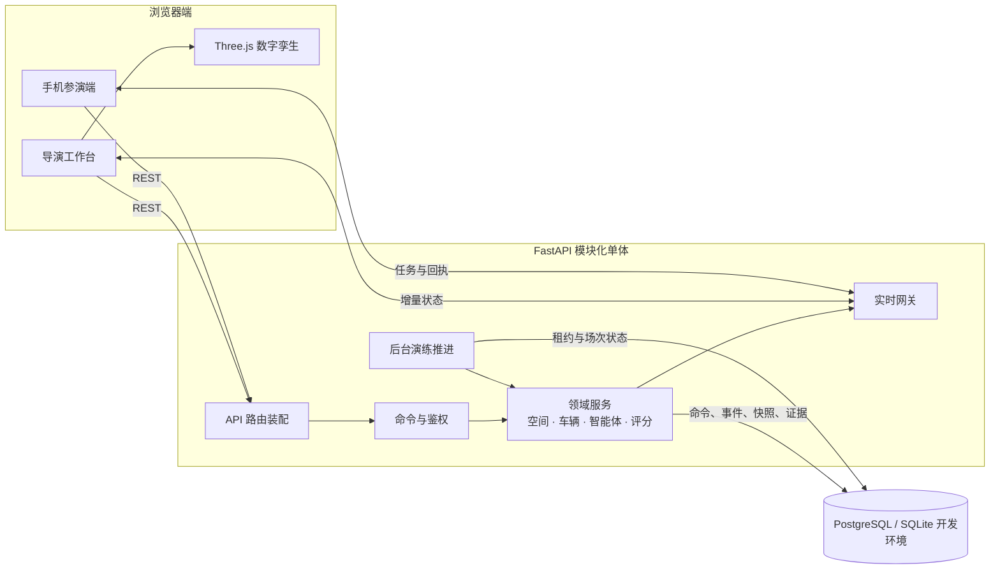
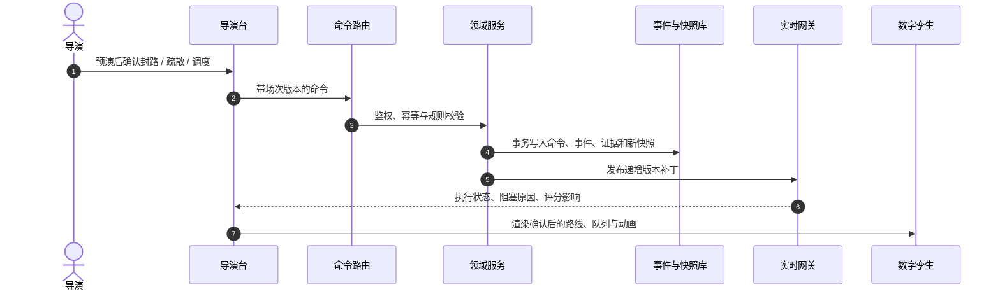
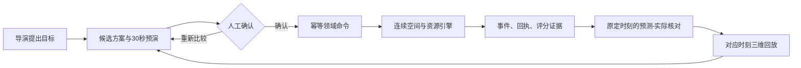

# 系统架构

## 架构定位

智演安巷采用 **模块化单体**。社区地图、演练状态、空间仿真、智能体执行、实时推送与评分证据共享同一个强一致的演练事务边界；在当前竞赛与教学部署规模下，拆成微服务会增加跨服务状态同步与排障成本，而不会提升可用性。

模块化不等于大文件堆叠：HTTP 路由、领域服务、持久化模型、前端领域类型与 Three.js 表现层各自独立，新增功能必须沿既定数据流进入系统。

智能体 P4 的执行边界：`agent_task_graph.py` 编译并校验任务依赖；`agent_claims.py` 管理场次级居民、值守员、机器人归属；`DrillCommandApplication` 再次校验批准版本与资源。工作进程租约控制“谁推进计划”，资源归属控制“谁可以派遣对象”，两者不能互相替代。批准写入稳定命令编号后才执行，恢复时优先读取命令台账；人工接管撤销后续自动下令，已受理移动保留。护送事件包含具体值守员映射，与空间仿真和三维表现共用身份。详见 [P4 实施记录](../2026-10-21-P4-任务图与资源归属.md)。

## 代码边界

### 训练目标与当前任务

新场次的 `world.training_briefing` 保存初始目标、火点、重点人员和责任任务。`training_journey.project_journey` 从同一份人员、任务、指令、机器人及完整事件状态派生当前阶段、行动入口和结束阻塞条件；它不写入事件、不执行命令、不调整评分。快照和增量实时消息携带同一 `journey` 契约，前端只负责展示和将动作分派给现有命令入口。

首页历史查询只选择最近待继续与已结束场次；进度另由受资源鉴权保护的单场 `/drills/{id}/journey` 读取，避免对每条历史运行仿真。旧世界使用标识为 `legacy_derived` 的只读简报，不重写历史。新增字段保存在既有 JSON 世界中，无数据库迁移。详见[实施与验证记录](../2026-10-25-训练任务工作区升级.md)。

### 厨房空间与运动表现

厨房空间契约：新世界的 `indoor_environment.doors[].portal` 冻结门洞位置、方向与净距，供三维表现和共享门控占用检查使用。`motion_trace` 只记录已执行的行走坐标，最多 18 点，通过既有实体差量传输；它不能代替命令、证据或评分事件。显示层遇到已关闭门洞时取消跨门插值并对齐权威位置。旧世界不回写，旧检查点按引擎版本失效重建。详见[厨房空间升级记录](../2026-10-26-厨房门洞与运动连续性升级.md)。

### 目录职责

| 目录 | 责任 | 不应承担 |
| --- | --- | --- |
| `backend/app/api` | HTTP/WebSocket 入口、身份、请求校验和响应映射 | 仿真、评分或寻路规则 |
| `backend/app/application` | 命令事务、批准范围、幂等、失败持久化与回执 | 导入 HTTP 路由或直接生成模型动画 |
| `backend/app/bootstrap` | 将应用端口绑定到共享服务及历史适配器 | 新增一套领域规则 |
| `backend/app/domain` | 跨入口共享领域错误与契约 | HTTP 依赖注入或 Vue 表现 |
| `backend/app/services` | 演练推进、空间路径、环境、车辆、智能体、实时状态 | Vue 或 HTTP 表现细节 |
| `backend/app/models` | 持久化实体及约束 | API 输入输出结构 |
| `backend/app/schemas` | Pydantic 请求、响应与命令契约 | 数据库会话操作 |
| `frontend/src/domain` | 跨页面领域类型和纯转换函数 | DOM 或网络副作用 |
| `frontend/src/api` | REST、WebSocket、重连和版本同步 | 页面排版与业务展示 |
| `frontend/src/components` | 页面与可组合交互 | 服务端权威状态的自行推断 |
| `frontend/src/three` | 场景、材质、模型、动画与视觉降级 | 命令提交或演练规则 |

## 一次指令的权威链路

页面不得跳过预演直接把本地结果当成完成；Three.js 也不能为“显得流畅”而让人员穿墙、提前到达或伪造任务完成。

## 运行时组成

- `app.api.router`：唯一的 API 路由装配点。
- `app.core.lifespan`：初始化表结构并托管演练调度、智能体监督任务；测试时不启动后台循环。
- `scenario_contracts`：声明案例契约版本、可运行状态、火源类型及模型能力；准备、保存、预览、发布和新场次共用。冻结世界记录契约；历史回放读取原世界，不重新按模板生成。
- `fire_sources`：统一解析充电棚对象或住宅厨房的合法地址、楼层、房间与户型容量；候选绑定场景底图版本。`exercise_world` 冻结火源身份、位置和道路接入点，供环境、巡检、处置任务与回放共用；失效地址不回退到其他火点。
- `indoor_fire`：厨房案例的分区连接、门状态及确定性烟气时间线。新厨房世界冻结米制高程、个人站位和户型容量；路径、暴露与渲染读取同一空间数据。
- `indoor_commands`：房门指令经统一命令应用服务，检查场次状态、房门身份与人员占用，写入事件后同步通行与烟气；不允许语言模型绕过确认直接操作。
- `engine_scheduler`：通过数据库租约推进运行中的场次，浏览器关闭不会停止演练。
- `agent_workflow`：提出和监督目标计划；领域命令仍需经过人工确认与服务端校验。
- `DrillCommandApplication`：页面和智能体命令的统一事务入口，接收服务端赋予的来源信息，并核对智能体批准版本、步骤和参数。
- `movement_commands`：居民分流、有限护送资源及机器人实际到位/广播等规则，供统一命令入口和旧 HTTP 适配器共同调用。
- `agent_allocation`：在冻结路网中计算路径优先与风险容量分流候选，不直接写入演练状态。
- `agent_execution`、`agent_resources`：把已批准计划映射为可观察的执行步骤、值守资源和机器人任务回执。
- `agent_outcomes`：按批准时冻结的人群、指标和观察时刻进行一次性结果核对；停止、完成或人工让权后仍保留观察。
- `agent_realtime`：为导演账号生成私有的目标计划投影，不向手机参演端广播管理计划。
- `realtime`：使用状态版本、实体补丁和追赶机制同步，不信任浏览器本地状态。

## 智能体计划闭环

计划候选、人工确认、命令执行和结果观察具有不同职责。申请方案审阅会记录暂停事件并冻结现场时钟；暂停状态允许批准，批准后继续现场并执行动作。预演不派遣人员或资源，结果核对只读取服务端权威历史状态，不反向修改人员、任务或得分。

## 审阅、控烟与人工责任任务

- `agent_containment` 基于同一室内模型判断房间、门洞与护送员占用；厨房候选可增加撤空后门控动作，执行经 `indoor.door.set` 再次校验。
- `agent_claims` 同时登记门控资源归属，人工修改可让计划交还控制。
- `agent_task_graph` 将冻结案例责任任务、阻塞条件和集合核验投影到同一计划；新UI提交的完整目标需要责任任务与清点完成才能结束。
- `training_mode` 冻结进新场次参数。教学时限按任务类型设置最低预算，考核沿用原发布期限；历史世界和得分不迁移。
- 慢读期间的传输心跳与状态版本分开；前端断流时补读快照，命令响应丢失时查询原幂等编号的回执。

上述协调是一个协调器内的四种能力；模型解析可选，执行合法性由领域工具确定，不将能力分栏视为多个独立大模型。

## 渐进重构计划

P1 已提取统一命令事务与居民/机器人执行规则。智能体下令调用应用服务；`bootstrap.commands.ExistingDrillRuntime` 显式适配既有读模型、空间预演、机器人队列规划及其余领域处理器。`agent_workflow` 的部分查询/预演与 `engine_scheduler` 仍使用 `operations` 辅助实现，后续沿端口逐条迁移，避免复制规则：

1. 继续迁移车辆、道路、任务等处理器及读模型，收束 `ExistingDrillRuntime`。
2. 让路由与后台调度共用提取后的服务，并保留现有幂等、事件与测试。
3. 将智能体工作流只保留为“计划和监督”，不直接依赖 API 模块。
4. 只有当独立负载、独立故障域或容量数据明确证明必要时，再把后台推进拆为独立 worker。

详见 [ADR-0001](adr/0001-modular-monolith.md)。
