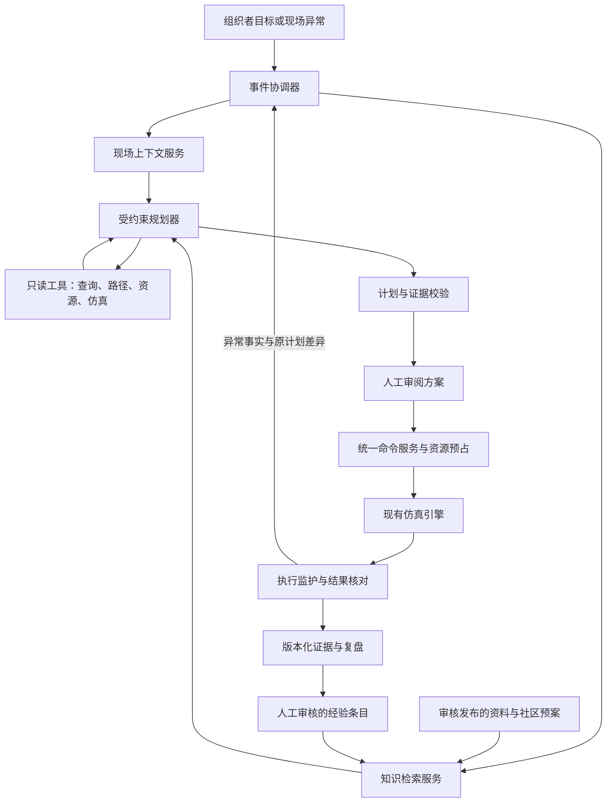

# 下一阶段系统优化：知识增强与工具驱动的演练决策

日期：2026-11-02。基线：`93f7df5`。本文是待实施设计，不表示知识库、RAG 或模型规划循环已经交付。

## 1. 阶段目标与范围

将智演安巷升级为能够引用专业资料、读取真实场次、调用仿真工具、组织可执行任务并监护执行偏差的演练决策系统。保留两个角色端、两个火灾案例和现有模块化单体架构。

下一阶段的核心交付是一条厨房决策链：组织者提出“优先护送三层重点居民，尽量降低烟气暴露”，系统检索适用预案，确认对象与资源，调用路径和仿真工具比较方案；批准后执行；遇到路线封锁，说明受影响对象并提出经过验证的修订。

不以聊天窗口数量、模型数量、向量数据库或某个编排框架作为交付依据。现阶段不增加独立角色端、独立子智能体聊天页或新的火灾案例。

## 2. 代码基线与需要改变的部分

| 现有实现 | 继续复用 | 本阶段调整 |
| --- | --- | --- |
| `agent_planner.interpret_goal` | 模型输出校验、对象 ID 白名单、离线回退 | 从三个目标字段扩展为完整目标契约，增加受预算约束的工具规划循环 |
| `agent_workflow.build_candidates` | 确定性预演、比较口径、方案去重 | 将固定策略作为可调用规划工具；允许组合合法动作并返回不可行原因 |
| `agent_task_graph` | DAG 校验、依赖、稳定命令 ID | 引入有类型的计划节点、前置条件、完成条件和批准范围 |
| `agent_claims`、统一命令应用服务 | 事务性资源归属、幂等、鉴权和执行回执 | 接受通过审核的计划版本，执行前再次核对状态与资源 |
| `scene_assistant.build_context` | 现场摘要、对象上下文、只读解释 | 增加知识检索依据，避免将现场摘要编号当作外部知识引用 |
| `AgentRun`、事件和结果核对 | 持久化计划、恢复和预测结果比较 | 记录知识版本、工具轨迹、计划依据及修订关系 |
| `SceneAssistant`、`AgentPlanWorkspace` | 现有助手工作区、计划/执行/证据结构 | 汇合聊天建议与目标计划，展示同一任务上下文及证据 |

当前工作流已有实际编排能力，但主要是程序生成任务图。当前模型的工具调用主要用于目标提取；本阶段才引入“选择工具—读取结果—调整草案”的规划循环。

## 3. 总体架构

三类数据具有不同职责：

| 数据 | 典型内容 | 读取与保存原则 |
| --- | --- | --- |
| 专业知识 | 已审核资料、社区预案、设备手册 | 检索发布版本，返回章节、页码或段落锚点 |
| 现场事实 | 人员位置、烟气、道路、任务、资源 | 查询服务端权威状态，携带场次、时刻和状态版本 |
| 工具结果 | 路线、不可达原因、资源分配、仿真预测 | 保存输入、算法/世界版本和预测窗口，禁止当作已发生结果 |

实时人员位置不通过文档向量索引读取。知识文本不直接改写通行、评分或任务合法性规则。

## 4. 知识库与 RAG

### 4.1 知识内容与发布

首批只覆盖现有两类场景需要的资料：可合法使用且有来源的相关消防资料、社区应急预案、楼栋及岗位说明、机器人与车辆的已支持能力说明、经过审核的历史复盘经验。

每份资料具有所有者、所属社区或全局适用范围、类别、来源链接、版权/使用说明、适用场景和生效状态。平台操作说明与专业处置资料分开标识。内置软件教学资料不得冒充官方消防依据。

处理过程：上传或录入 → 文件校验 → 提取文本 → 按标题与段落切分 → 检查抽取质量 → 审核 → 发布 → 索引。扫描件提取不足时标为待处理，不允许空文本“索引成功”。第一版支持文本型 PDF、DOCX、Markdown 和纯文本；加密文件和扫描件给出明确处理状态。

资料状态：草稿、处理中、待审核、已发布、失败、已停用。组织者可管理授权社区的资料；平台既有管理权限可发布全局资料，不增加新角色端。发布需要记录审核人、时间和版本。

### 4.2 检索过程

1. 根据问题、案例、当前对象、目标与社区构造检索请求。
2. 服务端先限定访问权限、已发布版本和适用范围。
3. 同时使用关键词检索与语义检索，合并去重并控制单份资料占比。
4. 按适用性、相关性和明确版本关系排序；可选重排作为可替换适配器。
5. 向模型提供少量完整证据段，并返回可打开的原文位置。
6. 校验回答中的引用确实属于本次检索结果；无依据时返回资料不足。

资料存在冲突时保留各自来源、适用对象和有效版本，优先使用经审核明确标记的替代关系；不能让模型仅按相关性分数决定哪条专业规定有效。无法解决的适用性冲突进入人工确认。

“混合检索”指检索能力，不绑定新基础设施。小规模本地 SQLite 可保留关键词检索；生产 PostgreSQL 的全文及向量索引通过适配器实现。语义通道不可用时明确显示“关键词检索”，不能伪装成向量检索成功。

Embedding 单独配置提供方、模型、维度和超时。已有聊天服务配置不能自动视为支持 Embedding。索引记录模型及切分版本；更换模型时重建新索引，构建完成后切换，旧索引保留回退能力。

### 4.3 引用与可复现性

- 知识引用使用 `K` 类编号，现场事实使用 `F` 类编号，工具结果使用 `T` 类编号。
- 引用保存资料版本、片段 ID、内容哈希、页码/标题路径与必要摘录；页码不可用时使用明确段落锚点。
- 现场事实记录 `drill_id`、`state_version`、`elapsed_seconds` 与事件序号；预测记录观察时刻和预测区间。
- 计划冻结本次使用的证据快照。资料更新不会悄悄改变已经批准计划的解释；删除或撤销权限后，历史依据仍受访问控制。
- 日常删除采用停用与保留期；确需永久清除时，历史显示证据已撤回，不绕过删除要求保留隐藏副本。
- 不展示模型猜测的置信百分比。展示可验证事实，例如“引用 2 份已发布资料”“1 项约束仍需确认”。

## 5. 智能体职责与编排

保留一个协调器、四种能力。它们是有明确输入输出的能力模块，可以分别使用规则、检索、模型或仿真工具；本阶段不宣称四个独立自主模型。

| 能力 | 输入 | 输出 | 可调用内容 |
| --- | --- | --- | --- |
| 现场感知 | 场次版本、选中对象、异常事件 | 当前事实、数据缺项、受影响对象 | 只读现场、任务、资源、事件查询 |
| 知识与方案规划 | 目标、现场事实、专业依据 | 候选行动、依赖、代价和未解决条件 | 知识检索、路径预览、分配与未来仿真 |
| 资源协同 | 计划节点、资源状态 | 资源需求、等待、冲突和替代 | 资源可用性查询；批准时由应用服务预占 |
| 执行监督 | 批准计划、领域事件、预测 | 进度、偏差、阻塞和修订请求 | 回执、结果核对、重新规划请求 |

编排由三层组成：目标说明要实现的结果；工作流规定观察、规划、批准、执行和核对；任务图表达具体动作的依赖、资源和完成条件。

### 5.1 目标与计划契约

目标包括楼栋、楼层、具体居民或人群、优先对象、允许资源、禁用通道、风险偏好、必须完成的案例任务和完成条件。用户明确说“尽量降低暴露”时，保留为可比较目标；不能自动编造暴露数值阈值。存在无法解析的关键约束时先展示确认项，禁止悄悄忽略。

计划节点包含动作类型、对象 ID、参数、前置步骤、资源需求、预期时长、完成规则、失败处置、证据引用和工具验证记录。模型只能选择注册的动作与场次内对象；代码执行、SQL、任意网络请求均不属于规划工具。

### 5.2 规划循环

读取一致版本的现场 → 检索 → 生成草案 → 工具校验 → 根据结果修订 → 形成可审阅候选。初始建议预算为最多 6 次工具调用、2 次草案修订；总时限和仿真计算预算独立可配置，数值属于待验证的运行参数。

工具返回结构化结果：输入版本、结果、可执行性、失败原因和有效范围。模型不得将失败结果覆盖成成功。不可行时展示具体阻塞；两个候选动作及预测相同时合并，只保留一个有效方案。

沿用既有方案审阅暂停机制，记录暂停由谁触发；恢复前核对场次是否被人工再次暂停。模型调用与仿真预演不占用数据库写锁。批准时重新检查状态、权限、资料适用性、资源与参数，事务性保存批准版本及稳定命令 ID。

### 5.3 监护与修订

道路封锁、关键门状态改变、护送资源不足、机器人任务失败等事件进入影响分析。相同对象的重复事件合并；已存在同一修订请求时不重复调用模型。计划失去执行条件后停止后续相关下令，已受理动作按现有领域规则处理。

修订展示原计划与新计划的动作、对象、资源和预测变化；保留已发生的位置、暴露、电量和已完成证据。新动作需要新版本批准，技术重试继续使用原命令 ID。人工接管撤销后续自动控制。

## 6. 工具与数据设计

首批工具按现有领域能力封装：`knowledge.search`、`scene.observe`、`residents.query`、`resources.inspect`、`routes.preview`、`simulation.compare`、`tasks.inspect`、`execution.inspect`。这些均为只读或预演工具。

执行动作继续使用既有统一命令应用服务。聊天回答只能生成“转为计划草案”的提议；它不能绕过批准或直接完成责任任务。断气、断电、现场核验等人工任务仍需真实责任回执。

| 持久化对象 | 作用 |
| --- | --- |
| `knowledge_documents` | 所有者、适用范围、类别、来源、当前发布版本 |
| `knowledge_versions` | 文件哈希、提取状态、审核、发布、保留期 |
| `knowledge_chunks` | 标题路径、页码/段落、文本、哈希 |
| `knowledge_index_generations` | 切分器、Embedding 模型、索引状态和激活版本 |
| `knowledge_retrieval_runs` / hits | 查询范围、命中证据、索引版本及耗时；查询文本按敏感数据策略保存 |
| `agent_tool_calls` | 工具名、运行/步骤、输入输出版本、状态、耗时和结果摘要 |
| 既有 `AgentRun` 扩展 | 目标契约、证据集 ID、规划器版本、修订来源；沿用原任务和资源表 |

新增表采用版本化迁移、外键与索引。文件放置在受控存储中，通过鉴权接口下载；文件系统真实路径不作为公开 URL。片段、索引和资料状态按版本关联，不为历史场次回填虚假检索记录。

API 分为资料管理、检索和计划工具三组：社区下的知识资料 CRUD/版本/审核发布；场次下的授权知识检索；既有 agent run 下的证据与工具轨迹。编排工具入口仅供服务端调度，不直接向浏览器开放任意工具调用。

建议新增模块 `services/knowledge/` 和 `services/agent_planning/`，分别承载摄取、检索、引用，以及目标、工具注册、草案、校验和预算。路由保持请求映射；先拆本阶段涉及部分，不重写整个仿真服务。

## 7. 页面与三维联动

### 7.1 知识资料页

首页侧栏增加一个“知识与预案”业务入口。主体采用资料列表和内容详情的主从布局：分类、适用社区、发布状态、处理失败原因清楚可见。详情显示内容、来源、版本和审核动作，不增加统计大屏。

组织者维护其授权资料；参演端只查看当前任务被允许引用的内容。上传、处理、审核和检索测试均有真实状态，处理失败可重试。

### 7.2 助手与计划工作区

沿用一个右侧工作区，组织为“目标与方案、执行、依据与结果”。问题和草案共享当前选中对象；从聊天转为计划时保留目标与引用。

方案卡只呈现核心差异：行动、受影响人员、风险与拥堵预测、资源、等待条件、预测覆盖范围。引用原文在同一工作区内替换显示，使用明确返回入口；不再叠出独立浮窗。

执行页突出当前动作、责任人、工具回执、等待原因与下一步。只显示面向用户的决策摘要、资料依据和实际工具调用结果，不展示或存储模型内部思维链。

宽屏为现场让出真实侧栏宽度；窄屏用一个可滚动面板，固定保留暂停、继续和退出。正文以 16px、辅助信息 14px 为基准，主要触控目标至少 44px。证据、任务和对象选择通过统一工作区切换。

### 7.3 三维表现

点击知识支撑的建议可高亮实际对象；路线工具结果叠加在对应楼层，预测路线与已执行轨迹明确区分。拒绝执行的门洞或路线显示具体受阻位置和服务端原因。

模型工作重点为门洞、楼梯平台、人员净距和护送会合的可观察性。新增资产必须沿用权威空间身份与包络，优先修复影响行动的几何问题；模型加载失败时保留可操作的轻量表现。

## 8. 安全、失效和运行成本

- 资料上传限制类型、大小和解压后体积；解析进程受时间、资源和文件访问限制，禁止宏与外部引用执行。资料 URL 初版只作来源记录，不自动抓取任意地址。
- 检索与原文下载使用同一权限边界；索引过滤、结果返回和证据查看都校验授权，禁止仅在页面隐藏跨社区资料。
- 现场查询同样遵守角色和教学/考核模式的可见范围；考核中尚未发现的准确火点、隐藏事件和未授权人员信息，不能从冻结世界或模型上下文泄露。
- 文档及工具返回作为不可信数据；文档中的“忽略规则”等文字不能改变系统指令或授权。
- 模型凭据仅在后端；聊天、Embedding 分别配置。默认不把全量人员名单和文件发送到外部服务，外部调用范围在资料管理和调用设置中可见。
- 知识索引后台执行，模型和仿真调用分别限制并发与预算；缓存必须包含权限范围、资料版本与索引版本。现场工具缓存还需状态版本。
- 模型不可用时继续既有确定性规划；检索不可用时显示缺失依据。两种回退均标识当前能力，不返回伪造模型或检索结果。
- 规划任务可取消；浏览器关闭后任务有服务端状态，重连恢复原任务。重启接续不得重复派发命令或重复消耗无限模型请求。

## 9. 分阶段交付

| 阶段 | 完整交付 | 用户验收 |
| --- | --- | --- |
| N1：知识与证据 | 资料摄取、版本发布、权限检索、可打开引用、关键词回退和索引状态 | 上传一份社区预案，发布后问指定问题，能找到对应段落；另一个社区的私有资料不可见 |
| N2：目标与工具规划 | 扩展目标契约、工具注册、受限规划循环、候选校验、证据冻结 | 提出三层重点居民目标，系统识别对象并用仿真比较实际不同的行动；未知约束明确出现 |
| N3：执行与修订 | 批准边界、异常影响分析、计划修订、人工接管及恢复 | 执行中封路，系统定位受影响任务，提出经预演的新计划，批准后从当前状态继续 |
| N4：联动展示与经验 | 工作区依据视图、三维高亮、复盘偏差、经验审核发布 | 从一项失败定位到事件与知识依据，保存审核经验，在下一场相似问题中检索到 |

每阶段都交付后端、持久化、页面、错误状态和必要验证。N1 不因尚未交付 N2 就宣称具备模型自主规划；N2 不因模型返回计划文本就宣称执行闭环完成。

## 10. 验收与评价方法

先建立小型、人工标注的两案例问题集，覆盖资料查找、适用性冲突、无答案、跨社区权限和过期资料。评价检索前若干结果能否覆盖标注依据、引用是否支持具体陈述；模型自身评价不作为唯一裁判。

规划验收覆盖正常疏散、资源不足、门洞受阻、道路突变、人工接管和模型超时。对相同冻结世界与随机种子，比较现有确定性方案和新增知识增强方案的人员到达、暴露、排队、任务核验、资源使用与耗时。结果按同口径记录，不预设新方案一定更优。

硬性检查：越权资料不得返回；不存在的对象或动作不得批准；工具失败不得包装成成功；重复批准不得重复派遣；历史引用不得指向错误版本；预测不得冒充完成事件。

检索覆盖率、响应时延和计算预算的数值目标，在拿到首批资料和基线后确定。发布记录同时给出中位和较慢请求耗时、检索/工具失败率及真实调用成本；不承诺未经测量的准确率或速度提升。

代表页面一次覆盖 390、768、1366×650、1440 宽度，重点检查引用展开、长资料标题、任务阻塞、模型失败和计划修订。只对实际发现的缺陷追加回归，避免与实现重复的测试堆积。

## 11. 第一批开发的完成定义

第一批实施 N1，并让现有场景问答真正使用发布资料：

1. 可上传、提取、审核、发布一份资料，刷新恢复每一步状态。
2. 只检索当前账号授权且适用的发布版本。
3. 回答提供真实原文定位，资料不足时不编造引用。
4. 模型关闭时仍可查看命中资料与现场事实。
5. 对话中的依据可携带到下一阶段的计划草案，而不是只留在聊天文本里。
6. 在厨房案例演示一次“资料依据 + 当前事实”的回答，并完成越权与失效路径检查。

知识内容需要项目方提供或选取可合法使用的权威来源；没有这批资料时可以完成管道和软件教学材料的检索，但不能将其标为专业消防知识库已建成。语义检索还依赖可用的 Embedding 提供方或本地模型，接口必须真实验证。

## 12. 设计自检

| 追问 | 处理方式 |
| --- | --- |
| 是否只是给聊天增加资料按钮？ | 检索结果冻结到计划依据，并参与工具验证后的方案解释 |
| 是否为了展示智能而放开模型下令？ | 规划输出接受类型、对象、资源和批准校验，执行仍走统一命令服务 |
| 能否处理资料与现场冲突？ | 分别展示适用性和实际不可行条件，冲突未解决时阻止相关批准 |
| 规划是否会无限重试？ | 工具、修订、时限和并发预算，加事件合并与稳定任务 ID |
| 是否再次增加面板重叠？ | 引用、任务和对象详情复用同一工作区，返回保留上下文 |
| 是否只是换了模型却没有可量化价值？ | 对相同冻结场景比较结果和人工操作负担，按实际证据决定后续投入 |
