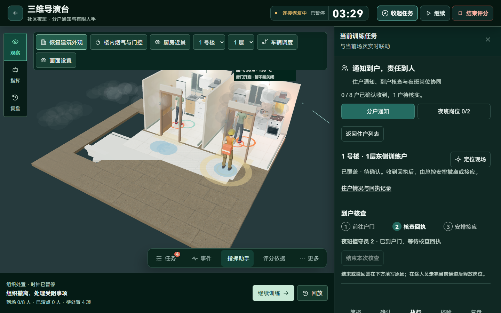
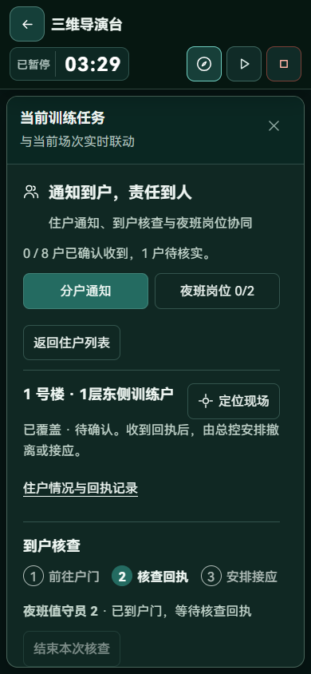
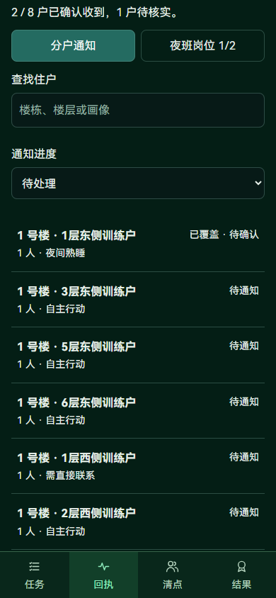

# 社区夜班协同与到户核查交付记录

功能交付：2026-11-13；发布兼容修复：2026-11-14。合并分户画像和到户核查两轮记录，作为当前社区功能的统一说明；两轮原始证据由本地验收输出保留。

## 已落地范围

| 环节 | 实际行为 |
| --- | --- |
| 准备与冻结 | 可选夜班画像、匿名住户、固定种子及 1–8 个岗位，保存、预览、发布和新场次使用同一参数 |
| 通知到户 | 区分通知覆盖、收到回执、行动命令；广播不自动确认收到，需直接联系的住户拒绝仅凭广播确认 |
| 到户核查 | 服务端选择可用岗位及户门外节点，沿道路、楼梯、走廊移动；新世界到门后才允许敲门回执 |
| 有限人手 | 核查、物业任务、护送及活动计划共用岗位；拒绝重复派遣；撤回保留位置，走完当前路段后释放 |
| 人员行为 | 行动受限、熟睡和需直接联系等画像影响准备与速度；确认通知不自动释放居民或完成护送 |
| 智能体 | 候选、批准和执行再次核对通知条件与岗位占用；助手可查询核查状态、阻塞与责任 |
| 环境 | 新模式拆分供水可用、资源就绪和有效喷水；断电与断气分别作用于对应场景 |
| 任务与档案 | 明确 `DecisionTask.kind`，显示名不改变新任务语义；档案保存分户回执、核查及未结束数量 |
| 三维与界面 | 同一人物身份、确认路径和轨迹；到门等待姿态、受阻颜色；单工作区、统一滚动正文和固定关闭键 |

新建社区契约版本为 2，已冻结版本 1 保留原人工回执兼容。引擎修订为 15，旧派生检查点重建，不删除事件或改写冻结成绩。开启及操作见[功能指南](../guides/community-training.md)。

## 实际检查与证据

- 社区专项最终 9 项：冻结与旧世界兼容、非法住户、同渠道通知前置、广播范围、到门前禁止敲门、责任人越权、有限岗位、撤回位置连续及环境因果。
- 最终社区、室内门控、智能体协调和场景问答组 **35 项通过**；另有归档等分组 **36 项通过**，批次重叠，不相加。
- 前端 **69 项通过**；`vue-tsc -b` 与 Vite 生产构建通过。
- 独立 SQLite、真实 HTTP 与 WebSocket 中，8 名居民、8 个住户、2 名值守员的电话回执由手机更新至导演台；一名承担断气任务时，另一名可实际前往重点人员会合。
- 独立场次中，组织者派出值守员到一层户门，观察连续移动、到门等待与岗位占用；到门本身不确认通知，也不释放居民。
- 已检查 1440×900、1366×650、768×1024、390×844 的相关工作区；到户升级最终复查 1440 和 390px，无文档横向溢出、正文 16px、一个主要抽屉及可见关闭键。

发布前完整测试与远端 CI 另见[本次发布记录](2026-11-14-repository-release.md)，不能用上述专项替代整库检查。

实跑修复了旧派生检查点残留的自动放行状态，以及定位居民误切面向墙壁的第一视角。长详情与训练引导改为共同滚动正文，标题背景不透明，避免内容透出及 Flex 挤压。

后端重启曾触发临时连接拒绝，恢复后同步成功；Windows WebGL 驱动有 shader 精度警告。原始 JUnit、录屏、日志及 QA 数据位于被忽略的 `output/`，不随源码提交账号或邀请凭据。

## 当前页面

桌面到户核查与三维现场联动：

390px 导演工作区保持标题和当前进度：

手机参演端读取同一住户进度：

## 未覆盖范围

本轮未重做住宅完整户型，也未验收全局刚体碰撞、所有镜头逐帧穿模、1000 人容量、真实语音或外部语言模型。到户烟气门槛随世界冻结，属于未实测标定的训练参数。正式避险待援、共享通道条件放行、全批次动态预测和结构化整改复验仍需后续交付。
