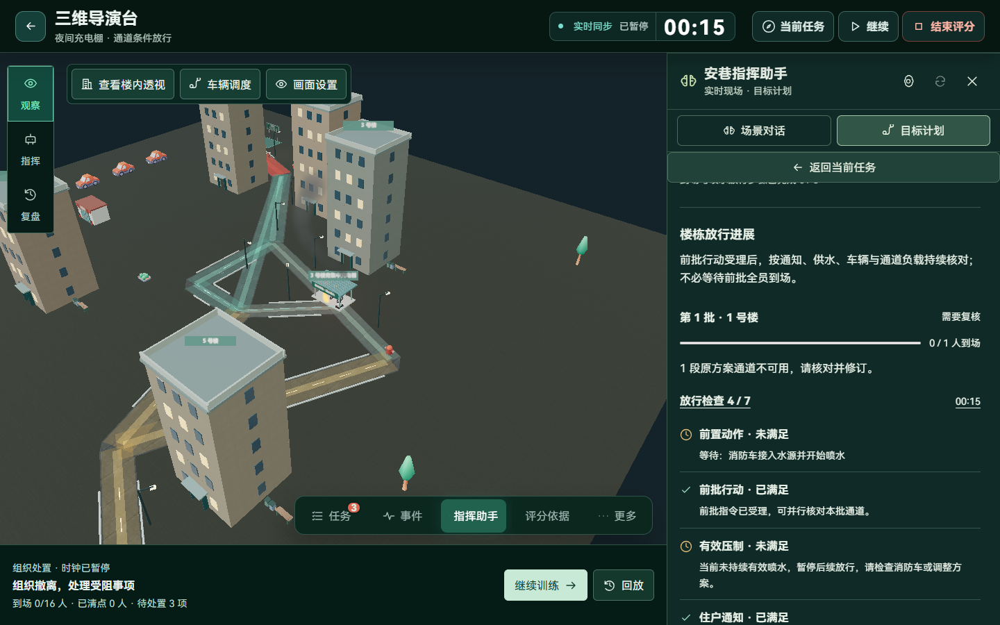
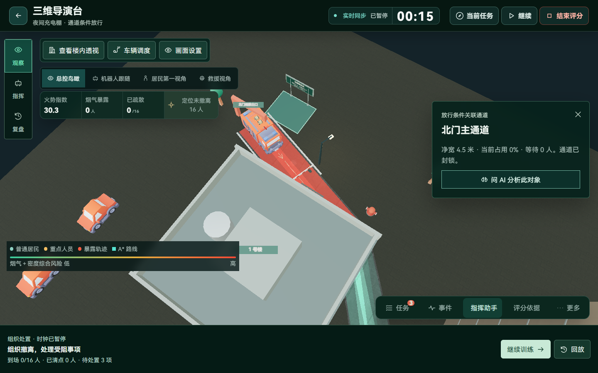

# 通道条件放行与三维定位交付记录

## 本轮范围

落实社区专属升级中的“有条件放行”：充电棚压制后撤离不再统一等待前栋全员到集合点，而是依据服务端实际通道、通知、车辆和岗位决定何时开始下一批。没有新增角色、独立聊天窗口或浏览器私有仿真状态。

| 环节 | 已落实的行为 |
| --- | --- |
| 准备与冻结 | 夜班场景选择实时通道条件或原串行方式；新世界冻结策略、占用门槛和版本 |
| 任务图 | 完成依赖与受理依赖分别保存，统一校验缺失节点及循环 |
| 执行 | 先核对前置动作和前批受理，再检查通知、有效压制、通行、管制、占用及岗位；临时等待可再次检查，封锁等问题进入复核 |
| 路线 | 按本批人员重新收集路段，避免把其他楼栋的路线当成本批约束 |
| 助手 | 展示检查时刻、通过项、阻塞原因和实际到场人数；默认展开第一批待处理项 |
| 三维 | 点击受限路段关闭助手，按冻结端点、楼栋及楼层定位；高亮沿确认路段绘制，切换对象与销毁时释放资源 |
| 兼容 | 旧世界、显式串行配置和已批准旧计划继续等待前栋到场；不改写历史成绩 |

广播能够先发出通知；居民出发要求收到回执。当前批准入口仍要求目标住户已确认，不把人工通知工作假设为自动完成。机器人移动、到位、广播以及护送资源复用继续保持实际完成依赖。

## 实际界面与操作

1440px 桌面助手与现场共同展示，放行检查在助手内部滚动；1366×650 下顶部继续、结束控制保持可见。390px 使用同一工作区，保留场次控制，没有新增悬浮卡片。

点击“定位”后，进入同一场次中的受限路段；详情随服务端状态更新，关联道路可继续使用既有对象问答。

[390px 手机检查界面](../images/conditional-release-mobile.png)。实测新增区域正文 16px、说明 14px、最小按钮高度 44px；在 1440×900、1366×650、390×844 三种视口未发现横向溢出。截图所示页面未发现新增面板重叠，不能据此推断所有页面和状态均已验收。

## 验证证据

在隔离 SQLite 数据库和本地 API 8023、前端 5185 上创建真实夜班场次，通过正式接口完成分户通知、确认、方案生成和批准；注入实际道路封锁后暂停。助手能够显示对应不可用路段，点击定位后关闭助手、显示道路名称及封锁状态。未使用拦截接口返回的成功替身。

| 检查 | 命令或方式 | 结果 |
| --- | --- | --- |
| 放行、旧串行、社区回归 | `python -m pytest tests/test_release_conditions.py tests/test_agent_release.py tests/test_community_training.py -q -p no:cacheprovider` | 26 passed |
| 最新投影修复与条件回归 | `python -m pytest tests/test_agent_coordination.py tests/test_release_conditions.py -q -p no:cacheprovider` | 20 passed，包含上行已执行的 12 项条件测试；两次合计 34 个不同用例 |
| 前端既有行为与模型回归 | `npm test` | 69 passed |
| 类型检查与生产构建 | `npm run build` | 通过 |
| 新组件布局扫描 | Impeccable layout detector：`ReleaseWaveList.vue` | 无规则命中 |
| 浏览器 | Edge / Playwright，桌面、短屏、手机；定位、返回、内部滚动、场次控制 | 如上述截图及尺寸记录 |

API 回归明确断言：第二批已受理时第一批尚未完成到场；低负载可放行，55% 占用、车辆独占会等待；封路、几何冲突和消失路段要求复核；占用清除后条件恢复。另覆盖住户回执、广播依赖、实际岗位、有效喷水、暂停后的新阻塞以及人工接管后不恢复自动下令。

验证期间主动重启了本轮 QA API，浏览器出现两次连接拒绝，随后恢复读取同一场次；没有把这些记录删去或报告为全程无错误。渲染另有既有 D3D 着色器浮点精度警告。本轮未新增第三方依赖，未读取或修改实际服务密钥。

## 数据与预测口径

- 新社区冻结契约为版本 3，包含 `release_policy`；配置仅作用于新场次。连续移动引擎仍为修订 15，本轮无需表结构迁移。
- 占用 55% 沿用现有拥堵指标，作为冻结训练参数，不是经过实测校准的安全阈值。
- 有界仿真仍主要覆盖首批。实时条件方案的后续释放时间依赖未来现场，不显示虚构的全批完成时间或无超时结论。
- 本轮没有重新完成两案例全场评分验收，没有获得可与旧成绩直接比较的新总分。
- 厨房户型资产、逐门烟气参数标定、通道受阻后的避险待援业务以及结构化整改复验仍需后续交付；大人口容量、生产 PostgreSQL 多进程和全部设备尺寸未执行本轮验收。

后端变更主要位于 `release_conditions`、`agent_release`、`agent_task_graph`、`agent_workflow`、`agent_execution` 和 `community_training`。前端复用原助手、导演台与三维组件，新增 `ReleaseWaveList` 作为纯展示与导航组件。操作方式见[社区训练指南](../guides/community-training.md#通道条件放行)。
