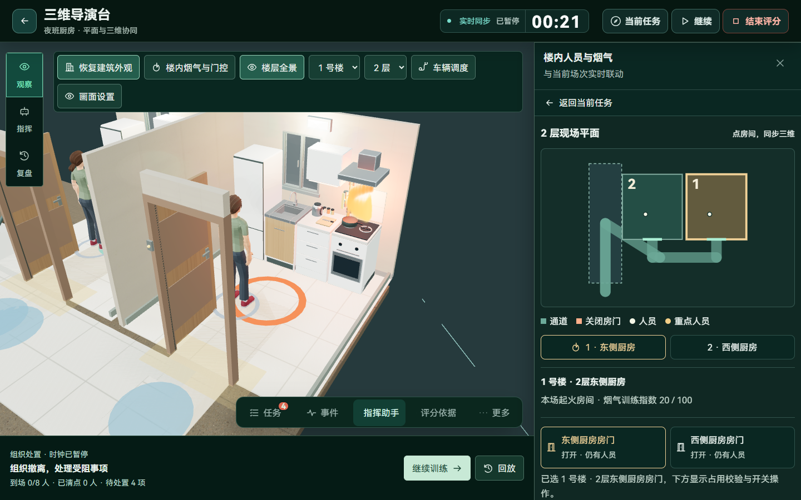
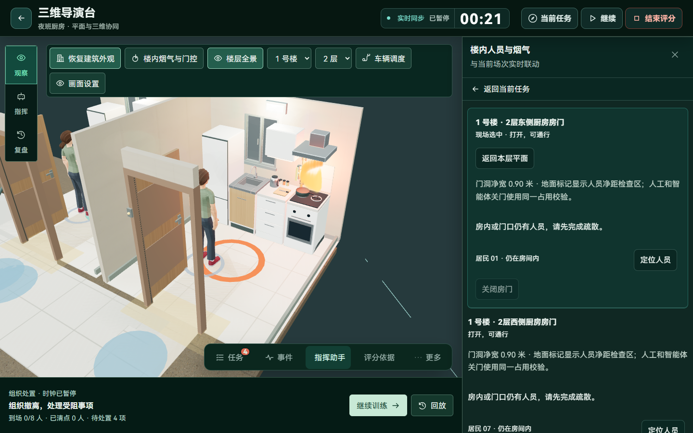

# 厨房平面、门控与设备尺寸升级

## 交付内容

本轮将厨房场景已有的房间、通道、门控、人员和烟气连接到同一个可操作的室内工作区，继续保留两角色端、统一命令服务及服务端权威状态。

| 环节 | 本轮实现 |
| --- | --- |
| 楼层态势 | 服务端按当前楼层计算待疏散、路线不可达、通知未确认、排队及待接应人数；不把广播或开门算作撤离 |
| 二维观察 | 实际分区与通道构成楼层平面，人员沿服务端坐标呈现；绘图变换不改变真实位置 |
| 房间选择 | 平面点击与大按钮均可选择厨房，三维切到对应房间；三维厨房点击复用同一室内工作区 |
| 选择保留 | 窗口尺寸变化继续观察选中的房间，避免镜头错误返回起火房间 |
| 房门核对 | 选择房门后进入其占用与开关区域，可返回原楼层平面；观察不会自动发出开关指令 |
| 通道定位 | 有排队路段时提供三维定位；房门实际状态同步影响通道投影 |
| 新厨房布局 | 宽台面不再无限拉伸冰箱和灶台；设备、火点及任务位置共同冻结，继续检查通行净空 |

[手机端楼层平面](../images/kitchen-plan-mobile.png)。截图来自本轮隔离运行场次，未通过拦截接口返回伪造成功数据。

## 实际门控链验证

使用本地独立 SQLite 数据库、API 8025 和前端 5187 创建夜班厨房场次：8 名居民、2 个值守岗位、二层厨房起火，起火房门初始关闭。正式接口生成的楼层态势为：二层待疏散 2 人、路线不可达 1 人、通知未确认 2 人。

浏览器完成“核对东侧厨房房门 → 继续演练 → 打开房门”。独立读取服务端后确认：

- 房门为 `open`，对应实际通道也为 `open`。
- 二层路线不可达人数从 1 降到 0，通知未确认人数仍为 2。
- 写入真实 `indoor.door_changed` 事件，未因开门自动完成通知、撤离或清点。
- 回放开门事件之前的时刻，房门与通道仍保持关闭状态。
- 选择房门会滚动定位到实际操作区，“返回本层平面”保留楼层和选中房间。

原有手动和智能体关门共同使用人员占用校验。本轮审查确认原有开门显示层已经立即让出通道，因此保留该机制，没有添加重复的动画补丁。

## 建模与兼容

新冻结的设备布局版本为 2。台面宽度上限 2.8 米，深度控制在 0.50–0.64 米，后墙预留 0.08 米边距，四个设备模块与其包络共同生成。宽度不足以容纳模块或净空检查失败时仍提示调整配置，不将家具挤入行走路线。

布局尺寸用于训练展示，未经过住宅测绘校准。已有版本 1 布局、火点、任务接近点和历史事件不重排；连续移动引擎修订仍为 15。本轮没有表结构迁移或新增第三方依赖。

房间选择标记属于显示层，地面、墙体、门洞及人物依旧使用冻结空间。平面图过滤个人起步连接的重复路段，最多显示 24 个人员标记，完整人数与人员列表不会因绘图上限截断。

## 检查与证据

| 检查 | 命令／范围 | 结果 |
| --- | --- | --- |
| 厨房服务与历史回放 | `python -m pytest tests/test_indoor_overview.py tests/test_kitchen_equipment.py tests/test_indoor_safety.py tests/test_kitchen_fire.py -q -p no:cacheprovider` | 16 passed |
| 前端既有行为与模型 | `npm test`，含新增绘图坐标回归 | 70 passed |
| 类型检查与生产构建 | `npm run build` | 通过 |
| 浏览器 | Edge / Playwright：1440×900、1366×650、390×844 | 单个主要工作区，无横向溢出，场次控制保持可见 |
| 新区域尺寸 | 实测样式与按钮边界 | 正文和所测说明均为 16px；按钮最小约 44.39px；图标 18px |
| 布局扫描 | Impeccable：`IndoorFloorPlan.vue`、`IndoorFirePanel.vue` | 无规则命中 |

专项回归还覆盖：跨楼层人员不会错误计入本层；已到场及其他楼栋人员不进入本层待办；占用投影不修改输入或烟气缓存；开门后通道恢复；历史时刻仍封闭；家具避让通道。原有厨房用例完成了受控时间下的疏散、护送与集合清点。本轮浏览器只执行到门控与通道变化，没有重新验收全场成绩。

浏览器检查发现并修复了新平面图的 SVG 样式误伤按钮图标的问题；最终截图中图标恢复到 18px。另修复了室内观察在改变窗口宽度时丢失所选房间的问题。本轮检查未出现浏览器控制台错误。

## 后续仍需落实

当前是可交互的厨房与公共疏散空间模块，尚未交付完整住宅户型、避险待援认证、救援交接或结构化整改复验。烟气百分数与温度继续遵循现有训练模型，本轮没有增加实测参数或声称预测精度提升。全体页面、1000 人容量、真实设备和生产多进程不属于本轮执行范围。

关键实现为 `indoor_overview`、`kitchen_equipment`、`IndoorFloorPlan`、`IndoorFirePanel`、`indoor-plan` 绘图变换及三维房间定位；操作说明见[场景与仿真指南](../guides/scenarios-and-simulation.md#厨房平面与三维联动)。
