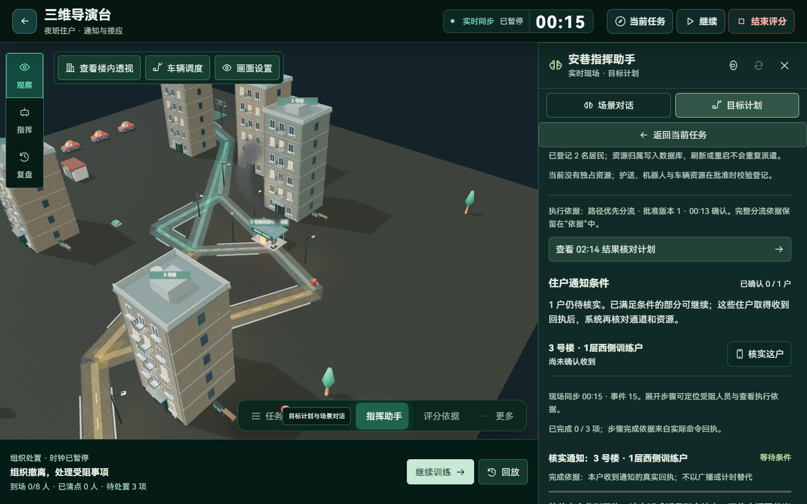
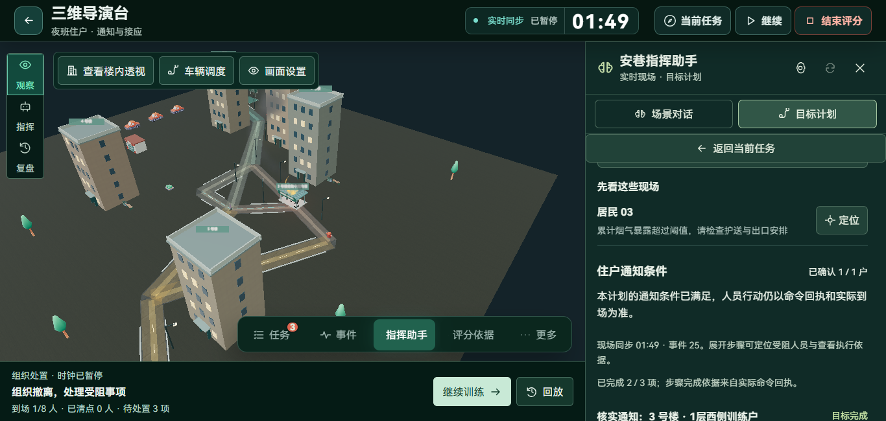
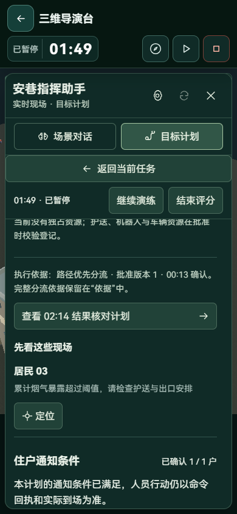

# 社区通知条件、独立模型与归档升级

日期：2026-11-15。范围为当前工作区的一轮可执行升级，包含此前尚未提交的厨房交互、通道条件放行改动；本轮未提交或推送。以下验证不替代两个案例的全流程评分验收。

## 交付内容

| 问题 | 本轮实现 | 行为依据 |
| --- | --- | --- |
| 夜班画像开关同时决定环境公式 | 新冻结世界保存 `model_manifest`，环境、居民、编排、空间与评分分别登记 | 普通和夜班世界在相同物理输入下得到相同环境曲线；无清单历史世界保留原公式 |
| 一户未确认导致整个计划无法批准 | `community.notice` 条件节点与居民动作拆分；已确认部分先执行 | 未取得回执的部分没有居民命令；取得真实回执后沿同一计划版本继续 |
| 等待通知的接应计划抢占核查人手 | 未确认住户的接应步骤延迟预占岗位 | 批准后岗位预占为空，值守员仍可接收到户核查；实际行动前重新检查资源 |
| 核实入口与原计划脱节 | 助手内“核实这户”定位对应住户，详情提供返回原计划入口 | 浏览器实际提交电话通知、收到回执并返回；复用单一工作区 |
| 归档标签忽略住户缺项 | 汇总住户未确认、核查未结束等全部事项后生成标签 | 其他项目完成但住户仍未确认的回归用例，标签为 `incomplete`，不生成全部核验文案 |
| 经验仅凭旧版本号和粗粒度参数匹配 | 经验保存模型清单、班次人数、种子和放行方式；检索逐项比较 | 模型或人手不同显示条件差异，缺少清单的旧经验显示待核对 |

通知条件节点是对住户回执的读取，不代表系统自动打电话、敲门或确认成功。实际移动继续经过统一命令服务；人工作业仍由有权限的参演人员提交。停止计划后补回执不会恢复自动下令。

## 真实操作记录

使用独立数据库 `output/notice-plan-20261115.db`，后端 8027、前端 5189。模型与语音服务关闭，使用服务端真实后台时钟、教学模式。未连接生产数据，未使用虚假接口响应。

1. 创建 8 人、2 名值守员、种子 37 的夜班充电棚场次，等待机器人实际确认火情。
2. 选择分属两户的普通居民，先核实其中一户；另一户保持未确认。
3. 生成并批准一份计划。任务图为一个通知条件、一个已执行居民动作、一个等待居民动作。
4. 浏览器打开助手，点击“核实这户”，确实进入待处理的三号楼一层西侧住户。
5. 恢复演练，在页面填写电话联系过程，依次提交“记录已发出通知”和“记录收到回执”，再返回原计划。
6. 服务端读取确认：计划版本仍为 1；通知条件完成且没有领域命令记录；两个人员动作均已有真实命令。后一名居民进入 `moving`，释放时刻为 66 秒，持续保留当前位置和累计暴露。暂停后动作显示暂停，通知回执仍保留。

本场用于验收通知与计划接续，未完成全部处置、清点和结束评分，**没有产生本轮可报告的最终得分**。

## 页面与空间表现

- 使用 Edge 真实浏览器检查 1440×900、1366×650、390×844；本轮通知与助手区域未发现横向溢出或主面板重叠。
- 新区块正文 16px、辅助信息 14px、标题 18px；实测“核实这户”按钮高度约 44.4px。
- 短屏保留顶部场次控制；390px 继续与结束按钮实测均为 44×44px。通知明细在既有助手内容区滚动，不新增绝对定位浮层。
- 住户核实与助手互斥展开；重复进入相同住户会重新定位，返回仍使用原计划。
- 刷新页面后重新打开助手，已确认 1/1 的通知条件从服务端恢复，未重复生成条件或行动。
- 暂停时住户详情解释回执不可提交的原因，继续后出现真实表单。
- 三维继续读取同一居民对象、路径、楼层与通知状态。本轮没有新增侵占通行区的装饰资产，也没有把完整住宅或全局穿模校准列为已完成。

浏览器未发现应用级错误；GPU 控制台仍有一次 Three.js 着色器浮点精度警告，本轮未处理驱动级着色器警告。

## 执行的验证

| 检查 | 结果 |
| --- | --- |
| `pytest tests/test_community_training.py tests/test_release_conditions.py tests/test_training_collection.py -q -p no:cacheprovider --tb=short` | 26 项通过 |
| `pytest tests/test_notice_plans.py -q -p no:cacheprovider --tb=short` | 5 项通过，包含分组、模型兼容、真实接续、岗位释放与停止后不自动下令、归档完整性 |
| `pytest tests/test_agent_coordination.py tests/test_agent_workflow.py -q -p no:cacheprovider --tb=short` | 20 项通过 |
| `pytest tests/test_knowledge_applicability.py tests/test_knowledge_experience.py -q -p no:cacheprovider --tb=short` | 8 项通过 |
| `npm test` | 70 项通过 |
| `npm run build` | 类型检查与生产构建通过 |
| Impeccable 布局检查：`NotificationPrerequisites.vue` | 未产生布局检查项；结合上述浏览器实查判断 |
| `python scripts/check_repository.py` | 检查 737 个交付文件，0 项问题 |
| `git diff --check` | 通过；已有厨房文件有 Git 行尾转换提示 |

后端共 59 项不同用例，按修改风险选取，未执行全量后端测试。回归的首次失败涉及测试 fixture 引入、列表响应封装和执行投影字段路径，已更正后重新通过；未将失败运行计为通过。

本轮未进行外部模型、语音、真实电话、实体设备、生产多进程、1000 人性能或模型实测校准验证。归档完整性回归使用构造的终态输入隔离缺陷，不冒充完整真人操作成绩。

## 代码与兼容

- `model_manifest.py`：冻结新世界版本；环境时间线读取明确标识，无清单世界走历史兼容。
- `agent_notifications.py`：拆分住户条件与行动，提供只读通知投影；不生成回执或执行动作。
- `agent_workflow.py`、`agent_release.py`、`agent_task_graph.py`：编译依赖、保留通知前置、按真实状态接续。
- `agent_claims.py`：通知前不预占接应岗位；资源互斥、批准版本、领域校验继续保留。
- `agent_execution.py`：展示通知进度，危险与门控问题优先于一般通知提醒，不将条件节点计为人员动作。
- `training_archive.py`、知识适用性与经验服务：最终完整性、模型来源和条件对照。
- 前端 `NotificationPrerequisites.vue`、助手、导演台与 `CommunityOperations.vue`：单工作区导航、回执表单和返回。

新数据保存在既有冻结世界、计划步骤、归档和经验 JSON 中，无新增数据库表或 DDL 迁移。新规则通过新场次启用；原世界、原批准计划及既有归档保留。已存在的旧档案不会重新写入，也尚未新增历史更正记录功能。

## 后续仍需交付

完整楼栋—单元—住户—成员契约、真实入户门与厨房门的区分、完整住宅户型、可编辑组合画像与岗位能力、人工通知与通道恢复的自动责任分派、全程批次预演、结构化整改复验仍待后续轮次。

当前“通知条件”是一条可执行等待依赖，不等同于智能体已自主编排全部到户任务。本轮没有扩大这些能力的完成声明。
