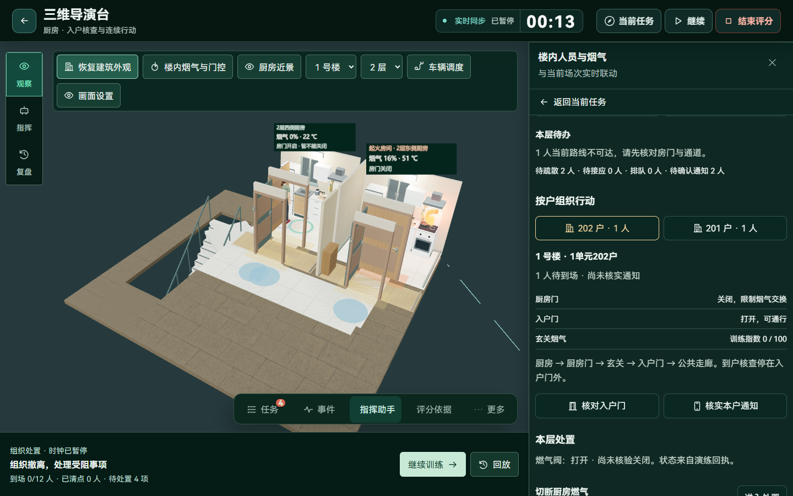
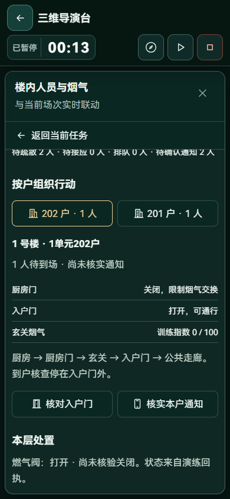
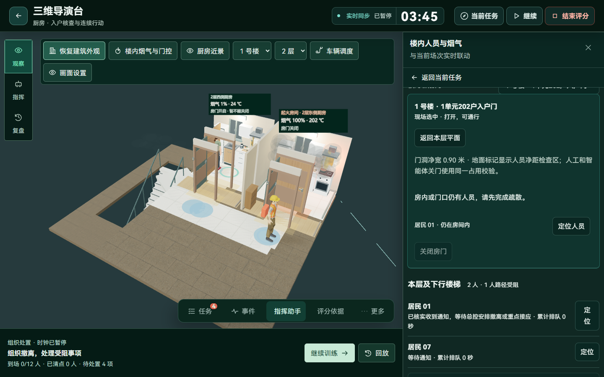

# 住宅入口、双门控烟与到户联动

本轮将厨房案例原有的“厨房直接连公共走廊”升级为“厨房—厨房门—玄关—入户门—公共走廊”，并连接住户身份、核查任务与楼内工作区。代码在当前工作区，尚未提交或推送。

## 实现范围

| 范围 | 实际实现 |
| --- | --- |
| 冻结空间 | 合适尺寸的住宅生成独立玄关、两道门、户外核查点与稳定住户编号；厨房通行点、设备及火点按同一几何生成 |
| 住户契约 | 楼栋、单元、楼层、户号、成员、厨房、玄关、两门及门外节点贯通准备、任务、现场、回执和归档 |
| 到户核查 | 值守员走到公共走廊的入户门外；新入口节点须属于同栋、同层且为走廊，错误对象返回422 |
| 门控与安全 | 两门各自控制通行和分区烟气交换；入户门关闭前检查厨房、玄关及门洞里的居民与护送员 |
| 模型细节 | 玄关地板、踢脚、鞋柜、独立墙体；入户门增加金属饰面、猫眼和锁体；厨房门维持不同外观 |
| 楼内交互 | 按户查看人员、通知、双门及玄关烟气；一键核对入户门、进入本户回执并返回原现场 |
| 布局 | 门控详情一次显示一扇门，其他门用选择器切换；住户条目与主要操作自然换行，沿用单工作区 |

该模块包含厨房与玄关，未将卧室、起居室组成的完整住宅标为完成。没有足够净空的自定义小建筑保留原紧凑布局。示例地址没有引入实际居民联系方式。

## 净距整改

检查发现，原先两门约0.95米的分隔可能使打开的入户门末端碰到关闭的厨房门。本轮改为1.03米分隔，内门保留1.20米门洞、0.90米通行带，外门保留0.90米门洞；行走带未为陈设缩窄。

紧凑厨房采用0.46米深设备布局，较大厨房继续采用原有较深模块。设备只在不侵入冻结通道时生成，柜体与火源高度、设备接近点分别冻结。新增几何检查覆盖玄关实物与行走带，以及外门打开、内门关闭时的门扇和墙板关系。

## 实际运行记录

独立数据库 `output/residential-entry-20261115.db`，后端8029、前端5191；服务端真实后台时钟、教学模式，模型和语音服务关闭。最终运行场次为12人、2名夜班值守员、种子37、二层东侧厨房起火。

1. 新场次冻结社区契约v5、室内几何v3、厨具布局v3及住户入口v1。
2. 楼内工作区显示202户厨房门关闭、入户门打开，1名居民待到场、尚未确认通知。
3. 页面点击“核实本户通知”，确实进入202户，而非住户列表或其他楼层。
4. 恢复演练并点击“派出值守员到户”。核查目标为202户入户门外的公共走廊节点。
5. 后台推进后，核查状态从`approaching`变为`at_door`；值守员位置为`x=28.65, y=26.0, height=3.38`，实际节点与目标节点一致。厨房门仍关闭，核查没有穿越厨房门。
6. 到门后，页面才解锁敲门渠道。填写核查过程，依次记录通知与收到回执，点击“返回楼内现场”。同一住户更新为已确认收到，核查完成并释放岗位。
7. 点击“核对入户门”，门控选择器正确定位202户入户门；现场仅有1个门详情。户内仍有居民时，页面显示阻塞原因，服务端也拒绝关闭。

本轮未安排全体居民撤离、处置四项任务并结束评分，没有产生本轮最终得分。通知确认不替代居民撤离、现场操作或集合清点。

## 页面验证

真实Edge浏览器检查1440×900、1366×650、390×844。本轮新增区域没有横向溢出，主工作区未出现卡片相互覆盖。住户区正文16px、辅助信息14px，按钮高度约44.4px。短屏保留顶部继续与结束控制；手机使用同一可滚动工作区。

首次检查后按上述门扇干涉结果统一修改，再对新冻结场次确认。截图来自最后一轮新场次，未通过改写旧世界替换模型。

## 执行检查

| 命令与范围 | 结果 |
| --- | --- |
| `pytest tests/test_residential_entries.py tests/test_kitchen_fire.py tests/test_kitchen_equipment.py tests/test_indoor_safety.py tests/test_indoor_overview.py tests/test_notice_plans.py tests/test_community_training.py -q -p no:cacheprovider --tb=short` | 33项不同用例通过 |
| 对入口校验与只读投影整理后的入口、安全、楼层投影组重跑 | 9项通过，属于上述33项的子集 |
| `npm test` | 71项通过，包括玄关行走净距、双门组合及现有模型行为 |
| `npm run build` | 类型检查与生产构建通过 |
| Impeccable布局检查：住户与楼内组件 | 未产生检查项；以实际浏览器检查补充判断 |
| `python scripts/check_repository.py` | 检查745个交付文件，0项问题 |
| `git diff --check` | 通过，现有厨房文件仍有Git行尾转换提示 |

最初后端用例中的旧几何版本、旧房间深度断言已按新契约更新；一项新用例误用了旧URL，改为正式命令入口后通过。前端新用例最初依赖已被静态合批移除的网格名称，已改为验证实际材质和几何关系。未隐去这些失败运行。

未执行全量后端测试、全站页面巡检、1000人压测、真实设备与生产多进程验证。尺寸与烟气仍是本项目的冻结训练模型，本轮没有宣称完成实测参数校准或全局碰撞求解。

## 关键文件与兼容

- `indoor_layout.py`、`spatial_world.py`：门、玄关、户外节点与居民通路。
- `indoor_fire.py`、`indoor_safety.py`：双门烟气连接与整户关门保护。
- `community_training.py`、`household_visits.py`：稳定地址与门外核查目标。
- `indoor_overview.py`：由同一现场投影住户、成员、通知与门状态；按分区索引成员，避免逐户重扫全人口。
- `residentialEntry.ts`、`residentialDoor.ts`、`indoorFireVisuals.ts`：玄关与双门的三维表现及净空约束。
- `DwellingInspector.vue`、`IndoorFirePanel.vue`、`OperationsCenter.vue`：选户、门控、回执与返回。

新增内容保存在已有冻结世界和事件投影中，不需要数据库DDL迁移。重新发布场景并创建新场次启用；旧场次继续读取原拓扑、尺寸和门控记录，旧档案与得分不回写。

本轮独立QA浏览器和8029/5191服务已停止，验证数据库与运行记录保留在被忽略的`output/`目录。

后续优先补完整户型、可配置的成员与岗位能力、避险待援交接和结构化整改复验。现有两端、统一命令、计划批准及事件体系继续复用。
