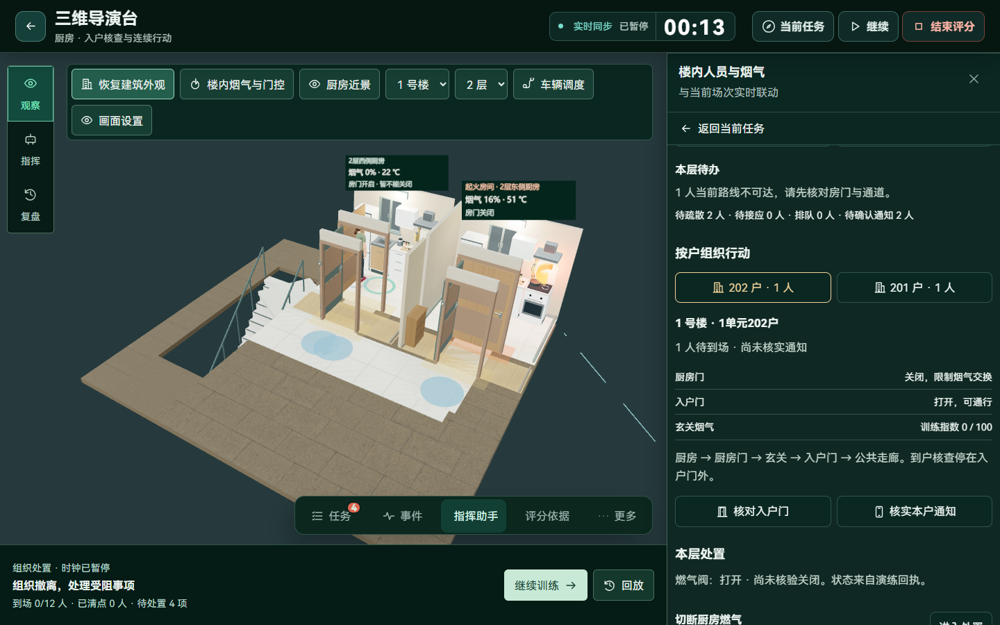
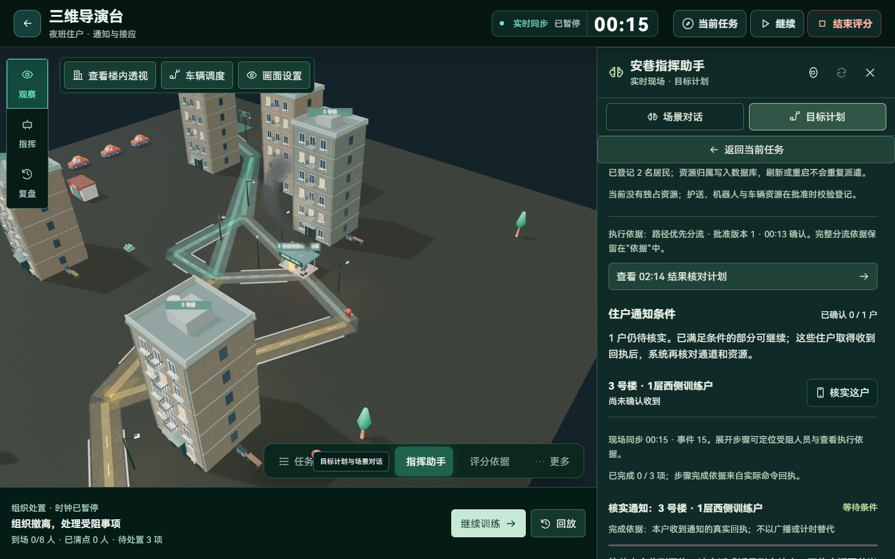
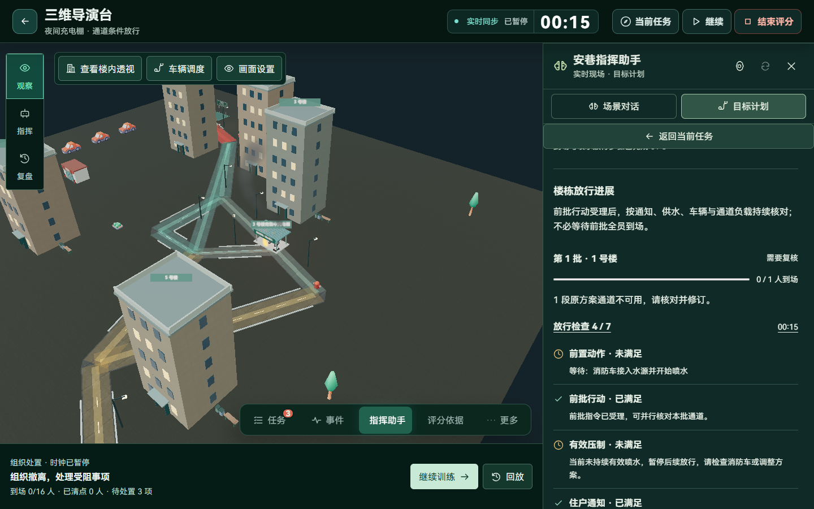

# 当前交付与发布验证

更新日期：2026-11-15。目标仓库为`Felix-lxx/zhiyan-anxiang`，保留main提交历史，按快进方式发布，不强制覆盖远端。

## 当前交付

| 能力 | 已实现的链路 |
| --- | --- |
| 条件放行 | 准备、保存、冻结策略；前批受理后核对通知、有效喷水、车辆管制、通道负载和接应岗位；封路进入复核 |
| 通知编排 | 允许批准包含未确认住户的方案；已确认部分先执行，其他部分等待真实收到回执；取得回执后沿原计划接续 |
| 有限人手 | 核查、接应和物业任务共用岗位；未确认住户的护送不提前占满到户人手；受理时重新检查归属 |
| 住宅空间 | 厨房—厨房门—玄关—入户门—公共走廊共享冻结几何、通行、烟气连接及住户身份 |
| 门控保护 | 关闭入户门检查厨房、玄关和门洞内人员；厨房门独立控制，核查目标停在公共走廊 |
| 单工作区 | 楼层平面与三维选中联动，按户查看与核对门控，进入住户回执后返回原计划或室内对象 |
| 归档与知识 | 汇总住户未确认、核查未结束等缺项后生成完整性标签；经验比较独立模型、人数、岗位、种子和放行条件 |

冻结版本为社区v5、室内几何v3、厨具布局v3、住户入口v1、环境因果v2、通知条件v1、评分v4。旧世界保持原拓扑、尺寸和规则，旧成绩与既有档案不回写。

厨房设备与通行净空分别定义；紧凑厨房使用较浅模块，大空间保留原有较深模块。外门打开、内门关闭时的门扇干涉已修正，并加入几何回归。三维注释、定位和状态牌不改变物理位置或评分。

## 真实操作证据

以下为此前开发阶段实际执行的本地独立数据库验收，本次仓库整理未重新录制或冒充全流程得分：

| 链路 | 实际观察 |
| --- | --- |
| 通道条件与三维定位 | 在8023/5185的夜班场次通过正式接口生成并批准方案，封路后助手显示实际不可用路段，点击定位回到同一三维现场 |
| 通知等待与原计划接续 | 在8027/5189的8人、2岗位场次，先确认一户，另一户等待；页面提交电话通知与收到回执后，计划版本保持1，两个人员动作均已有真实命令 |
| 到户核查与双门 | 在8029/5191的12人、2岗位厨房场次，值守员沿道路、楼梯和走廊到达202户门外，位置`28.65 / 26.0 / 3.38`与目标节点一致；厨房门仍关闭 |
| 敲门与岗位释放 | 实际到门后解锁敲门渠道，人工依次提交通知与收到回执；核查完成、岗位释放，返回室内仍定位原楼层 |
| 房门与成员保护 | 选择202户入户门时仅显示一个门详情；户内仍有居民时页面说明阻塞，正式命令返回409 |

这几组操作未完成新规则下的全部处置、全员清点和结束评分，因此没有本次版本的完整演练得分。原始场次、脚本与日志保存在被忽略的`output/`目录，开发证据文档已保存在源码检查点`fe4ec93`的Git历史中。

[手机单工作区](../images/residential-entry-mobile.png) · [1366×650短屏](../images/residential-entry-short.png) · [户内人员与门控](../images/residential-entry-door.png)

[手机通知工作区](../images/notice-plan-mobile.png) · [短屏保留控制](../images/notice-plan-short.png)

[受限通道定位](../images/conditional-passage.png) · [手机放行检查](../images/conditional-release-mobile.png)

上述实际浏览器检查覆盖1440×900、1366×650、390×844。新增区域正文16px、辅助14px、主要按钮至少44px，未发现新增区域横向溢出或主要面板重叠。不是全站所有状态的视觉验收。

## 本地发布检查

| 检查 | 执行结果 |
| --- | --- |
| 后端完整套件 | 首次349通过、2失败；下述原因为旧断言与新契约冲突，修复后定向回归结果另记 |
| 后端失败回归组 | `test_audit_fixes.py test_motion_trace.py`共10项通过，44.27秒，含两项原失败用例 |
| 前端`npm test` | 71项通过 |
| 前端`npm run build` | 类型检查与生产构建通过 |
| 仓库检查、文档链接及凭据特征 | 730个交付文件，0项问题；源码完全重复列表为空，`git diff --check`通过 |
| GitHub Actions | 随最终main提交运行；状态以该提交对应检查为准 |

完整后端命令为`python -m pytest tests -q -p no:cacheprovider --tb=short --junitxml=../output/repository-release-20261115.xml`，297.93秒。两项失败及处理：

- 厨房轨迹用例将首个门洞固定为0.9米；现在核对实际起火厨房门与冻结门洞字段，并验证门洞不小于通行带。连续轨迹、回放和检查点一致性断言保留。
- 充电棚完整执行用例要求至少95分，新因果规则下该选择实际94分。未改评分或暴露阈值，改为核对疏散、清点、护送、按时任务、响应和结束的完成分，以及风险扣分、全员到达证据和总分分项一致性。完成流程不自动证明选择安全或高分。

本地JUnit和日志留在`output/repository-release-20261115*`。本地完整运行与修复后回归分别记录，不将首次失败写成完整通过。最终Linux完整套件查看[GitHub Actions](https://github.com/Felix-lxx/zhiyan-anxiang/actions)。

## 仓库整理

| 内容 | 处理 |
| --- | --- |
| 历次未提交升级 | 先提交源码检查点`fe4ec93`，保留完整原始代码、报告及截图，然后整理当前目录 |
| 9份按日期堆叠的报告 | 收束为本文件、历史验收基线、三维资源记录3个稳定入口；独有操作与兼容说明进入功能指南 |
| 过时和未使用截图 | 仅移除已经被新版替代且不再引用的文件，保留当前功能和短屏/手机截图，历史得分文字证据另存 |
| 源码与测试 | 按命令、领域服务、投影和表现层保留职责；没有发现完全相同的源码副本，不按相似文件名删除有效实现 |
| 兼容、迁移与许可 | 保留旧世界适配、数据库迁移、回归、源模型处理工具和第三方许可 |
| 本地数据 | `.env`、数据库、日志、浏览器记录、临时录屏和构建产物不提交，也不作为清理目标删除 |

查询原始记录：`git show fe4ec93:docs/reports/2026-11-15-residential-entries.md`；其他阶段记录同理。仓库不重写历史。

## 升级与剩余范围

本轮业务字段进入既有冻结世界、计划、档案与经验JSON，不增加DDL迁移。已有任务类型迁移仍按启动流程执行。备份配置与数据库后升级代码，重新发布并新建场次启用新规则；旧场次保留原冻结内容。[部署与回滚](../operations/deployment.md)。

完整卧室/起居户型、全局碰撞校准、任务图全程预测和结构化整改复验仍待深化。外部模型、语音、实体设备、PostgreSQL生产多进程和1000人性能未在本次整理中验收。

历史完整演练结果单列于[验收基线](acceptance-baseline.md)，材质来源与许可见[三维资源记录](model-assets.md)。
