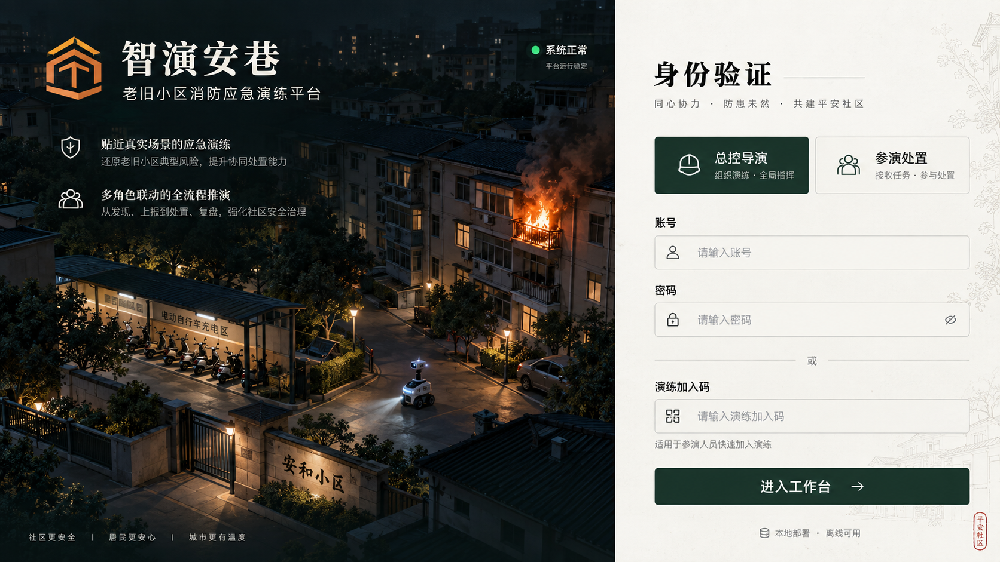
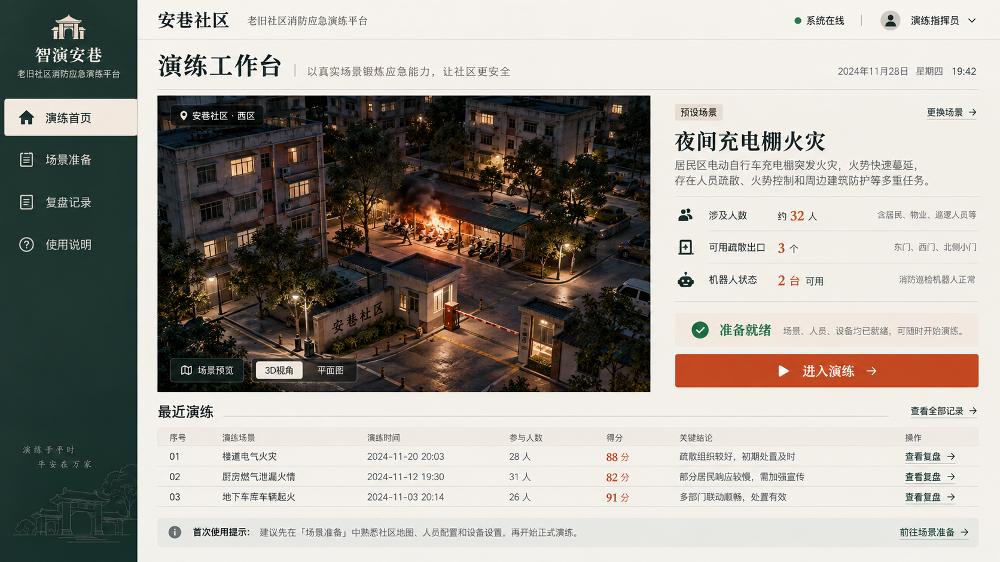
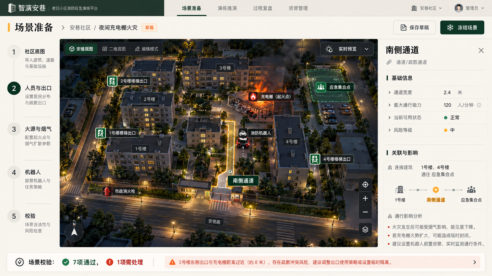
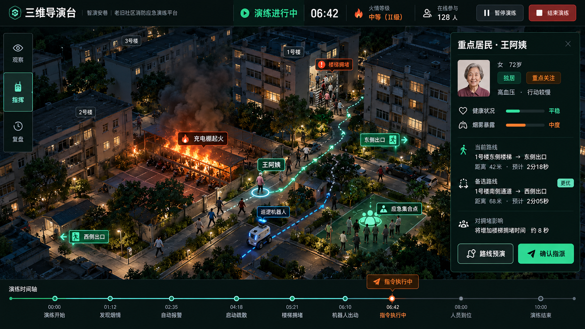
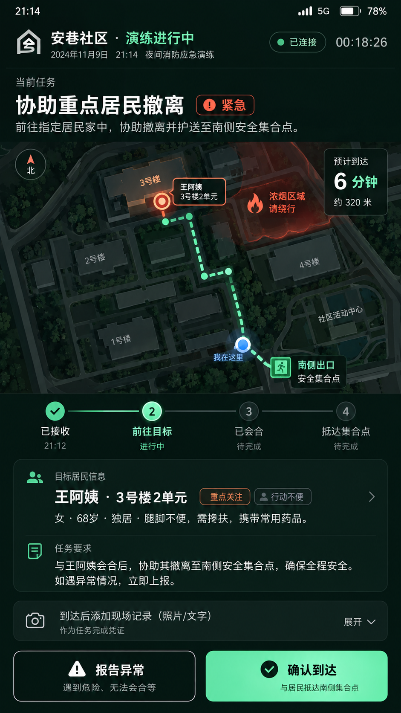
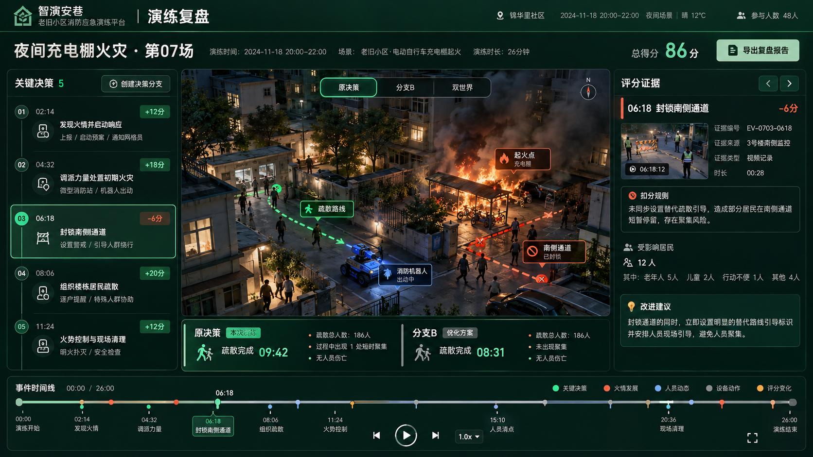
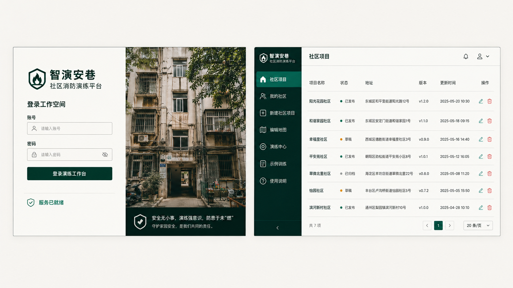
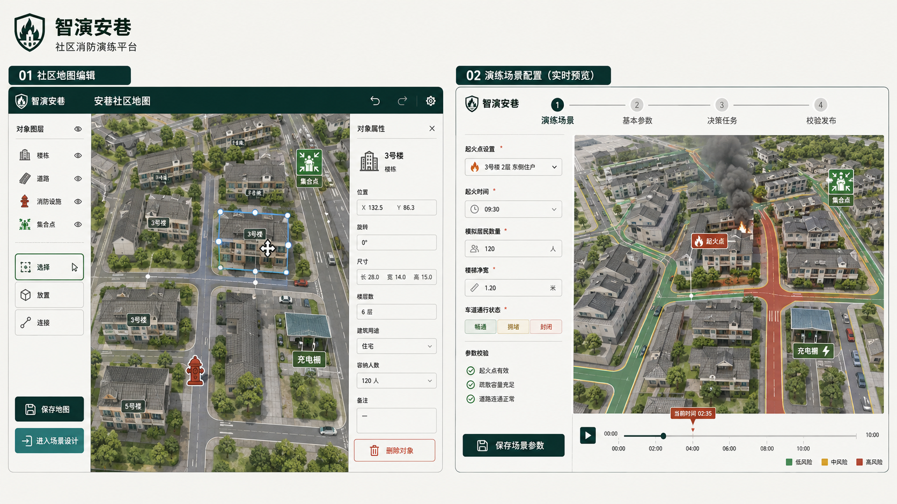
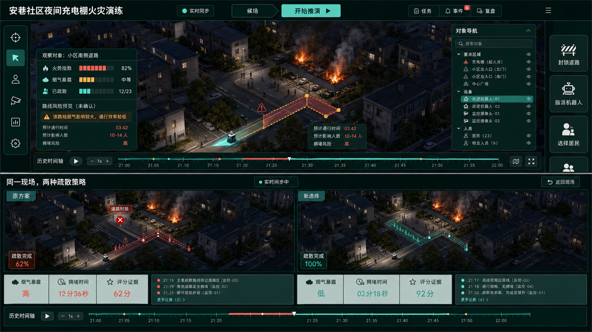
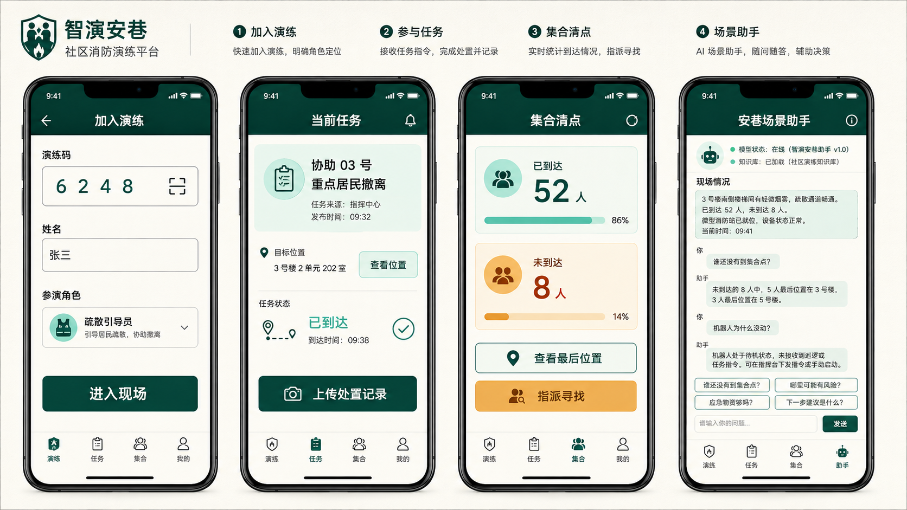

# 智演安巷核心界面样式图

本组样式图基于现有项目的双表面设计体系：登录、项目、地图和场景配置使用暖白资料面；演练运行、平行推演使用深青沉浸式现场面。图片用于布局、视觉层级和交互位置参照，不替代现有业务数据模型。

## 两角色交付版六个核心页面

本轮按“总控导演端 + 参演处置端”收敛后的系统大纲，补充六张可直接用于页面复刻的高保真设计图。

### 01 登录与加入演练

- 左侧表达夜间老旧小区与消防演练现场，右侧完成导演登录或参演加入。
- 关键入口始终可见，不增加营销数据卡和无关介绍。

### 02 导演工作台首页

- 首页围绕唯一主案例“夜间充电棚火灾”和“进入演练”组织。
- 最近演练使用紧凑记录表，避免继续堆叠仪表盘组件。

### 03 场景准备与实时预览

- 左侧为准备步骤，中间为同源三维现场，右侧只显示所选对象属性。
- 底部统一展示场景校验结果，冻结前必须处理阻断问题。

### 04 全屏三维导演台

- 三维现场占据主要空间；观察、指挥、复盘三个模式互斥呈现。
- 点击居民、道路或机器人后才出现上下文操作面板，并先做路线预演再确认。

### 05 手机参演处置端

- 一次只呈现一个任务、一个路线和一个当前动作。
- 主操作固定在拇指区，异常上报和到达确认具有明确优先级。

### 06 演练复盘与评分证据

- 时间轴、三维回放、关键决策和评分证据在同一上下文中联动。
- 原决策和分支方案使用同一快照比较，突出可解释结果而非指标卡片。

## 视觉令牌

- 暖白纸面：`#F6F7F2`
- 社区画布：`#EFEEE8`
- 深青背景：`#071A17`
- 品牌青绿：`#1B5147`
- 实时状态：`#79DDCD`
- 火险红：`#A33F31` / `#FF826C`
- 告警琥珀：`#E8B966`

## 样式图与功能对应

### 登录与社区项目

- 登录页：值班交接式身份验证、服务健康状态、社区真实影像。
- 项目页：固定导航、项目清单、状态/版本/更新时间和地图/演练入口。
- 生成提示要点：高保真桌面 UI；暖白资料面；无卡片墙、无图表仪表盘；中文标签使用“智演安巷、登录工作空间、社区项目、编辑地图、演练中心”。

### 地图编辑与场景配置

- 地图编辑器：大画布、对象图层、选择/放置/连线工具、所选对象属性面板。
- 场景配置：四步工作流、紧凑参数编辑、同源三维实时预览、风险道路和时间轴。
- 生成提示要点：地图为主、属性面板按选择出现；场景表单与三维预览并列；中文标签使用“对象图层、保存地图、基本参数、空间预览、校验发布”。

### 三维导演台与平行推演

- 三维导演台：全屏社区现场、空间工具、对象导航、态势指标、任务入口与历史时间轴。
- 平行推演：同一机位双世界、封路差异、疏散路线、暴露/拥堵/评分证据对比。
- 生成提示要点：深青沉浸式现场；三维社区优先；工具分区不重叠；中文标签使用“封锁道路、指派机器人、选择居民、同一现场，两种疏散策略、评分证据”。

### 手机参演与场景助手

- 加入演练：演练码、姓名、角色和进入现场。
- 参演任务：查看位置、到达确认和处置记录。
- 集合清点：已到达/未到达、最后位置和寻找指派。
- 场景助手：现场状态、多轮问答、建议问题和模型状态。
- 生成提示要点：四个手机屏幕；每屏只突出一个任务；44px 触控操作；无 AI 星光装饰、无聊天头像堆叠；中文标签使用“加入演练、当前任务、集合清点、安巷场景助手”。

## 开发落地约束

1. 样式图中的楼栋、道路、居民和机器人必须绑定现有接口数据，不能作为静态背景图代替三维功能。
2. 所有空间操作先展示路线、风险和预计影响，再允许确认。
3. 桌面端以三维现场为主，抽屉和工具栏只能占用明确预留区域。
4. 手机端每屏保留一个主任务，底部导航不超过四项。
5. 图片中的个别示意数据和生成文字仅用于视觉占位，开发时使用系统真实字段和现有中文文案。

生成方式：Codex 内置 ImageGen，`ui-mockup` 模式；共四组独立提示生成，最终文件已复制到本目录。
