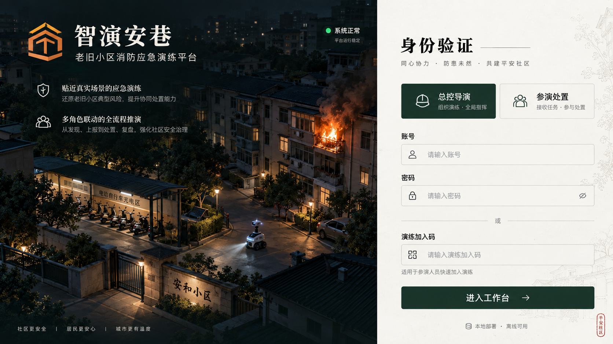
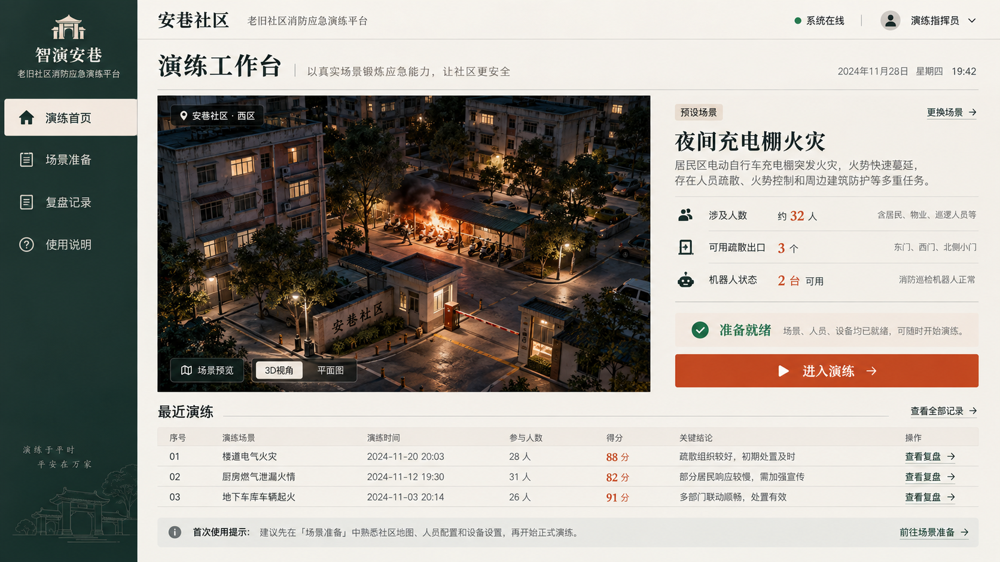
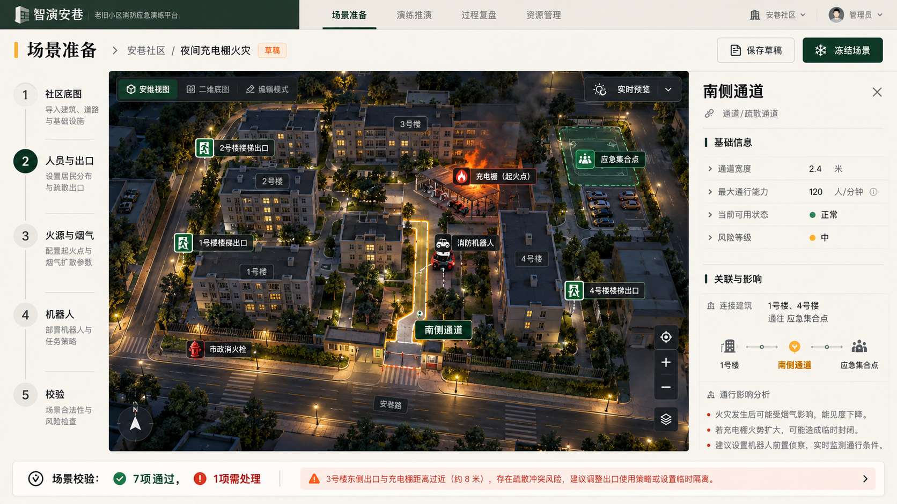
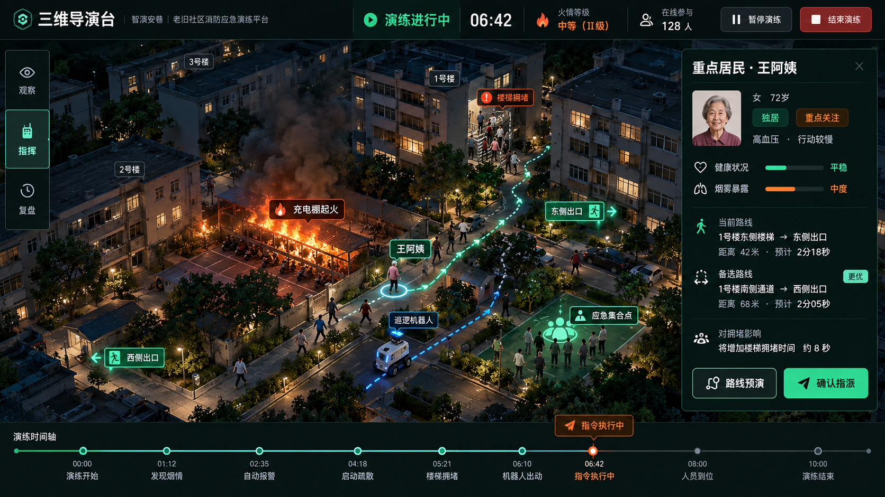
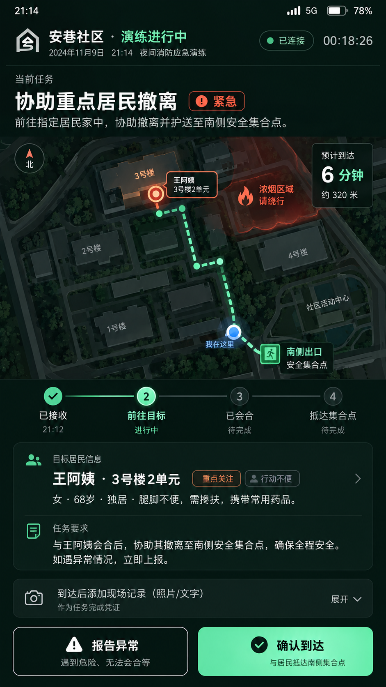
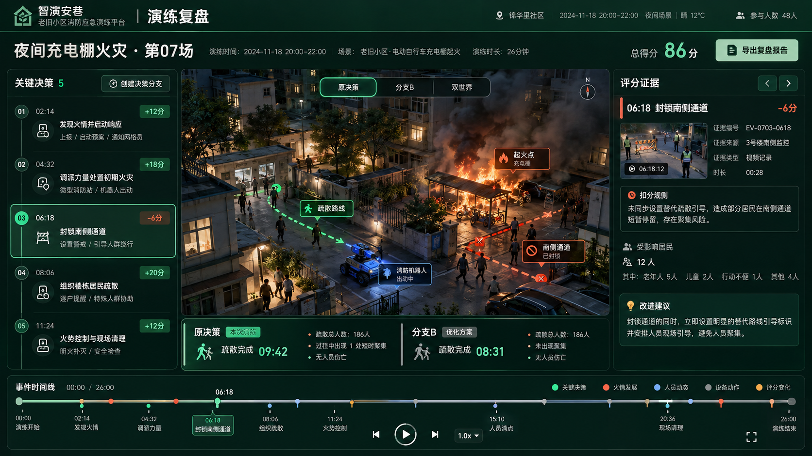

# 智演安巷核心界面样式图

本组样式图基于现有项目的双表面设计体系：登录、项目、地图和场景配置使用暖白资料面；演练运行、平行推演使用深青沉浸式现场面。图片用于布局、视觉层级和交互位置参照，不替代现有业务数据模型。

## 两角色交付版六个核心页面

本轮按“总控导演端 + 参演处置端”收敛后的系统大纲，补充六张可直接用于页面复刻的高保真设计图。

### 01 登录与加入演练

- 左侧表达夜间老旧小区与消防演练现场，右侧完成导演登录或参演加入。
- 关键入口始终可见，不增加营销数据卡和无关介绍。

### 02 导演工作台首页

- 首页围绕充电棚、厨房两个案例，以及继续训练、准备训练和处理遗留事项组织。
- 最近演练使用紧凑记录表，避免继续堆叠仪表盘组件。

### 03 场景准备与实时预览

- 左侧为准备步骤，中间为同源三维现场，右侧只显示所选对象属性。
- 底部统一展示场景校验结果，冻结前必须处理阻断问题。

### 04 全屏三维导演台

- 三维现场占据主要空间；观察、指挥、复盘三个模式互斥呈现。
- 点击居民、道路或机器人后才出现上下文操作面板，并先做路线预演再确认。

### 05 手机参演处置端

- 一次只呈现一个任务、一个路线和一个当前动作。
- 主操作固定在拇指区，异常上报和到达确认具有明确优先级。

### 06 演练复盘与评分证据

- 时间轴、三维回放、关键决策和评分证据在同一上下文中联动。
- 原决策和分支方案使用同一快照比较，突出可解释结果而非指标卡片。

## 视觉令牌

- 暖白纸面：`#F6F7F2`
- 社区画布：`#EFEEE8`
- 深青背景：`#071A17`
- 品牌青绿：`#1B5147`
- 实时状态：`#79DDCD`
- 火险红：`#A33F31` / `#FF826C`
- 告警琥珀：`#E8B966`

## 开发落地约束

1. 样式图中的楼栋、道路、居民和机器人必须绑定现有接口数据，不能作为静态背景图代替三维功能。
2. 所有空间操作先展示路线、风险和预计影响，再允许确认。
3. 桌面端以三维现场为主，抽屉和工具栏只能占用明确预留区域。
4. 手机端每屏保留一个主任务，底部导航不超过四项。
5. 图片中的个别示意数据和生成文字仅用于视觉占位，开发时使用系统真实字段和现有中文文案。

本目录六张图片为历史 ImageGen 设计参考，包含示意文字和占位数据；不作为当前功能或视觉验收证据。当前运行截图见根目录 README。已淘汰的四组 v1 合成图不再随最新版交付，可通过 Git 历史查阅。
